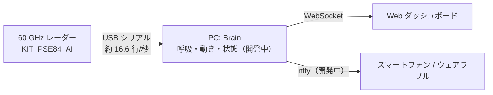

# IBUKI（いぶき）— カメラを使わない赤ちゃんの呼吸見守り

<!-- TODO: デモ動画・画像ができたら差し替え
[](動画URL)
-->

> 医療機器ではありません。病気の診断や SIDS（乳幼児突然死症候群）の予防はできません。

## 製品概要
### 背景(製品開発のきっかけ、課題等）
赤ちゃんが寝ている間、保護者は「ちゃんと息をしているか」が気になり、夜中に何度も様子を見に行きます。
カメラ型のベビーモニターは映像が残ることへのプライバシーの不安があり、体に付けるセンサーは赤ちゃんが嫌がったり外れたりします。

### 製品説明（具体的な製品の説明）
ベビーベッドに取り付けた 60 GHz ミリ波レーダーで、赤ちゃんに触れず、カメラも使わずに、胸のわずかな動きを計測します。
PC で呼吸の波形・呼吸数・体の動きを計算してダッシュボードに表示し、異常が続いたときは保護者のスマートフォンやウェアラブルに通知します（通知は開発中）。

### 特長
#### 1. カメラ不使用・非接触
映像を撮らないのでプライバシーに配慮できます。赤ちゃんの体には何も付けません。

#### 2. ミリ波レーダーで胸の動きをとらえる
レーダーの反射の位相から胸の変位（mm）を求めます。距離ごとに分けて計測するので、どの距離で動きがあるかもわかります。

#### 3. すべてローカルで動作
計測データはクラウドに送らず、手元の PC で処理します。外部に送るのは通知だけです。

### 解決出来ること
- 夜中に何度も見に行く保護者の負担を減らします。
- 別の部屋にいても、スマートフォンやウェアラブルで様子がわかります。

### 今後の展望
- 3 本の受信アンテナを合成して感度を上げる
- ボードを小さな箱に収め、ベビーベッドに取り付けやすくする
- 赤ちゃんの呼吸データで判定のしきい値を調整する

### 注力したこと（こだわり等）
* レーダーのファームウェアを自作し、チャープごとのレンジ FFT をボード上で実行。PC へ約 16.6 行/秒で欠落なく送信（実機で確認）
* 誤解を与えない表示：呼吸数がわからないときは 0 ではなく「不明」と表示
* 判定のしきい値は推測ではなく、実際の録画データから決める

## システム構成



| 部分 | 状態 |
|---|---|
| レーダーファームウェア（[firmware/](firmware/)） | 完成・実機で確認済み |
| ライブ表示ツール（[firmware/tools/live_view.py](firmware/tools/live_view.py)） | 完成・実機で約 50 cm の人を検出 |
| Web ダッシュボード（[web/](web/)） | モック（表示データはシミュレーション） |
| Brain（呼吸・動き・状態の判定）とサーバー | 開発中 |
| スマートフォン・ウェアラブルへの通知 | 開発中 |

## 動かし方
- **ファームウェア：** ビルド・書き込み・通信プロトコルは [firmware/README.md](firmware/README.md) を参照
- **ライブ表示（レーダーの動作確認）：** ボードを USB で接続して
  ```
  ../env/bin/python firmware/tools/live_view.py
  ```
- **ダッシュボード（モック）：**
  ```
  cd web
  npm install
  npm run dev
  ```

## 開発技術
### 活用した技術
#### API・データ
* ntfy（プッシュ通知、開発中）
* WebSocket（PC からダッシュボードへの状態配信、開発中）

#### フレームワーク・ライブラリ・モジュール
* ModusToolbox 3.9、CMSIS-DSP、XENSIV BGT60TRxx ドライバ（ファームウェア）
* Python：NumPy、SciPy、pyserial、matplotlib
* React、TypeScript、Vite、Recharts（ダッシュボード）

#### デバイス
* Infineon PSOC Edge E84 AI Kit（KIT_PSE84_AI）：XENSIV BGT60TR13C 60 GHz レーダー
* MacBook（処理・表示）
* iPhone / ウェアラブル（通知の受信）

### 独自技術
#### ハッカソンで開発した独自機能・技術
* レーダー処理と通信プロトコル：[firmware/proj_cm55/ibuki.c](firmware/proj_cm55/ibuki.c)
  （チャープごとの DC 除去・ハン窓・64 点 FFT、距離 15〜101 cm の複素データを送信。commit 917dbb7、db8e8f2）
* レーダー設定をプリセット P1（58.5〜62.5 GHz、距離分解能 3.75 cm）に変更：commit 55fd0f6
* ライブ表示ツール：距離ごとの動き・動きの量・呼吸の波形を表示（commit 2b83df6）
* Web ダッシュボード：[web/](web/)（commit fd42b05）

## English summary
IBUKI is a camera-free, contact-free breathing monitor for babies. A 60 GHz radar on the crib measures tiny chest movements. A laptop computes the breathing wave, breathing rate and movement, shows them on a web dashboard, and (in progress) notifies the parents' phone or wearable. Everything runs locally. Not a medical device.

Done: radar firmware (tested on the board: ~16.6 lines/s, no lost data), live radar viewer (detects a person at ~50 cm), mock dashboard. In progress: breathing/state processing, server, notifications.

## チーム
* Manami Ando
* RamadhanAdam
* （他のメンバーを追加してください）
