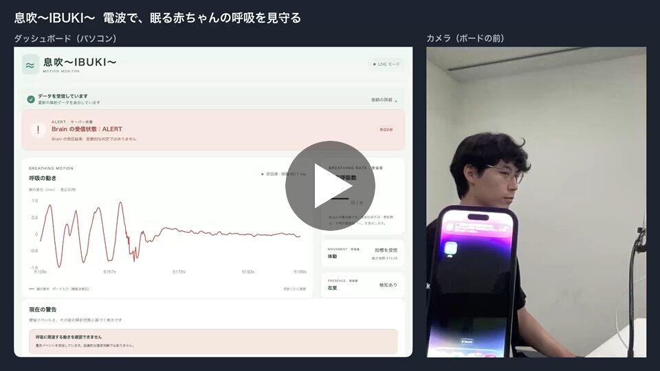
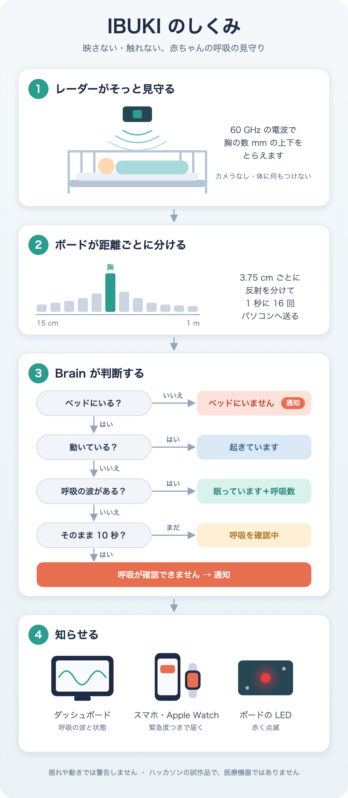
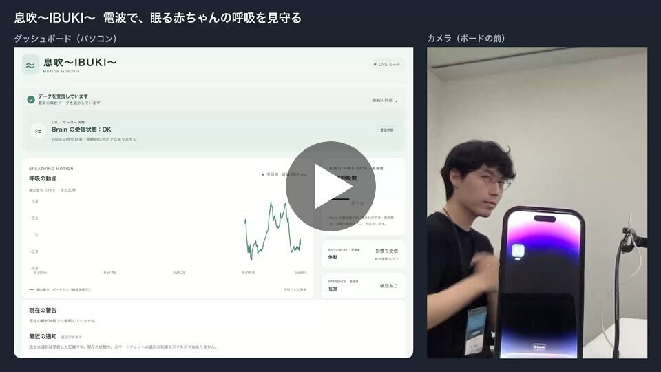
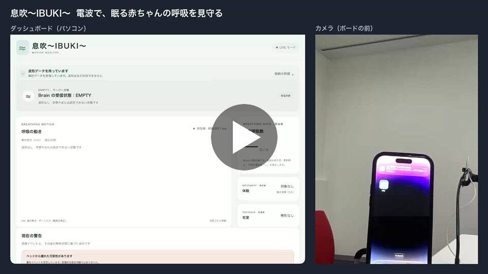
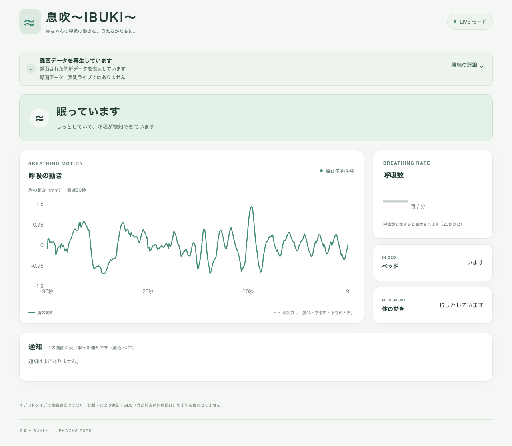
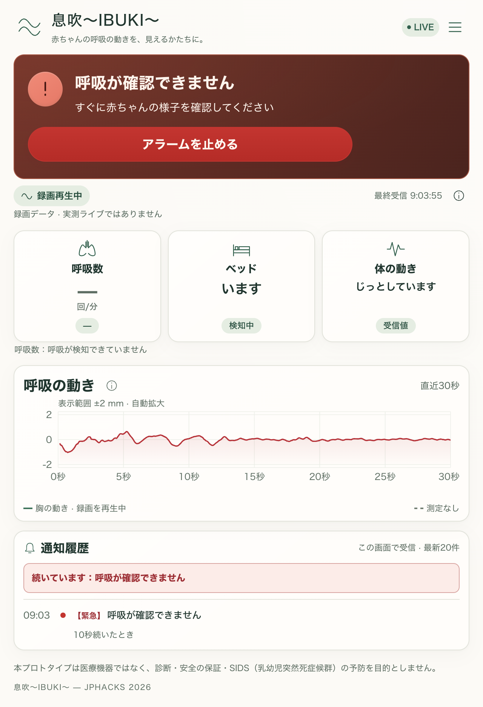
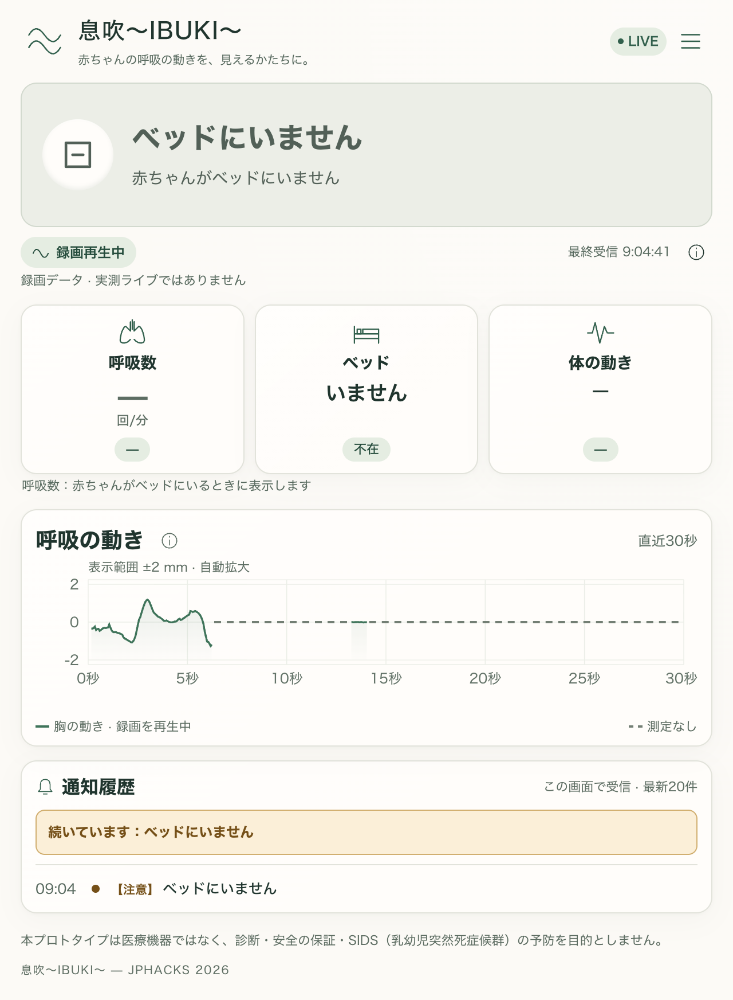
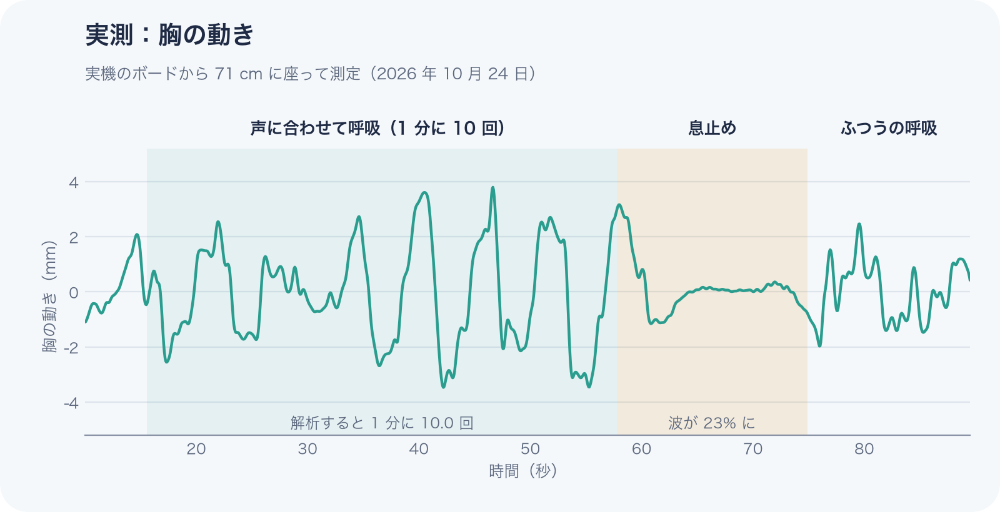
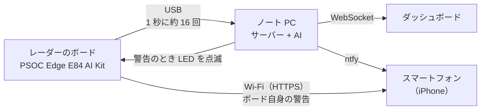

# 息吹～IBUKI～ 

**カメラも、ウェアラブル端末もいらない。非接触センサーで、お休み中の赤ちゃんの呼吸を見守る。**

🏆 JPHACKS 2026 Hack Day Audience Award（広島会場）受賞

[](https://github.com/jphacks/hs_2605/actions/workflows/tests.yml)

[](https://jphacks.github.io/hs_2605/videos/demo_1_no_breathing.mp4)

▶ 画像をクリックするとデモ動画が開きます（息を止めると警告が出るまで）。ほかの動画は[デモ動画](#デモ動画)にあります。

ベビーベッドのそばに置いた 60 GHz のミリ波レーダーが、赤ちゃんの胸のわずか数ミリの上下運動をとらえます。呼吸が止まっていると判断された場合、保護者のスマートフォンに通知が届き、ボードの LED が点滅します。判断はボードの AI 用チップで動く学習済みモデルが行い、ボードは自分で Wi-Fi から通知を送れます。

<p align="center">
  
</p>

> ハッカソンで作った試作品です。医療機器ではなく、病気の診断や SIDS（乳幼児突然死症候群）の予防はできません。

## 製品概要
### 背景(製品開発のきっかけ、課題等）
赤ちゃんが眠っているあいだ、「ちゃんと息をしているかな」と夜中に何度ものぞきに行く親は少なくありません。
見守りカメラは便利ですが、寝顔がずっと撮られ続けることに抵抗がある家庭もあります。録音・録画を行うシステムでは、家族の会話などプライバシーの懸念もあります。直接体に装着する端末は、赤ちゃんが嫌がったり、寝返りで外れたりする可能性があります。

触れずに、映さずに、それでいてちゃんと見守れないか。その答えとして 息吹～IBUKI～ を作りました。名前は「息吹（いぶき）」、命の息づかいから取っています。

### 製品説明（具体的な製品の説明）
息吹～IBUKI～ は、ベビーベッドのそばに置いた 60 GHz のレーダーで眠っている赤ちゃんの呼吸を見守り、呼吸が止まったようならスマートフォンに知らせる見守り装置です。カメラは使わず、体にも何もつけません。

息吹～IBUKI～ は 3 つの部分でできています。

1. **レーダーのボード**：Infineon の PSOC Edge E84 AI Kit に、私たちが書いたファームウェアを入れています。跳ね返ってきた電波を距離ごとに分け、1 秒に約 16 回パソコンへ送ります。同じデータで、ボードの AI 用チップ（Ethos-U55）が学習済みモデルを動かして状態を判断し、警告のときは Wi-Fi（eduroam）から自分でスマートフォンに通知します。温度・湿度と、ボードが動かされたことも測ります。
2. **パソコンの Brain**：学習済みの AI モデル（2 つの CNN、8 ビット）で、赤ちゃんがいるか、動いているか、息をしているかを判断し、呼吸数を計算します。
3. **ダッシュボードと通知**：ブラウザに呼吸の波と状態を表示し、スマートフォンに【緊急】【注意】【お知らせ】の 3 段階で知らせます。


| 表示 | 意味 |
|---|---|
| 眠っています | じっとしていて、呼吸が検知できている |
| 起きています | 動いている（激しく動いている間は呼吸は正しく測定されません） |
| 呼吸を確認中 | 呼吸が検知できていない |
| 呼吸が確認できません | じっとしているのに、呼吸が検知されない状態が10秒以上続いている（緊急通知、パソコンのアラーム音、LED の点滅。アラーム音はボタンを押すまで止まりません） |
| 呼吸が速い状態が続いています | 通常より呼吸が速い状態が続いている |
| ベッドにいません | 赤ちゃんがいない状態（通知と LED の点滅） |

### 特長
#### 1. 映さない、触れない、安全性の高いセンサー
低出力で、人体への影響が極めて低いミリ波レーダーを使用しています。カメラを使用しないため、寝顔の映像は残りません。頻繁に着替える赤ちゃんだけでなく、共に生活するご家族のプライバシーも守られます。赤ちゃんの体にも何もつけません。

#### 2. 胸の動きをミリ単位でとらえる
跳ね返ってきた電波の位相のずれから、胸の動きをミリ単位で計算します。距離ごとに分けて計算するため、壁や家具の反射と区別できます。

#### 3. 日常的に使える「起きたよ」機能
赤ちゃんが起きたときにスマートフォンで通知を受け取ることができます。万が一のときだけでなく、在宅勤務中など、普段の生活にも便利です。国際色豊かなメンバーでのディスカッションの中で「海外では赤ちゃんと大人の別室睡眠の習慣がある」という意見から生まれました。

#### 4. 誤報を出さない
動いているときやボードが揺れたときは、呼吸を「わからない」として扱い、「呼吸が止まった」とは知らせません。静かになったときは、その人の反射が残っているかで、「ベッドにいない」と「息が止まった」を見分けます。

#### 5. パソコンがなくても知らせる
ボードの AI 用チップが自分で判断し、Wi-Fi から直接スマートフォンに通知します。パソコンの電源が切れていても、警告は届きます。

### 解決出来ること
- 夜中に何度ものぞきに行かなくても、別の部屋で様子がわかります。
- 見守りカメラに抵抗がある家庭でも使えます。
- 「起きた」「ベッドにいない」もわかるので、呼吸以外の見守りにも役立ちます。

### 今後の展望
- 赤ちゃんで確かめる（赤ちゃんの呼吸は 1 分に 30〜60 回で、息吹～IBUKI～ が見ている範囲に入ります）
- とても浅い呼吸の録画を増やして、AI モデルの息止めの検出を強くする
- 3 本のアンテナでわかる方向を使い、赤ちゃんとそばにいる大人を見分ける（方向の測定はできています）
- 家庭の Wi-Fi（WPA2/WPA3）にも対応する（今は eduroam で確認）
- 他のハードウェアやアプリケーションと連携し、緊急時には大きなアラーム音で確実に保護者が気付くようにする
- 小さなケースに入れて、ベッドの柵に取り付けられるようにする

### 注力したこと（こだわり等）
* **実際のデータで決める。** AI モデルは、赤ちゃんの呼吸データ（AIR-400）をもとにしたデータと、私たちの実機の録画で学習しました。新しいモデルは、学習に使っていない人の録画で前のモデルより良いときだけ使います。1 分に 10 回の呼吸を 10.0 回と測れました。
* **ボードの上で動かす。** モデルを 8 ビットにして、ボードの AI 用チップで動かしています。ボードとパソコンの判断が一致することを確かめました。
* **誤報を出さない。** 隣で大人が 20 分作業している録画で、間違った「呼吸なし」は 0 回です。迷ったときは「まだそこにいる」と考えて、呼吸を見続けます。
* **止まらない。** レーダーが止まってもボードが自分で復帰し、USB を抜き差ししてもサーバーがつなぎ直します。
* **すぐに使える。** `ibuki.command` をダブルクリックするだけで、すべてが起動します。
* **家族のデータを守る。** カメラを使わず、通知は暗号化してトークンで守り、秘密は git に入れません。対策は [SECURITY.md](SECURITY.md) にまとめました。

## デモ動画
実機のボードで録画しました。左がダッシュボード、右がボードの前で試している人です。ボードの前にいるのは赤ちゃんではなく、赤ちゃんの代わりをしているチームメンバー（大人）です。テストは大人で行いました（[成人で試した結果が赤ちゃんにも当てはまる理由](#成人で試した結果が赤ちゃんにも当てはまる理由)）。右の映像は撮影用のカメラで（息吹はカメラを使いません）、手前は通知を受け取る保護者のスマートフォン、右のクランプに付いているのがレーダーのボードです。

動画のダッシュボードは、状態を記号で表示しています：STILL = 眠っています、OK = 起きています、CHECK = 呼吸を確認中、ALERT = 呼吸が確認できません、EMPTY = ベッドにいません。呼吸数は Brain が確かなときだけ表示し、それ以外は「—」です。

動画の撮影後に、パソコンのアラーム音（保護者が止めるまで鳴り続ける）と、ダッシュボードの停止ボタンを追加しました。動画には入っていませんが、停止ボタンは動画の下の画像にあります。

**1. 息を止めると警告**：ふつうに呼吸している間は波と呼吸数が出ます。息を止めると「呼吸を確認中」から「呼吸が確認できません」になり、スマートフォンに緊急の通知が届きます。
[](https://jphacks.github.io/hs_2605/videos/demo_1_no_breathing.mp4)

- 0:00 ふつうに呼吸：眠っています（STILL）。波と呼吸数（1 分に約 20 回）
- 0:38 息を止める：波が小さく、平らになる
- 0:46 呼吸を確認中（CHECK）
- 0:53 呼吸が確認できません（ALERT）。画面に警告
- 0:55 スマートフォンに通知が届く
- 0:59 揺れを検知し、波の表示がいったん止まる

**2. 動いても誤報なし**：体を動かすと「起きています」になり、警告は出ません。止まると呼吸の表示に戻ります。
[](https://jphacks.github.io/hs_2605/videos/demo_2_movement.mp4)

- 0:00 じっとして呼吸：眠っています（STILL）
- 0:13 腕や体を動かす：起きています（OK）。警告は出ない
- 0:32 じっとする：眠っています（STILL）に戻る

**3. ベッドから離れると通知**：立ち去ると「ベッドにいません」になり、スマートフォンに通知が届きます。
[](https://jphacks.github.io/hs_2605/videos/demo_3_left_bed.mp4)

- 0:00 じっとして呼吸：眠っています（STILL）
- 0:10 立ち上がって、ボードの前から離れる
- 0:14 呼吸を確認中（CHECK）
- 0:17 ベッドにいません（EMPTY）。画面に「ベッドから離れた可能性があります」
- 0:19 スマートフォンに通知が届く
- 0:27 戻ってくる：起きています（OK）
- 0:33 座って静かにする：眠っています（STILL）

**今のダッシュボード（動画の撮影後）**：状態を記号ではなく言葉で表示し、アラームの停止ボタンを追加しました。ボードで録った実際の記録（[recordings/samples/](recordings/samples/)）を今のダッシュボードで再生して撮った画面です。

<table>
  <tr>
    <td width="33%" valign="top"><br>ふつうに呼吸：眠っています。胸の動きの波</td>
    <td width="33%" valign="top"><br>息を止める：呼吸が確認できません。アラームの停止ボタンと【緊急】の通知</td>
    <td width="33%" valign="top"><br>ベッドから離れる：ベッドにいません。グラフは灰色の点線（測定なし）になり、【注意】の通知</td>
  </tr>
</table>

## 動作確認の結果
すべて実機のボードで確かめました。

| 項目 | 結果 |
|---|---|
| データの送信 | 1 秒に 16.6 回、欠けなし |
| 呼吸数（1 分に 10 回のペースで呼吸） | 9.0〜10.7 回（解析では 10.0 回） |
| 間違った「呼吸なし」 | 隣で大人が作業する 20 分の録画で 0 回。学習に使っていない人のとても浅い呼吸では、10 秒の設定で 1 分の録画 3 本に計 3 回（20 秒の設定では 0 回） |
| 息止めの検出 | 大人の息止めで約半分（呼吸の浅い人や、20 秒ほどの短い息止めは見逃すことがある） |
| 警告の流れ | iPhone への通知、LED の点滅、ボタンでの解除まで動作 |
| ボードの AI | 2 つのモデルが AI 用チップ（Ethos-U55）で動き、パソコンと同じ判断 |
| ボードからの通知 | ボードが eduroam につながり、パソコンなしで iPhone に通知が届く |
| ボードのセンサー | 温度・湿度を 10 秒ごとに送信、ボードを叩くと「ボードが動いた」 |
| レーダーが止まったとき | 自動で復帰（テスト 4 段階すべて合格） |

<p align="center">
  
</p>

実機で測った胸の動きです。呼吸すると波が見え、息を止めると波が消えます。Brain が見ているのは、この波です。

### 成人で試した結果が赤ちゃんにも当てはまる理由
テストは成人（開発者3名）で行いました。息吹～IBUKI～ は 0.1〜1.5 Hz、つまり 1 分に 6〜90 回の呼吸を読み取れます。

- 赤ちゃんの呼吸は大人より速く、新生児はふつう 1 分に 30〜60 回です。WHO の「速い呼吸」の目安も、2 か月未満は 60 回、2〜12 か月は 50 回、1〜5 歳は 40 回で、どれもこの範囲に入ります。
- 警告は決まった大きさで判断せず、赤ちゃん一人ひとりの普段の呼吸と比べます。そのため、小さな呼吸にも合わせられます。
- 限界：赤ちゃんの胸の動きは大人より小さいです。とても浅い呼吸は 20〜30 cm では検出できましたが、50 cm では検出できませんでした。そのため、ボードは赤ちゃんの近くに設置する必要があります。実際に赤ちゃんで試す必要があります。

出典：WHO「[Management of the sick young infant aged up to 2 months: Chart booklet](https://www.who.int/publications/i/item/9789241516365)」（2 か月未満）、WHO「[IMCI chart booklet](https://apo.who.int/publications/i/item/9789241506823)」（2 か月〜5 歳）

## しくみ


判断は学習済みの AI モデルです。パソコンでは TensorFlow Lite、ボードでは AI 用チップで動きます。くわしくは [ml/README.md](ml/README.md)、[pc/README.md](pc/README.md)、[firmware/README.md](firmware/README.md) に記載されています。

## 動かし方
ボードを USB でつなぎ、Mac では `ibuki.command`、Windows 10/11 では `ibuki.cmd` をダブルクリックします。ターミナルからも起動できます。準備ができるとブラウザで LIVE 監視画面が自動的に開きます。

```sh
# macOS
./ibuki.command
```

```powershell
# Windows（PowerShell / CMD）
.\ibuki.cmd
# ポートを指定する場合
.\ibuki.cmd --port COM5
```

- 初回は Python のパッケージ（[requirements.txt](requirements.txt)）を入れて、ダッシュボードをビルドします。Python 3.10+ と Node.js 22.12+（npm を含む）が必要です。
- Windows は `..\env\Scripts\python.exe`、次に `.venv\Scripts\python.exe` を再利用し、なければ `.venv` を作ります。通常は KitProg3 のポートを自動検出します。複数ある場合や検出できない場合は `--port COM5` のように指定してください。終了は Ctrl+C です。
- 通知を使うときは、[.env.example](.env.example) を `.env` にコピーして、ntfy のトピックを書きます。
- 録画を再生するときは `./ibuki.command --replay recordings/<ファイル名>.csv` です。

**ボードがなくても試せます。** Hack Day に実機で録った録画（各 1 分）を [recordings/samples/](recordings/samples/) に入れています。

| macOS | Windows（PowerShell / CMD） | 見られること |
|---|---|---|
| `./ibuki.command --replay recordings/samples/breathing.sample.csv` | `.\ibuki.cmd --replay recordings/samples/breathing.sample.csv` | ふつうの呼吸：「眠っています」と呼吸の波 |
| `./ibuki.command --replay recordings/samples/hold.sample.csv` | `.\ibuki.cmd --replay recordings/samples/hold.sample.csv` | 息止め：「呼吸を確認中」から「呼吸が確認できません」の警告 |
| `./ibuki.command --replay recordings/samples/leave.sample.csv` | `.\ibuki.cmd --replay recordings/samples/leave.sample.csv` | 立ち去り：「ベッドにいません」の通知 |

録画再生は実機の現在の測定ではありません。`--loop` で繰り返し、`--brain placeholder` など既存のサーバーオプションもそのまま使えます。1 回のテストを終えたら Ctrl+C で止め、次の録画を起動してください。ホールドの警告音は Mac / Windows とも、画面の停止ボタン・サーバーの Enter・ボードの SW1 で止めるまで繰り返します。`IBUKI_SIREN=0` で音を無効にできます。録画でも `.env` の ntfy 設定は有効です。

ファームウェアは [firmware/README.md](firmware/README.md)、サーバーと通知は [pc/README.md](pc/README.md)、ダッシュボードは [web/README.md](web/README.md)、赤ちゃんの呼吸データと開発中の AI モデルは [ml/README.md](ml/README.md) にくわしく書いてあります。

## 開発技術
### 活用した技術
#### API・データ
* ntfy（スマートフォン（iPhone）への通知）
* WebSocket（パソコンからダッシュボードへの配信）

#### フレームワーク・ライブラリ・モジュール
* ファームウェア：ModusToolbox 3.9、Arm GNU Toolchain 14.2、CMSIS-DSP、XENSIV BGT60TRxx ドライバ
* サーバーと Brain：Python、FastAPI、uvicorn、websockets、NumPy、SciPy、pyserial、python-dotenv、requests
* ダッシュボード：React、TypeScript、Vite、Recharts
* AI：TensorFlow / Keras、TensorFlow Lite（LiteRT）、Arm Vela、ModusToolbox ML（mtb-ml）
* ボードの Wi-Fi：FreeRTOS、lwIP、Mbed TLS、Infineon Wi-Fi Connection Manager、Enterprise Security（PEAP）、HTTP Client
* テストと道具：unittest、Node.js のテストランナー、GitHub Actions、matplotlib、macOS の say

#### デバイス
* Infineon PSOC Edge E84 AI Kit（XENSIV BGT60TR13C 60 GHz レーダー、Ethos-U55、CYW55513 Wi-Fi、SHT4x、BMI270）
* MacBook、iPhone

### 独自技術
#### ハッカソンで開発した独自機能・技術
ハッカソンの期間中（2026 年 10 月 24〜25 日）に作りました。ファームウェアの土台だけは Infineon のサンプル（DEEPCRAFT deploy radar）です（[b2015f2](https://github.com/jphacks/hs_2605/commit/b2015f2)）。

* **レーダーのファームウェア**：ボードの上で距離ごとの FFT まで計算して送ります。止まっても自分で復帰します。[firmware/proj_cm55/ibuki/](firmware/proj_cm55/ibuki/README.md)（[917dbb7](https://github.com/jphacks/hs_2605/commit/917dbb7)、[8d30423](https://github.com/jphacks/hs_2605/commit/8d30423)）
* **Brain**：在室、動き、呼吸、呼吸数を判断します。立ち去りと息止めは、その人の反射が残っているかで見分けます。[brain.py](pc/ibuki/brain.py)（[99be1af](https://github.com/jphacks/hs_2605/commit/99be1af)、[53a9a22](https://github.com/jphacks/hs_2605/commit/53a9a22)）
* **ボードの揺れの検出**：壁や家具の反射がそろって動いたら、ボードの揺れと判断します。[shake.py](pc/ibuki/shake.py)（[9008636](https://github.com/jphacks/hs_2605/commit/9008636)）
* **サーバーと通知**：ボード、Brain、ダッシュボード、LED をつなぎ、緊急度つきで通知します。[server.py](pc/ibuki/server.py)（[50cdc95](https://github.com/jphacks/hs_2605/commit/50cdc95)、[89c1b0b](https://github.com/jphacks/hs_2605/commit/89c1b0b)）
* **アラーム音**：呼吸が確認できないとき、パソコンからアラーム音を鳴らします。保護者が止めるまで鳴り続けます（ダッシュボードの停止ボタン、ボードの SW1、サーバー画面の Enter）。[server.py](pc/ibuki/server.py)（[baa0667](https://github.com/jphacks/hs_2605/commit/baa0667)、[705b907](https://github.com/jphacks/hs_2605/commit/705b907)）
* **ダッシュボード**：呼吸の波、状態、通知の履歴をリアルタイムに表示します。[web/](web/)（[827dfc2](https://github.com/jphacks/hs_2605/commit/827dfc2)、[80a9233](https://github.com/jphacks/hs_2605/commit/80a9233)）
* **ワンコマンドで起動**：準備、ビルド、起動、ブラウザの表示まで 1 回で行います。[ibuki.command](ibuki.command)（[42db14c](https://github.com/jphacks/hs_2605/commit/42db14c)）
* **自動テスト**：パソコン側 71 個、ダッシュボード 66 個。push のたびに GitHub Actions で実行します。[pc/tests/](pc/tests/)、[web/tests/](web/tests/)

#### Hack Day 後に開発した機能・技術
* **AI モデル**：呼吸を見つける 1D CNN と、状態（呼吸・停止・体動・不在）を決める 2D CNN。手で決めたルールの代わりに判断します。[ml/](ml/README.md)（[#73](https://github.com/jphacks/hs_2605/pull/73)、[#81](https://github.com/jphacks/hs_2605/pull/81)、[#82](https://github.com/jphacks/hs_2605/pull/82)）
* **8 ビット化と TensorFlow Lite**：パソコンでは 8 ビットのモデルを TensorFlow Lite で動かします。[runtime.py](ml/runtime.py)（[#84](https://github.com/jphacks/hs_2605/pull/84)）
* **ボードの AI 用チップ**：同じモデルを Ethos-U55 で動かし、ボードだけで判断します。[ai.c](firmware/proj_cm55/ibuki/ai.c)（[#85](https://github.com/jphacks/hs_2605/pull/85)）
* **ボードからの Wi-Fi 通知**：もう 1 つのコア（CM33）が eduroam に接続し、HTTPS で ntfy に通知します。[ibuki_wifi.c](firmware/proj_cm33_ns/ibuki_wifi.c)（[#90](https://github.com/jphacks/hs_2605/pull/90)）
* **ボードのセンサー**：温度・湿度（SHT4x）と、ボードが動かされたこと（BMI270）。[sensors.c](firmware/proj_cm55/ibuki/sensors.c)（[#88](https://github.com/jphacks/hs_2605/pull/88)、[#89](https://github.com/jphacks/hs_2605/pull/89)）
* **3 本のアンテナ**：全アンテナのデータを送り、胸の方向を求めます。[antennas.py](ml/antennas.py)（[#83](https://github.com/jphacks/hs_2605/pull/83)、[#91](https://github.com/jphacks/hs_2605/pull/91)）
* **セキュリティ**：脅威モデル、ntfy のアクセストークン、停止ボタンのペアリング。[SECURITY.md](SECURITY.md)（[#72](https://github.com/jphacks/hs_2605/pull/72)、[#80](https://github.com/jphacks/hs_2605/pull/80)）
* **ファームウェアの省電力**：出力を待たない送信、待ち時間のスリープ、モジュール分け。（[#74](https://github.com/jphacks/hs_2605/pull/74)）
* **ダッシュボードの新デザイン**：昼と夜のテーマ。[web/](web/)（[#77](https://github.com/jphacks/hs_2605/pull/77)）
* **ダッシュボードの「ボードの様子」**：判定している AI、ボードの AI の判断、ボードの Wi-Fi、温度・湿度、ボードの状態を表示します。停止ボタンのペアリング、スマートフォンの画面の確認。[BoardPanel.tsx](web/src/BoardPanel.tsx)（[#94](https://github.com/jphacks/hs_2605/pull/94)、[#95](https://github.com/jphacks/hs_2605/pull/95)）
* **Windows 対応**：`ibuki.cmd` とアラーム音。（[#66](https://github.com/jphacks/hs_2605/pull/66)）

## English summary
息吹～IBUKI～ watches a sleeping baby's breathing without a camera and without anything touching the baby. A 60 GHz radar next to the crib picks up chest movements of a few millimeters, and a laptop turns them into a breathing wave, a breathing rate and a simple state. If breathing seems to stop, the parents' iPhone gets a notification and the board's LED blinks. Trained models (two small CNNs, 8-bit) make the decisions, in the app with TensorFlow Lite and on the board's own AI chip (Ethos-U55); the board can also send the alert itself over Wi-Fi, without the laptop. Tested on the real board: a paced 10 breaths/min test measured 10.0, and 20 minutes of an adult working beside the board gave no false "no breathing" alert.

We tested on adults. Babies breathe faster (newborns about 30–60 times a minute), and WHO's "fast breathing" levels for children (60 a minute under 2 months, 50 at 2–12 months, 40 at 1–5 years) are all inside the range 息吹～IBUKI～ reads, 6–90 breaths a minute. A baby's chest moves less than an adult's, so the board goes close to the baby (20–30 cm), and testing with real babies is the next step.

Disclaimer: It's a hackathon prototype, not a medical device.

## チーム
* Manami Ando
* RamadhanAdam
* Hong Taegwan
