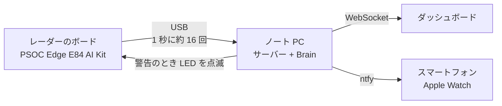

# 息吹～IBUKI～ 

**カメラも、ウェアラブル端末もいらない。非接触センサーで、お休み中の赤ちゃんの呼吸を見守る。**

<!-- デモ動画ができたら、下の行のコメントを外して画像と動画の URL を入れる

-->

ベビーベッドのそばに置いた 60 GHz のミリ波レーダーが、赤ちゃんの胸のわずか数ミリの上下運動をとらえます。呼吸が止まっていると判断された場合、保護者のスマートフォンに通知が届き、ボードの赤い LED が点滅します。

  

> ハッカソンで作った試作品です。医療機器ではなく、病気の診断や SIDS（乳幼児突然死症候群）の予防はできません。

## 製品概要
### 背景(製品開発のきっかけ、課題等）
赤ちゃんが眠っているあいだ、「ちゃんと息をしているかな」と夜中に何度ものぞきに行く親は少なくありません。
見守りカメラは便利ですが、寝顔がずっと撮られ続けることに抵抗がある家庭もあります。録音・録画を行うシステムでは、家族の会話などプライバシーの懸念もあります。直接体に装着する端末は、赤ちゃんが嫌がったり、寝返りで外れたりする可能性があります。

触れずに、映さずに、それでいてちゃんと見守れないか。その答えとして 息吹～IBUKI～ を作りました。名前は「息吹（いぶき）」、命の息づかいから取っています。

### 製品説明（具体的な製品の説明）
息吹～IBUKI～ は 3 つの部分でできています。

1. **レーダーのボード**：Infineon の PSOC Edge E84 AI Kit に、私たちが書いたファームウェアを入れています。跳ね返ってきた電波を距離ごとに分け、1 秒に約 16 回パソコンへ送ります。
2. **パソコンの Brain**：赤ちゃんがいるか、動いているか、息をしているかを判断し、呼吸数を計算します。
3. **ダッシュボードと通知**：ブラウザに呼吸の波と状態を表示し、スマートフォンに【緊急】【注意】【お知らせ】の 3 段階で知らせます。

| 表示 | 意味 |
|---|---|
| 眠っています | じっとしていて、呼吸が検知できている |
| 起きています | 動いている（激しく動いている間は呼吸は正しく測定されません） |
| 呼吸を確認中 | 呼吸が検知できていない |
| 呼吸が確認できません | じっとしているのに、呼吸が検知されないが10秒以上続いている（緊急通知、パソコンのアラーム音、LED の点滅。アラーム音はボタンを押すまで止まりません） |
| 呼吸が速い状態が続いています | 通常より呼吸が速い状態が続いている |
| ベッドにいません | 赤ちゃんがいない状態（通知と LED の点滅） |

### 特長
#### 1. 映さない、触れない、安全性の高いセンサー
低出力で、人体への影響が極めて低いミリ波レーダーを使用しています。カメラを使用しないため、寝顔の映像は残りません。頻繁に着替える赤ちゃんだけでなく、共に生活するご家族のプライバシーも守られます。赤ちゃんの体にも何もつけません。

#### 2. 胸の動きをミリ単位でとらえる
跳ね返ってきた電波の位相のずれから、胸の動きをミリ単位で計算します。距離ごとに分けて計算するため、壁や家具の反射と区別できます。

#### 3. 日常的に使える「起きたよ」機能
赤ちゃんが起きたときにスマートフォンで通知を受け取るができます。万が一のときだけでなく、在宅勤務中など、普段の生活にも便利です。国際色豊かなメンバーでのディスカッションの中で「海外では赤ちゃんと大人の別室睡眠の習慣がある」という意見から生まれました。

#### 4. 誤報を出さない
動いているときやボードが揺れたときは、呼吸を「確認中」として扱い、「呼吸が止まった」とは知らせません。静かになったときは、その人の反射が残っているかで、「ベッドにいない」と「息が止まった」を見分けます。

### 解決出来ること
- 夜中に何度ものぞきに行かなくても、別の部屋で様子がわかります。
- 見守りカメラに抵抗がある家庭でも使えます。
- 「起きた」「ベッドにいない」もわかるので、呼吸以外の見守りにも役立ちます。

### 今後の展望
- 赤ちゃんで確かめる（赤ちゃんの呼吸は 1 分に 30〜60 回で、息吹～IBUKI～ が見ている範囲に入ります）
- 3 本ある受信アンテナを組み合わせて、毛布越しでも、より正確に測れるようにする
- ボードの AI 用チップで判断を動かし、パソコンなしで使えるようにする
- 他のハードウェアやアプリケーションと連携し、緊急時には大きなアラーム音で確実に保護者が気付くようにする
- 小さなケースに入れて、ベッドの柵に取り付けられるようにする

### 注力したこと（こだわり等）
* **実際のデータで決める。** 閾値は 3 人・24 本の録画から決めました。1 分に 10 回の呼吸を 10.0 回と測れました。
* **誤報を出さない。** 24 本の録画で、間違った「呼吸なし」は 0 回です。迷ったときは「まだそこにいる」と考えて、呼吸を見続けます。
* **止まらない。** レーダーが止まってもボードが自分で復帰し、USB を抜き差ししてもサーバーがつなぎ直します。
* **すぐに使える。** `ibuki.command` をダブルクリックするだけで、すべてが起動します。

## デモ動画
実機のボードで録画しました。左がダッシュボード、右がボードの前で試している人です。

**1. 息を止めると警告**：ふつうに呼吸している間は波と呼吸数が出ます。息を止めると「呼吸を確認中」から「呼吸が確認できません」になり、スマートフォンに緊急の通知が届きます。

**2. 動いても誤報なし**：体を動かすと「起きています」になり、警告は出ません。止まると呼吸の表示に戻ります。

**3. ベッドから離れると通知**：立ち去ると「ベッドにいません」になり、スマートフォンに通知が届きます。

## 動作確認の結果
すべて実機のボードで確かめました。

| 項目 | 結果 |
|---|---|
| データの送信 | 1 秒に 16.6 回、欠けなし |
| 呼吸数（1 分に 10 回のペースで呼吸） | 9.0〜10.7 回（解析では 10.0 回） |
| 間違った「呼吸なし」 | 3 人・24 本の録画で 0 回 |
| 息止めの検出 | じっと息を止めた録画で警告が出る |
| 警告の流れ | 通知、Apple Watch、LED の点滅、ボタンでの解除まで動作 |
| レーダーが止まったとき | 自動で復帰（テスト 4 段階すべて合格） |

  

実機で測った胸の動きです。呼吸すると波が見え、息を止めると波が消えます。Brain が見ているのは、この波です。

### 成人で試した結果が赤ちゃんにも当てはまる理由
テストは成人（開発者3名）で行いました。息吹～IBUKI～ は 0.1〜1.5 Hz、つまり 1 分に 6〜90 回の呼吸を読み取れます。

- 赤ちゃんの呼吸は大人より速く、新生児はふつう 1 分に 30〜60 回です。WHO の「速い呼吸」の目安も、2 か月未満は 60 回、2〜12 か月は 50 回、1〜5 歳は 40 回で、どれもこの範囲に入ります。
- 警告は決まった大きさで判断せず、赤ちゃん一人ひとりの普段の呼吸と比べます。そのため、小さな呼吸にも合わせられます。
- 限界：赤ちゃんの胸の動きは大人より小さいです。とても浅い呼吸は 20〜30 cm では検出できましたが、50 cm では検出できませんでした。そのため、ボードは赤ちゃんの近くに設置する必要があります。実際に赤ちゃんで試す必要があります。

出典：WHO「[Management of the sick young infant aged up to 2 months: Chart booklet](https://www.who.int/publications/i/item/9789241516365)」（2 か月未満）、WHO「[IMCI chart booklet](https://apo.who.int/publications/i/item/9789241506823)」（2 か月〜5 歳）

## しくみ

Brain は機械学習ではなく、録画から決めたルールで判断します。くわしくは [pc/README.md](pc/README.md) に記載されています。

## 動かし方
ボードを USB でつなぎ、`ibuki.command` をダブルクリックします（ターミナルなら `./ibuki.command`）。ブラウザで LIVE 監視画面が自動的に開きます。

- 初回は Python のパッケージ（[requirements.txt](requirements.txt)）を入れて、ダッシュボードをビルドします。Python 3 と Node.js が必要です。
- 通知を使うときは、[.env.example](.env.example) を `.env` にコピーして、ntfy のトピックを書きます。
- 録画を再生するときは `./ibuki.command --replay recordings/<ファイル名>.csv` です。

ファームウェアは [firmware/README.md](firmware/README.md)、サーバーと通知は [pc/README.md](pc/README.md)、ダッシュボードは [web/README.md](web/README.md) にくわしく書いてあります。

## 開発技術
### 活用した技術
#### API・データ
* ntfy（スマートフォンと Apple Watch への通知）
* WebSocket（パソコンからダッシュボードへの配信）

#### フレームワーク・ライブラリ・モジュール
* ファームウェア：ModusToolbox 3.9、Arm GNU Toolchain 14.2、CMSIS-DSP、XENSIV BGT60TRxx ドライバ
* サーバーと Brain：Python、FastAPI、uvicorn、websockets、NumPy、SciPy、pyserial、python-dotenv、requests
* ダッシュボード：React、TypeScript、Vite、Recharts
* テストと道具：unittest、Node.js のテストランナー、matplotlib、macOS の say

#### デバイス
* Infineon PSOC Edge E84 AI Kit（XENSIV BGT60TR13C 60 GHz レーダー）
* MacBook、iPhone、Apple Watch

### 独自技術
#### ハッカソンで開発した独自機能・技術
ハッカソンの期間中（2026 年 10 月 24〜25 日）に作りました。ファームウェアの土台だけは Infineon のサンプル（DEEPCRAFT deploy radar）です（[b2015f2](https://github.com/jphacks/hs_2605/commit/b2015f2)）。

* **レーダーのファームウェア**：ボードの上で距離ごとの FFT まで計算して送ります。止まっても自分で復帰します。[ibuki.c](firmware/proj_cm55/ibuki.c)（[917dbb7](https://github.com/jphacks/hs_2605/commit/917dbb7)、[8d30423](https://github.com/jphacks/hs_2605/commit/8d30423)）
* **Brain**：在室、動き、呼吸、呼吸数を判断します。立ち去りと息止めは、その人の反射が残っているかで見分けます。[brain.py](pc/ibuki/brain.py)（[99be1af](https://github.com/jphacks/hs_2605/commit/99be1af)、[53a9a22](https://github.com/jphacks/hs_2605/commit/53a9a22)）
* **ボードの揺れの検出**：壁や家具の反射がそろって動いたら、ボードの揺れと判断します。[shake.py](pc/ibuki/shake.py)（[9008636](https://github.com/jphacks/hs_2605/commit/9008636)）
* **サーバーと通知**：ボード、Brain、ダッシュボード、LED をつなぎ、緊急度つきで通知します。[server.py](pc/ibuki/server.py)（[50cdc95](https://github.com/jphacks/hs_2605/commit/50cdc95)、[89c1b0b](https://github.com/jphacks/hs_2605/commit/89c1b0b)）
* **ダッシュボード**：呼吸の波、状態、通知の履歴をリアルタイムに表示します。[web/](web/)（[827dfc2](https://github.com/jphacks/hs_2605/commit/827dfc2)、[80a9233](https://github.com/jphacks/hs_2605/commit/80a9233)）
* **ワンコマンドで起動**：準備、ビルド、起動、ブラウザの表示まで 1 回で行います。[ibuki.command](ibuki.command)（[42db14c](https://github.com/jphacks/hs_2605/commit/42db14c)）
* **自動テスト**：パソコン側 39 個、ダッシュボード 51 個。[pc/tests/](pc/tests/)、[web/tests/](web/tests/)

## English summary
息吹～IBUKI～ watches a sleeping baby's breathing without a camera and without anything touching the baby. A 60 GHz radar next to the crib picks up chest movements of a few millimeters, and a laptop turns them into a breathing wave, a breathing rate and a simple state. If breathing seems to stop, the parents' phone and Apple Watch get a notification and the board's LED blinks. Tested on the real board: a paced 10 breaths/min test measured 10.0, and 24 recordings from 3 people gave no false alerts.

We tested on adults. Babies breathe faster (newborns about 30–60 times a minute), and WHO's "fast breathing" levels for children (60 a minute under 2 months, 50 at 2–12 months, 40 at 1–5 years) are all inside the range 息吹～IBUKI～ reads, 6–90 breaths a minute. A baby's chest moves less than an adult's, so the board goes close to the baby (20–30 cm), and testing with real babies is the next step.

Disclaimer: It's a hackathon prototype, not a medical device.

## チーム
* Manami Ando
* RamadhanAdam
* Hong Taegwan
