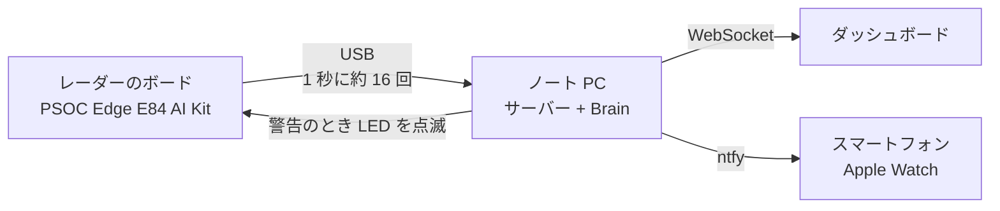

# IBUKI（いぶき）

**カメラも、体につけるセンサーもいらない。電波で、眠る赤ちゃんの呼吸を見守る。**

<!-- デモ動画ができたら、下の行のコメントを外して画像と動画の URL を入れる
[](動画URL)
-->

ベビーベッドのそばに置いた 60 GHz のミリ波レーダーが、赤ちゃんの胸のわずか数ミリの上下をとらえます。呼吸が止まったように見えたら、保護者のスマートフォンと Apple Watch に知らせ、ボードの赤い LED が点滅します。

<p align="center">
  
</p>

> ハッカソンで作った試作品です。医療機器ではなく、病気の診断や SIDS（乳幼児突然死症候群）の予防はできません。

## 製品概要
### 背景(製品開発のきっかけ、課題等）
赤ちゃんが眠っているあいだ、「ちゃんと息をしているかな」と夜中に何度ものぞきに行く親は少なくありません。
見守りカメラは便利ですが、寝顔がずっと撮られ続けることに抵抗がある家庭もあります。体に貼るセンサーは、赤ちゃんが嫌がったり、寝返りで外れたりします。

触れずに、映さずに、それでいてちゃんと見守れないか。その答えとして IBUKI を作りました。名前は「息吹（いぶき）」、命の息づかいから取っています。

### 製品説明（具体的な製品の説明）
IBUKI は 3 つの部分でできています。

1. **レーダーのボード**：Infineon の PSOC Edge E84 AI Kit に、私たちが書いたファームウェアを入れています。60 GHz の電波を出し、跳ね返ってきた電波を距離ごとに分けて、1 秒に約 16 回パソコンへ送ります。
2. **パソコンの Brain**：受け取った信号から、赤ちゃんがいるか、動いているか、息をしているかを判断し、呼吸数を計算します。
3. **ダッシュボードと通知**：ブラウザに呼吸の波と状態を表示し、異常のときはスマートフォンと Apple Watch に通知します。

赤ちゃんの状態は、次の 5 つで表します。

| 表示 | 意味 |
|---|---|
| 眠っています | じっとしていて、呼吸が見えている |
| 起きています | 動いている（動いている間は呼吸を測らない） |
| 呼吸を確認中 | じっとしているのに、呼吸が見えない |
| 呼吸が確認できません | その状態が続いた（通知と LED の点滅） |
| ベッドにいません | 赤ちゃんがいなくなった（通知と LED の点滅） |

### 特長
#### 1. 映さない、触れない
カメラを使わないので、寝顔の映像は一切残りません。赤ちゃんの体にも何もつけません。電波は布を通るので、毛布越しでも使えるはずです（まだ試していません）。

#### 2. 胸の動きをミリ単位でとらえる
跳ね返ってきた電波の位相のずれから、胸の動きをミリ単位で計算します。距離ごとに分けて見ているので、壁や家具の反射とは区別できます。

#### 3. 誤報を出さない
動いているあいだや、ベッドやボードが揺れたときは、呼吸を「わからない」として扱います。「呼吸が止まった」と間違えて知らせることはありません。わからないときに、呼吸数を 0 と表示することもしません。

### 解決出来ること
- 夜中に何度ものぞきに行かなくても、別の部屋で様子がわかります。
- 見守りカメラに抵抗がある家庭でも使えます。
- 「起きた」「ベッドにいない」もわかるので、呼吸以外の見守りにも役立ちます。

### 今後の展望
- 3 本ある受信アンテナを組み合わせて、毛布越しでも、もっとはっきり測れるようにする
- ボードの AI 用チップで、眠りの状態を見分ける小さなモデルを動かす
- 小さなケースに入れて、ベッドの柵に簡単に取り付けられるようにする
- たくさんの赤ちゃんのデータで、判定の基準を見直す

### 注力したこと（こだわり等）
* **実際のデータで確かめること。** しきい値は勘で決めず、2 人分・16 本の録画を見て決めました。音声に合わせて 1 分間に 10 回呼吸するテストでは、ちょうど 10.0 回と測れました。
* **誤報を出さないこと。** 呼吸、動き、ボードの揺れ、立ち去り、空の部屋のどの録画でも、間違った「呼吸なし」は一度も出ませんでした。
* **止まらないこと。** レーダーのデータがあふれたり止まったりしても、ボードが自分で復帰します。USB を抜き差ししても、サーバーが自分でつなぎ直します。

## 動作確認の結果

すべて実機のボードで確かめました。

| 項目 | 結果 |
|---|---|
| データの送信 | 1 秒に 16.6 回、欠けなし |
| 呼吸数（1 分に 10 回のペースで呼吸） | 9.0〜10.7 回（2 人、6 本の録画。解析では 10.0 回） |
| 間違った「呼吸なし」 | 16 本の録画で 0 回 |
| 息止めの検出 | じっと息を止めた録画で警告が出る |
| 警告の流れ | 通知、Apple Watch、LED の点滅、ボタンでの解除まで実機で動作 |
| レーダーが止まったとき | 自動で復帰（テスト 4 段階すべて合格） |

<p align="center">
  
</p>

上の図は、実機のボードで測った胸の動きです。声に合わせて呼吸すると 1 分に 10 回の波がはっきり見え、息を止めると波がほぼ消えます。Brain が見ているのは、この波です。

## しくみ



## 動かし方
ボードを USB でつなぎ、リポジトリのフォルダで次の 2 つを動かします。

```
../env/bin/python pc/ibuki/server.py
```

```
cd web
npm install
npm run dev
```

表示されたアドレスをブラウザで開き、LIVE を選びます。くわしい手順は、ファームウェアが [firmware/README.md](firmware/README.md)、サーバーと通知の設定が [pc/README.md](pc/README.md)、ダッシュボードが [web/README.md](web/README.md) にあります。

## 開発技術
### 活用した技術
#### API・データ
* ntfy（スマートフォンと Apple Watch への通知）
* WebSocket（パソコンからダッシュボードへの配信）

#### フレームワーク・ライブラリ・モジュール
* ModusToolbox 3.9、CMSIS-DSP、XENSIV BGT60TRxx ドライバ（ファームウェア）
* Python：FastAPI、uvicorn、websockets、NumPy、SciPy、pyserial
* React、TypeScript、Vite、Recharts（ダッシュボード）

#### デバイス
* Infineon PSOC Edge E84 AI Kit（XENSIV BGT60TR13C 60 GHz レーダー）
* MacBook
* iPhone、Apple Watch

### 独自技術
#### ハッカソンで開発した独自機能・技術
* **レーダーのファームウェア**：ボードの上で距離ごとの FFT まで計算し、決めた形式でパソコンへ送ります。[firmware/proj_cm55/ibuki.c](firmware/proj_cm55/ibuki.c)（commit 917dbb7、55fd0f6）
* **自動で復帰するファームウェア**：データがあふれたら捨てて再起動、1 秒止まったらウォッチドッグが再起動します（commit 8d30423、827023d）。
* **Brain**：在室、動き、呼吸、呼吸数を判断し、状態と警告を決めます。2 人分の録画で調整しました。[pc/ibuki/brain.py](pc/ibuki/brain.py)（commit 99be1af）
* **ボードの揺れの検出**：ふだん動かない壁や家具の反射がそろって動いたら、ボードが揺れたと判断し、呼吸を「わからない」にします。[pc/ibuki/shake.py](pc/ibuki/shake.py)（commit 9008636）
* **サーバー**：ボード、Brain、ダッシュボード、通知、LED をつなぎます。[pc/ibuki/server.py](pc/ibuki/server.py)（commit 50cdc95）
* **ダッシュボード**：呼吸の波と状態をリアルタイムに表示します。[web/](web/)（commit fd42b05、827dfc2）

## English summary
IBUKI watches a sleeping baby's breathing without a camera and without anything touching the baby. A 60 GHz radar next to the crib picks up chest movements of a few millimeters. A laptop turns them into a breathing wave, a breathing rate and a simple state (asleep, awake, not breathing, not in bed). If breathing seems to stop, the parents' phone and Apple Watch get a notification and the board's red LED blinks. Movement or a bumped board never causes a false "not breathing" alert. Tested on the real board: a paced 10 breaths/min test measured 10.0, and 16 recordings from 2 people gave no false alerts. It's a hackathon prototype, not a medical device.

## チーム
* Manami Ando
* RamadhanAdam
* lemonwasp
