# Offline radar captures

Run from the repository root with Python 3.10 or newer. The parser uses only
the standard library; validation against existing ML readers uses the NumPy
already included in the PC requirements. No TensorFlow, training, GPU or board
is needed.

```python
from ml.analysis.protocol import read_capture

capture = read_capture("recordings/samples/breathing.sample.csv")
print(len(capture.frames), len(capture.configs), len(capture.issues))
# 999 12 0
frame = capture.frames[0]
print(frame.data.seq, frame.data.t_ms, frame.config_line_number)
# 12875 774777 6
print(frame.data.i[0], frame.data.q[0], frame.z()[0])
# -4874 -5908 (-487.4-590.8j)
if frame.config is not None:
    distances_cm = frame.config.ranges_cm()
for issue in capture.issues:
    print(issue.line_number, issue.reason, issue.raw)
```

`parse_line(text)` returns `Data`, `Config`, or an uninterpreted `OtherMessage`.
Malformed D/C and blank input raise `ValueError`. `parse_capture(lines)` accepts
an iterable of raw rows; `read_capture(path)` reads a recorder CSV. Capture errors
are collected with 1-based physical line numbers, the original row, and a reason.
Malformed rows are skipped; subsequent rows are still read. An empty file returns
an empty capture. Filesystem errors propagate. UTF-8 BOM is accepted and invalid
UTF-8 bytes are replaced, causing invalid numeric fields to be reported.

`Data.i` and `Data.q` are immutable tuples of Python integers in nearest-first
bin order. They preserve original integer values without a floating point cast.
`seq` is the board sequence number. **`t_ms` is elapsed milliseconds since board
boot, not a Unix timestamp or a host recording time.** Values and ordering are
preserved across gaps/restarts; this package does not repair or resample them.

`Config` contains `first_cm`, `step_mm`, `n`, and `scale`. The bin distance is
`first_cm + bin_index * step_mm / 10`; the complex value is
`I / scale + 1j * Q / scale`. Floating point conversion occurs only in `z()`.

The recorder saves raw incoming rows and can start between periodic C messages.
Consequently, the first valid C is also associated with preceding D rows; each
frame exposes its `config_line_number`, which may be later than its own line.
This assumes the first observed configuration applied to that initial interval;
the capture cannot prove historical configuration before recording began.
Subsequent valid C messages apply only to subsequent D rows. Malformed C rows are
reported and do not replace the last valid C. No C means `config` and
`config_line_number` remain `None`, and `frame.z()` raises `ValueError`.
No range or scale defaults are inferred from ML constants.

A D/C bin-count mismatch is reported while retaining the D frame's raw integers;
`z()` refuses conversion. Inspect `capture.issues` before downstream analysis.
The reader loads the capture in memory to associate late configuration.

## Canonical ingestion (schema v1)

Install Parquet support **only in the offline analysis environment**; it is not
added to the production PC requirements:

```bash
python -m pip install -r ml/analysis/requirements.txt
python -m ml.analysis.ingest recordings/samples/breathing.sample.csv --out-dir analysis_runs/breathing
python -m ml.analysis.ingest recordings/samples/hold.sample.csv --out-dir analysis_runs/hold
python -m ml.analysis.ingest recordings/samples/leave.sample.csv --out-dir analysis_runs/leave
```

The input is read without modification. `analysis_runs/` is ignored by Git;
keep private/generated datasets there and do not force-add them. No HTML report,
filtering, resampling, model evaluation or runtime change is performed.

Each output directory contains exactly:

| Artifact | Contents |
| --- | --- |
| `manifest.json` | Schema/format, session ID, input basename/byte count/SHA-256, declared provenance, observed configurations with source lines, counts, writer settings and artifact SHA-256 hashes |
| `frames.parquet` | Typed D/E frames in original source order, including raw integer arrays and configuration associations |
| `events.jsonl` | One JSON object per configuration, recorded non-frame message, malformed-row diagnostic or inferred anomaly |
| `quality.json` | Row diagnostics, unchanged legacy D quality, combined exported D/E quality and separate explicit/inferred status counts |

`schema_version` is `1` and `format` is `ibuki.radar.capture`. The default session
ID is `sha256:<input hash>`; `--session-id` can supply an explicit identifier.
`--source-type repository_sample|board_capture|synthetic|unknown` defaults to
`unknown`. Schema v1 follows the IBUKI 2.0 Development Design v0.2 taxonomy:

| Source type | Meaning |
| --- | --- |
| `repository_sample` | Public sample recording included in this repository |
| `board_capture` | Recording captured from physical radar hardware |
| `synthetic` | Artificially generated or simulated data |
| `unknown` | Source has not been verified or declared |

The earlier PR implementation's `recorded` and `replay` values are rejected;
there are no compatibility aliases or automatic normalization. `recorded` alone
does not verify hardware origin, and replay is a playback mode that does not
change the original data provenance. When replaying an existing recording,
declare its verified original source type or leave it `unknown`.
`source_type_provenance` remains `operator_declared` for the three known types
and `unspecified` for `unknown`; a declaration is not independent verification.
`--scenario` and `--scenario-provenance` record operator declarations; provenance
without a scenario is rejected. For example:

```bash
python -m ml.analysis.ingest recordings/samples/hold.sample.csv --out-dir analysis_runs/declared-hold --source-type repository_sample --scenario hold --scenario-provenance "operator supplied filename label; timing unverified"
```

No scenario or source type is inferred from a filename. Scenario metadata always
has `is_ground_truth: false`; neither a filename nor a recorded Y message
establishes medical truth, labeled breath-hold intervals or sensor accuracy.
The input hash identifies the actual bytes, including encoding and line endings.
No acquisition time, subject identity or dataset origin absent from the recording
is invented. Repeated observed C configurations are retained in the manifest and
events rather than collapsed.

### Frame columns and units

| Columns | Arrow types / meaning |
| --- | --- |
| `schema_version`, `session_id` | Non-null int16 and string |
| `source_line`, `message_type` | Non-null int64, string; physical source line (1-based), D or E |
| `seq`, `board_uptime_ms` | Non-null int64; original sequence and milliseconds since board boot, **not Unix time** |
| `antenna_count`, `bin_count` | Non-null int8, int32; actual frame dimensions |
| `raw_i`, `raw_q` | Non-null nested lists of int64, indexed `[antenna][nearest-first bin]`; no float conversion |
| `wire_encoding` | Non-null string: `decimal_integer_pairs` (D) or `base64_int16_le` (E) |
| `value_divisor` | Nullable float64; observed C.scale for D, exactly 1 for E |
| `scaled_values_available` | Non-null bool; whether value conversion is supported |
| `configuration_status` | Non-null string: `known`, `missing_config` or `bin_mismatch` |
| `config_source_line`, `config_bin_count` | Nullable int64; associated C row and declared bin count |
| `first_cm`, `step_mm`, `config_scale` | Nullable float64; original observed C parameters |

D stores one antenna. For a usable D configuration, form complex values as
`raw_i / value_divisor + 1j * raw_q / value_divisor`. This matches
`CaptureFrame.z()` and the public samples' existing `ml.features.read_csv`
interpretation (within floating point rounding). Without C, D raw integers are
retained, the divisor/geometry are null and conversion is unavailable. A bin
mismatch retains the observed parameters and frame but marks conversion
unavailable; consumers must check `scaled_values_available`.

E strictly requires a base64 payload of 288 bytes: three antennas, 24 bins each,
interleaved I/Q, little-endian signed int16. Wire offsets are
`2 * (antenna * 48 + bin * 2 + component)` bytes, where component 0 is I and 1 is
Q. Values are stored exactly as int64 and are **already in value units**: form
`raw_i + 1j * raw_q`, never divide by C.scale. This agrees with
`ml.antennas.read_e` and `ml.features.read_csv` (the latter keeps antenna 0).
E values remain usable without C, but geometry remains null. No physical
displacement calibration is implied by these value units.

Both frame types use the existing configuration policy: the first valid C also
backfills preceding frames, then later valid C applies forward. This assumes the
first observed settings applied before they arrived; it cannot verify that
history. `config_source_line` makes this assumption visible. Range geometry is
`first_cm + bin * step_mm / 10`, only when configuration is present and compatible.
Malformed C does not replace valid C. The additive `protocol.parse_e_line` decoder
leaves the existing D/C `parse_line`/`parse_capture` interfaces unchanged.

### Events, diagnostics and quality

Events carry schema/session IDs, `source_line`, `message_type`, `event_type`,
`origin`, `raw`, `raw_bytes_base64` and a `detail` object. Y/H/S/B and unknown
nonempty messages retain their full payload without interpretation. C events
also contain decoded configuration. `raw` preserves whitespace (excluding the
line terminator); `raw_bytes_base64` preserves original row bytes, including an
initial BOM or invalid UTF-8. Invalid UTF-8 is replaced in the readable text only.

Malformed D/C/E, invalid base64, blank rows and bin mismatches appear in both
events and `quality.json` with source lines/reasons. Frames outside the schema's
int64/int32 bounds cannot be exported; their raw rows remain as `schema_range`
diagnostics, with no clipping. Empty files yield a typed empty Parquet table,
empty events and zero counts.

`S,<time>,radar restart...` status messages have
`event_type: radar_restart_status` and `origin: explicit_board_status`. These
report the board's message, without proving restart completion. Sequence/time
gaps, duplicates, backwards values and long intervals have
`origin: inferred_from_frames` and separate event types. They are integrity
observations and are never relabeled as explicit restart messages.

`quality.d_quality` is exactly the existing parser/quality result for D; it
continues to list E as uninterpreted. `quality.frame_quality` reuses the same
quality calculation over exported D and E frames together in source order, with
`total_frames` and `reported_issue_count`. E antenna 0 is used only for the
existing bin/config checks; all three antennas remain in Parquet. For mixed
D/E streams these two views can legitimately report different sequence gaps.
Combined quality assumes both message types share a sequence/time domain; no
repair, sorting by time, interpolation or inferred sample insertion occurs.

### Reproducibility and safe output

Identical source bytes/name, metadata settings and writer environment produce
byte-identical artifacts; tests compare all four files. JSON keys and events
have stable ordering, UTF-8/LF output and no NaN/Infinity or wall-clock timestamps.
There are no absolute input/output paths in the manifest. Parquet uses fixed
writer options (2.6, uncompressed, no dictionary, 4,096 rows/group, data page 1.0)
and records the actual PyArrow version. Cross-version byte identity is not
promised; preserve the writer version when reproducing hashes.

An existing output is rejected unless `--force` is supplied. Even with force,
replacement only accepts an empty directory or a complete managed v1 bundle;
unrelated files, symlinks and outputs containing the original input are rejected.
The complete bundle is staged before directory replacement, with rollback if
the final rename fails. Use one writer per output directory; replacement is not
a cross-process transaction. Parsing/export currently holds a recording in
memory. Missing PyArrow, invalid input paths and unsafe output paths exit with a
clear error; malformed rows instead produce an auditable successful dataset.

Observed public-sample conversions with PyArrow 24.0.0:

| Input | Frames (D) | Configuration events | Diagnostics |
| --- | ---: | ---: | ---: |
| `breathing.sample.csv` | 999 | 12 | 0 |
| `hold.sample.csv` | 1,000 | 12 | 0 |
| `leave.sample.csv` | 996 | 12 | 0 |

These counts describe file conversion, not physiological performance. E behavior
is verified with small synthetic wire fixtures because these samples contain D.
Run ingestion and existing analysis tests after installing offline requirements:

```bash
python -m unittest discover -s ml/analysis/tests -t . -v
python -m unittest discover -s pc/tests -t pc -v
```

Future work can consume this versioned dataset for an offline HTML report;
that report and changes to training, runtime models, alarms or firmware are
outside this conversion PR.

## Standalone HTML report: end-to-end Sprint 1 workflow

The HTML report consumes the four canonical artifacts, **not the original CSV**.
Use the existing NumPy/Matplotlib environment plus the offline Parquet dependency.
Run from the repository root:

```bash
python -m pip install -r ml/analysis/requirements.txt
python -m ml.analysis.ingest recordings/samples/breathing.sample.csv --out-dir analysis_runs/breathing --source-type repository_sample
python -m ml.analysis.report analysis_runs/breathing --output analysis_runs/breathing_report.html --bin 9
```

Repeat for the other public recordings, with separate outputs:

```bash
python -m ml.analysis.ingest recordings/samples/hold.sample.csv --out-dir analysis_runs/hold --source-type repository_sample
python -m ml.analysis.report analysis_runs/hold --output analysis_runs/hold_report.html --bin 9
python -m ml.analysis.ingest recordings/samples/leave.sample.csv --out-dir analysis_runs/leave --source-type repository_sample
python -m ml.analysis.report analysis_runs/leave --output analysis_runs/leave_report.html --bin 9
```

Open the HTML directly in a browser. It embeds PNG figures and CSS and requires
no server, JavaScript, CDN or internet connection. Metadata and original event
payloads are escaped as text. Desktop and mobile previews below use only the
public breathing sample (not private recordings):

| Desktop signal panels | Mobile overview |
| --- | --- |
| [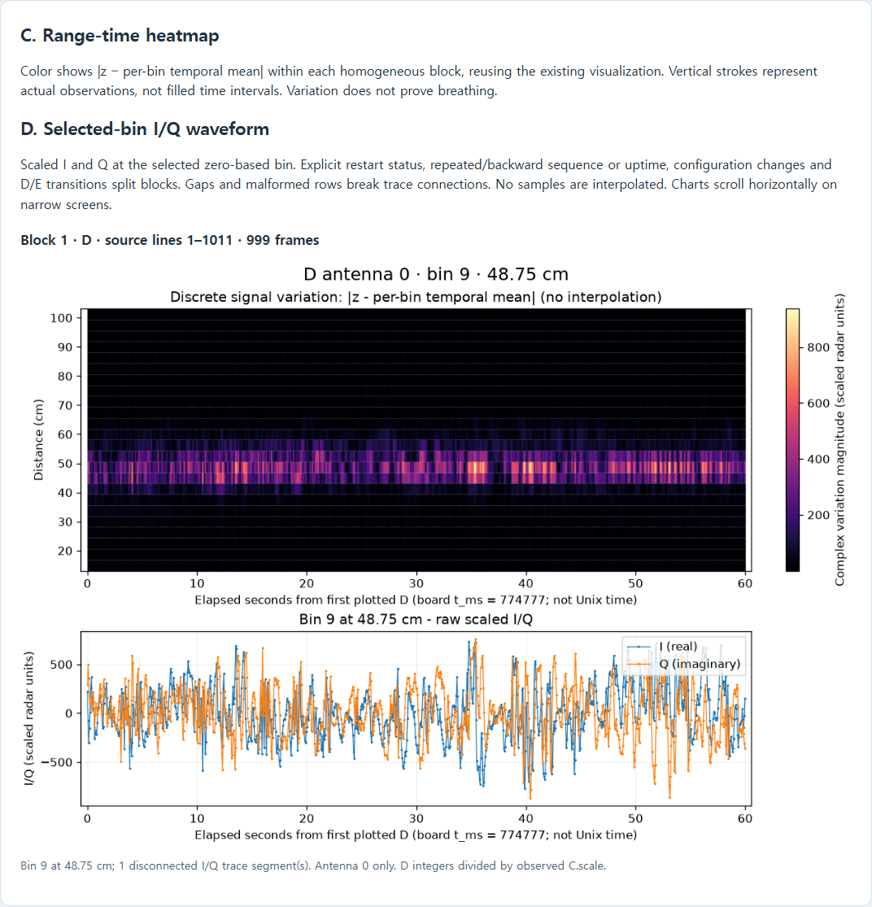](previews/breathing-desktop.png) | [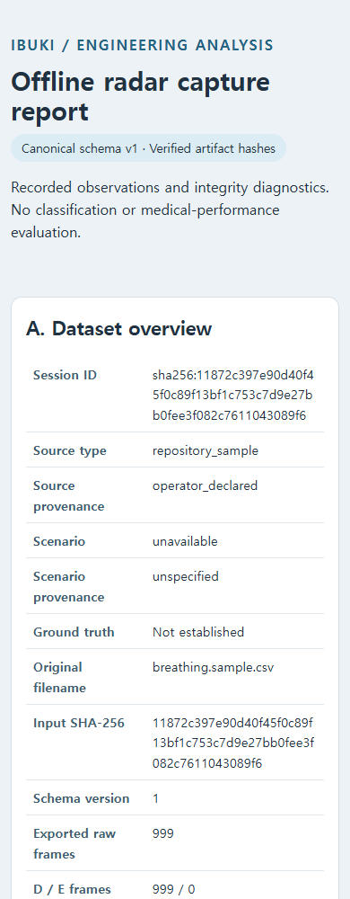](previews/breathing-mobile.png) |

The six sections show dataset/provenance metadata, authoritative quality
diagnostics, a range-time variation heatmap, selected-bin scaled I/Q, the
sampling timeline/source events, and interpretation limits. Bin indices are
zero-based; bin 9 in these samples is 48.75 cm. This is a selected distance,
not a guarantee that the same target occupies that bin in every recording.

### Validation before rendering

`load_dataset(directory)` checks format `ibuki.radar.capture`, schema version 1,
all four regular files, and SHA-256 for frames/events/quality against the
manifest. It validates the expected Arrow types/nullability and schema metadata,
array dimensions, integer ranges, sequence/uptime values, D/E unit semantics,
configuration association, event fields and manifest/quality counts. Parquet's
equivalent nested-list child names `item`/`element` are allowed. Duplicate JSON
keys and non-finite JSON numbers are rejected. Unsupported/corrupt input exits
with an error; there is no CSV fallback or repair.

Hashes check consistency against the manifest, not provenance authenticity or
signatures. The original input SHA-256 is displayed as recorded in the manifest;
the report never accesses the original recording to verify it. Source/scenario
declarations retain ingestion semantics; filenames and Y messages are not truth.

### Plot and quality interpretation

- `quality.json.frame_quality` supplies the combined D/E integrity metrics;
  the report does not replace them with newly calculated whole-session metrics.
  Exported raw frames may include incompatible configuration. Rejected D/E rows
  are counted from diagnostic source lines absent from exported frames; C/blank
  errors and retained bin mismatches are not additional missing frames.
- Scaled I/Q and `abs(z - mean(z, axis=0))` reuse `prepare_visualization`.
  D divides integers by observed C.scale. E uses already-scaled int16 values,
  never C.scale, and displays antenna 0 only. All antennas stay in Parquet.
- Configuration and D/E transitions, repeated/backward sequence or timestamps,
  and explicit S radar-restart status split independent plotting blocks. Existing
  visualization logic breaks trace connections across sequence/timing gaps and
  malformed rows. Each block has its own temporal mean and color scale, so
  colors across blocks are not directly comparable. Singleton blocks have zero
  variation relative to their own mean; that does not establish no movement.
- Heatmap strokes are individual observations at recorded timestamps, not filled
  time cells. No interpolation is performed. Each block's time origin is shown
  as board uptime; timestamps are not Unix time. The sampling timeline plots
  actual uptime offsets in physical source order without connecting points.
  Explicit S markers use only a parseable recorded S timestamp; inferred anomaly
  markers use actual frame timestamps. Unknown timestamps remain unavailable.
- Missing/incompatible geometry, invalid bin selection for a block or values
  that cannot be plotted produce an explicit unavailable reason alongside the
  available overview, quality and events. Empty datasets retain diagnostics.
  E-only datasets with compatible C geometry are supported; without C, the
  report does not invent distances even though E value units are known.

### Output safety and determinism

Write reports **outside** the managed dataset directory, as siblings in the
examples. Output inside a dataset is rejected, including with `--force`, so the
four-file ingestion bundle remains safe for subsequent ingestion operations.
Existing HTML is protected unless report `--force` is explicitly supplied;
input datasets/recordings are never modified. Output must end in `.html`, its
parent directory must exist, and symlink outputs are rejected. Forced writes
replace a staged file rather than modifying a hard-linked source in place.

For identical artifacts/settings and the same plotting/font environment, HTML
bytes are deterministic. There are no generated wall-clock timestamps or
absolute input/output paths. Cross-version PNG byte identity is not promised.
Reports and datasets in `analysis_runs/` remain ignored by Git; only the two
representative public-sample screenshot previews are committed. The report
loads artifacts and figures in memory; many discontinuities create many blocks
and may produce a large HTML file. Narrow screens scroll graphs/tables inside
their panels to preserve readable labels.

### Executed validation and Sprint 1 checklist

Python 3.11.5 / PyArrow 24.0.0 on Windows: report tests 14 passed, full analysis
suite 110 passed, PC tests 72 passed, web tests 69 passed, web build passed
(existing bundle-size warning). Commands:

```bash
python -m unittest ml.analysis.tests.test_report -v
python -m unittest discover -s ml/analysis/tests -t . -v
python -m unittest discover -s pc/tests -t pc -v
# From web/:
npm test
npm run build
```

Actual CLI conversions/reports were generated under
`analysis_runs/sprint1-final/`, using the commands above with that output prefix:

| Public sample | Frames D/E | Events | Row diagnostics | Estimated missing | HTML bytes |
| --- | ---: | ---: | ---: | ---: | ---: |
| breathing | 999 / 0 | 12 | 0 | 0 | 419,553 |
| hold | 1,000 / 0 | 12 | 0 | 0 | 347,496 |
| leave | 996 / 0 | 12 | 0 | 0 | 232,647 |

All three reports were opened in headless Chrome at 1,440px and 390px widths.
All figures loaded, no external HTTP requests or page errors occurred, and
there was no page-level horizontal overflow. Graphs and event tables scroll
inside their panels on mobile. Signal panels were visually inspected for all
three samples; a different signal shape does not establish breathing accuracy.

- [x] Canonical ingestion and versioned provenance (merged ingestion PR).
- [x] Hash/schema validation and authoritative integrity diagnostics.
- [x] Self-contained report, range-time/IQ and sampling timeline.
- [x] Safe separate output, deterministic bytes, edge/regression tests.
- [x] Public-sample conversion and desktop/mobile visual review.

Sprint 2 work remains separate: collect/verify dataset provenance and labels,
perform properly labeled signal/model evaluations, and investigate features or
filtering using evidence. This report does not train a classifier, change runtime
models/alarms/firmware/web, or establish apnea/alarm performance, medical-device
validity or infant safety.

## Descriptive signal profiling (Sprint 2)

Profile a verified schema-v1 dataset without reading its original CSV or any
validation labels/model artifacts:

```bash
python -m ml.analysis.signal_profile analysis_runs/breathing --output analysis_runs/breathing_profile.json
# Optional zero-based bin selection; repeat --bin (default: all bins per block):
python -m ml.analysis.signal_profile analysis_runs/breathing --output analysis_runs/breathing_bin9_profile.json --bin 9
```

Use the offline requirements/environment described above. No additional
dependencies are introduced. The module reuses `report.load_dataset` for all
canonical file/hash/schema validation and `report.prepare_blocks` for D/E
scaling and homogeneous blocks. It never imports the labeled evaluator or
reimplements the CNN's wave/level/amount features. It does not run models,
filtering, threshold tuning or training.

The shared canonical loader reads its single Parquet buffer synchronously and
closes the reader before later validation errors can terminate a CLI. Hash and
schema validation, raw values and existing report APIs remain unchanged.

### Analysis units and formulas

Each analysis block is a continuous `VisualizationData.trace_segments` slice
inside a homogeneous report block. Resets, repeated/backward sequence or board
time, explicit S restart status and D/E/configuration transitions separate parent
blocks. Sequence gaps, long intervals and intervening malformed-row diagnostics
separate trace segments using the existing visualization policy. The mean is
recomputed for each continuous analysis block; no statistic combines segments
across a gap. This differs deliberately from the HTML heatmap's parent-block
mean when that parent has multiple traces.

For N actual observed samples of distance bin k, let:

```text
z[j,k] = scaled complex I/Q from the existing block adapter
mu[k]  = sum(z[j,k], j=0..N-1) / N
v[j,k] = abs(z[j,k] - mu[k])
sample_count = N
median_variation_magnitude = median(v[:,k])
p95_variation_magnitude    = linear empirical 0.95 quantile of v[:,k]
rms_variation_magnitude    = sqrt(sum(v[j,k]^2, j=0..N-1) / N)
```

The shared `visualize.variation_magnitude` computes v for both tools. For p95,
sort the N magnitudes, let h=(N-1)*0.95, and interpolate between sorted positions
floor(h) and ceil(h). That is interpolation of an empirical **quantile**, not
interpolation of missing radar measurements. To avoid overflow when squaring,
statistics are calculated after division by each bin's maximum magnitude, then
multiplied by that maximum. All-zero magnitudes return zero. This numerical
rescaling does not normalize the output signal or change the stated formulas.

All magnitude statistics are in **scaled radar value units**, not millimeters,
power, SNR or calibrated motion. D integers use observed C.scale; E int16 values
are already scaled and use divisor 1. Only antenna 0 is profiled for both types;
other E antennas remain in the source artifact and their count is recorded.
Geometry is taken only from compatible observed C settings, including the
ingestion policy that first-valid-C backfills initial frames. No distances or
scales are invented. Single-sample variation is zero by construction; it does
not establish stillness or absence of breathing.

Samples have equal weight, not elapsed-time weight. Positive irregular intervals
can remain within a segment if the shared gap policy does not split them. No
sampling rate is assumed; timestamps remain board uptime milliseconds, never
Unix time. There is no sample filling, interpolation, resampling, FFT or cadence
correction.

### Output, coverage and provenance

The JSON has its own `format: ibuki.radar.signal_profile` and `profile_version: 1`;
the canonical dataset schema remains unchanged. It includes session/source and
scenario provenance, original filename/input SHA-256, all observed C settings,
verified artifact hashes from the manifest (frames/events/quality), dataset
writer information, NumPy version, and the authoritative complete quality
summary. These hashes establish consistency, not authenticity; no original CSV
is rehashed or used as a fallback.

`blocks` retain parent/trace IDs, source lines, sequence/uptime endpoints,
selected/recorded antenna counts, geometry and scale semantics. Frame row
indices are zero-based, with `frame_row_end_exclusive` exclusive; source lines
are original 1-based physical lines. Every exported frame belongs to exactly
one available or unavailable block. `coverage.analyzed_frames` plus
`coverage.unavailable_frames` equals the exported frame count. Malformed rows
that ingestion could not export remain visible in the copied quality diagnostics.

Missing/incompatible geometry or non-finite prepared values produce
`status: unavailable`, an explicit reason and `bin_statistics: null`; they are
not turned into zero-valued statistics. Empty datasets have no blocks and an
explicit reason. `--bin` accepts distinct nonnegative integers and rejects bins
outside any usable parent block; omit it to accommodate changing bin counts.
Upper range cannot be verified for unavailable geometry, and no statistics are
invented there. Bin selection affects columns, not which observed frames are
counted within a usable block.

Output must be a separate `.json` outside the canonical directory. Existing
output requires `--force`; symlink output is rejected, and forced writes stage
and replace the file rather than writing through a hard link. The output parent
must exist. Source artifacts/recordings are never modified. JSON uses stable
key/bin/block order, finite numbers and no wall-clock timestamp or output path;
identical artifacts/settings/environment produce byte-identical output.
Keep all generated profiles in ignored `analysis_runs/`.

### Public-sample observations — descriptive only

Actual commands used the repository-sample canonical artifacts generated during
the Sprint 1 workflow, with all 24 bins profiled:

```bash
python -m ml.analysis.signal_profile analysis_runs/sprint1-final/breathing --output analysis_runs/sprint1-final/breathing_profile.json
python -m ml.analysis.signal_profile analysis_runs/sprint1-final/hold --output analysis_runs/sprint1-final/hold_profile.json
python -m ml.analysis.signal_profile analysis_runs/sprint1-final/leave --output analysis_runs/sprint1-final/leave_profile.json
```

Each sample produced one analysis block, zero unavailable frames and zero row
diagnostics. A consistent example, bin 9 at 48.75 cm, yielded these values
(rounded to three decimals, scaled radar value units):

| File label only | Observed samples | Median | p95 | RMS |
| --- | ---: | ---: | ---: | ---: |
| breathing | 999 | 311.593 | 662.516 | 377.462 |
| hold | 1,000 | 27.762 | 47.347 | 30.670 |
| leave | 996 | 2.735 | 14.653 | 8.258 |

These describe observed variation in that bin across each entire recording.
The same distance need not contain the same target in different recordings.
File labels do not establish breath-hold intervals, subject state, ground truth,
noise levels or an optimal bin/filter. No classification accuracy, synthetic
accuracy, SNR improvement, model performance, medical validation or safety claim
follows from this table. No condition ranking or threshold is selected.

Tests use small unlabeled wire fixtures with analytically known statistics and
all three public samples. They cover formulas, constants/singletons, gaps,
resets/repeated time, irregular cadence, D/E transitions and scale, missing or
mismatched C, invalid bins/timestamps, hash rejection, complete coverage,
unchanged input bytes/mtime, CLI behavior and deterministic output:

```bash
python -m unittest ml.analysis.tests.test_signal_profile -v
python -m unittest discover -s ml/analysis/tests -t . -v
python -m unittest discover -s pc/tests -t pc -v
```

Further descriptive investigations can compare explicitly selected time ranges
or verify recording provenance. Filtering proposals, labels and model evaluation
remain separate work; this PR leaves the labeled evaluator from PR #111 intact.

Executed locally with Python 3.11.5 / PyArrow 24.0.0: profiling tests 14 passed,
full analysis 125 passed, web tests 69 passed and web build passed (existing
bundle-size warning). The PC suite initially had 71 passes and one failure:
`tests.test_server.ServerTest.test_alert_turns_led_on_and_survives_ntfy_failure`
at `pc/tests/test_server.py:110`, missing the one-shot
`{"type":"alert","reason":"no_breath","since_s":10}` WebSocket message while
ALERT status messages were present. Its isolated rerun passed (1 test, 16.535 s):
`python -m unittest tests.test_server.ServerTest.test_alert_turns_led_on_and_survives_ntfy_failure -v`
from `pc/`. PC code/tests were unchanged. Full remote PC/web regression results
are recorded in the PR, including any retry evidence.

## Offline STFT spectrogram

`ml.analysis.spectrogram` shows how the frequency content of one distance bin
changes over time. It consumes a canonical schema-v1 directory through
`report.load_dataset`; it never reads the original CSV as a fallback. NumPy,
SciPy and headless Matplotlib are already available; Parquet uses the existing
offline-only requirements. Antenna 0 is the only supported antenna in this version.

```bash
python -m ml.analysis.ingest recordings/samples/breathing.sample.csv --out-dir analysis_runs/stft-samples/breathing --source-type repository_sample
python -m ml.analysis.spectrogram analysis_runs/stft-samples/breathing --bin 9 --output analysis_runs/stft-samples/breathing_stft.png
python -m ml.analysis.ingest recordings/samples/hold.sample.csv --out-dir analysis_runs/stft-samples/hold --source-type repository_sample
python -m ml.analysis.spectrogram analysis_runs/stft-samples/hold --bin 9 --output analysis_runs/stft-samples/hold_stft.png
python -m ml.analysis.ingest recordings/samples/leave.sample.csv --out-dir analysis_runs/stft-samples/leave --source-type repository_sample
python -m ml.analysis.spectrogram analysis_runs/stft-samples/leave --bin 9 --output analysis_runs/stft-samples/leave_stft.png
```

Each export writes both the PNG and a matching `.json` beside it. Optional
`--json` also prints the same JSON to stdout, instead of a success message.
`--window-sec` defaults to 12 and `--hop-sec` to 3; both must be positive/finite
and hop must not exceed window. Bin indices are zero-based (default 0). An
out-of-range bin in a usable block is an error; absent geometry instead has an
explicit unavailable result. Existing PNG **or** JSON requires `--force`.
Outputs must be outside the canonical directory; parents must exist, symlinks
are rejected, and original recordings/canonical artifacts are never modified.
Keep generated files in ignored `analysis_runs/`, not Git. Rendering and JSON
encoding complete before writes. Use a single writer; force replacement of the
two files is not a cross-file transaction. JSON includes the PNG SHA-256.

### Signal and segmentation

The input is the **real linear I/Q projection** from `signal.project_iq`, not
magnitude or an independently filtered I/Q signal. For each continuous segment,
subtract its complex mean, rotate by half the angle of the sum of centered
complex squares, and take the real component. The axis is fixed over that
segment rather than recomputed at arbitrary STFT windows. This shares PR #108's
projection definition; it does not produce CNN features or predictions. D uses
observed C.scale, E values are already scaled and never divided by C.scale.
The projection sign is not physical direction, and one axis can miss orthogonal
motion; its spectrum is not the full complex I/Q spectrum.

`report.prepare_blocks` and existing visualization trace segments separate
sequence discontinuities, repeated/backward board time/sequence, explicit S
restart status, D/E/configuration transitions, long intervals and malformed-row
boundaries. STFT windows never span these boundaries. The shared
`signal.sampling_cadence` uses recorded endpoints:

```text
dt_ms = (t_last - t_first) / (observed_count - 1)
fs = 1000 / dt_ms
tolerance_ms = max(1 ms, 0.02 * dt_ms)
```

Both the maximum adjacent-interval deviation and cumulative uniform-grid
deviation must stay within that tolerance across the segment. Small timestamp
quantization/jitter is accepted as an approximately regular sampling grid;
samples themselves are never interpolated. Irregular segments beyond this
conservative policy are unavailable, even if a small portion might be usable.
No fixed firmware/model sampling rate is assumed.

### STFT, power units and time coordinates

Window/hop seconds become sample counts N/H by nearest-integer, half-up rounding
using the measured fs. N must be at least 8 and H at least 1. Only complete
windows are used: no boundary padding, tail padding, resampling or invented
measurements. Uncovered tail samples are explicitly counted. The initial
12-second setting is close to the model's 200-frame context for these samples;
N is measured-cadence dependent and the model context/weights remain unchanged.

```text
w[n] = 0.5 - 0.5*cos(2*pi*n/N), n=0..N-1        # periodic Hann
X[m,k] = sum(w[n]*x[m*H+n]*exp(-2*pi*i*k*n/N))
P[m,k] = abs(X[m,k])^2 / (fs * sum(w[n]^2))
```

Positive non-Nyquist one-sided bins are doubled; DC and an even-N Nyquist bin
are not. The implementation uses SciPy STFT with `scaling="psd"`, then squares
the normalized coefficients and applies this one-sided factor. There is no
per-window detrending; the segment projection already subtracts its global mean.
DC is retained. P is **radar value units squared/Hz**, not calibrated motion or
SNR. Integrated PSD equals Hann-weighted window energy, which need not equal
the unweighted energy of a short sine window.

The DFT has no zero padding (`nfft=N`). Frequency spacing is fs/N (approximately
1/window duration). This is grid spacing, not uncertainty or guaranteed ability
to resolve two peaks; Hann broadens peaks (equivalent noise bandwidth about
1.5 bins). Longer windows trade time localization for finer frequency spacing;
overlap increases plotted window count, not independent evidence.

Each time coordinate is the arithmetic mean of **actual observed timestamps in
that window**, minus the segment's integer uptime reference. JSON retains exact
integer first/last window uptimes, original source lines and end-exclusive frame
row indices, so large uptime values do not lose their small relative offsets.
Time is board uptime, never Unix time. Separate segments use separate panels and
origins. Flat color cells are centered on those times; midpoint display edges
are not interpolation of input measurements or spectral estimates. A singleton
STFT column uses its actual first/last observed window times as display edges.

### Color scale, metadata and unavailable results

PNG colors use `10*log10(max(P, 1e-12) / (1 radar value unit²/Hz))`. The fixed
-120 dB **display floor** is not a measured noise floor or physiological cutoff.
The upper color limit follows the largest PSD in the report; panels share a
scale, but separate PNGs can have different upper limits. Compare colorbar
numbers/JSON, not colors alone. Zero-power constant signals display at the floor
without inventing a peak.

JSON stores linear PSD as `[frequency][window]`, frequency coordinates, measured
cadence/errors, effective window/hop duration, all window bounds, segment source
lines, coverage/tail counts, selected antenna, scale semantics, provenance,
verified artifact hashes, authoritative quality and numerical-library versions.
Missing/incompatible C geometry, short segments/windows, irregular timing or
non-finite projection/power produce explicit reasons with null spectral arrays.
Empty input produces an unavailable PNG and JSON; nothing is fabricated.
Identical input/settings/library/font environment gives deterministic JSON/PNG
bytes with no generation clock or absolute output path. Cross-version byte
identity is not promised. Loading/rendering is in memory; many discontinuities
can produce a tall PNG.

### Executed public-sample processing and limits

The commands above processed all three public samples at bin 9 / 48.75 cm with
the default requested 12-second window / 3-second hop. All had one usable
segment and no integrity diagnostics. Measured values (rounded here):

| File label only | Observed frames | fs (Hz) | N / H | STFT columns | fs/N (Hz) | Covered frames | Tail not windowed |
| --- | ---: | ---: | --- | ---: | ---: | ---: | ---: |
| breathing | 999 | 16.640822 | 200 / 50 | 16 | 0.083204 | 950 | 49 |
| hold | 1,000 | 16.640570 | 200 / 50 | 17 | 0.083203 | 1,000 | 0 |
| leave | 996 | 16.640744 | 200 / 50 | 16 | 0.083204 | 950 | 46 |

All three PNGs were visually inspected for axes, labels, power scale and clipping.
Tests compare known sinusoid frequencies at multiple sampling rates, a frequency
change over time, PSD against independent SciPy periodograms (even/odd N), and
Hann-weighted energy, plus missing data/restarts/configuration, timestamps,
constant/short/empty input, deterministic exports and file preservation.

```bash
python -m unittest ml.analysis.tests.test_spectrogram -v
python -m unittest discover -s ml/analysis/tests -t . -v
python -m unittest discover -s pc/tests -t pc -v
```

Spectral peaks are **not automatically breathing frequencies**. Filenames are
not ground-truth labels, and this exploratory plot does not measure classifier
accuracy, denoising gains, SNR improvement, apnea/alarm performance or medical
performance. No new recordings, labels, filtering, model training/weights,
firmware, live monitoring, alarms or React changes are included.

## Synthetic 2.5D spatial evaluation

`ml.analysis.spatial_sim` is a hardware-free algorithm experiment. **Synthetic
accuracy does not establish real-world direction-estimation accuracy.** Actual
antenna geometry, phase/gain calibration and independent physical measurements
are required before validation. No board or independent E captures were used.

### Signal and estimator assumptions

The generator assumes an ideal horizontal collinear far-field array with antenna
x positions `[0, 0.5, 1.0]` wavelengths, all y positions zero and elevation zero.
These are simulation settings, not verified board dimensions. Pair 0-1 is half a
wavelength; pair 0-2 is one wavelength by default (`--baseline-02-lambda`).

For one selected bin, before signed-int16 quantization:

```text
z[t,a,k] = B[a,k] + A*sin(2*pi*f*t)*exp(0.7j)
                    *exp(2j*pi*x_lambda[a]*sin(theta[t])) + noise[t,a,k]
```

Other bins contain static complex background `B` and noise only. Background has
fixed magnitude and seeded random phases. Noise has independent zero-mean Gaussian
real and imaginary components, each with the configured standard deviation.
This is linear complex-amplitude modulation, not a calibrated chest-displacement
or FMCW propagation model. There is no path loss, multipath, antenna pattern or
multi-person separation. The sweep changes horizontal angle at a fixed range bin.

Values round to nearest integer (ties to even); overflow is rejected, never clipped
or wrapped. E encoding is antenna-major, then bin-major, interleaved I/Q, signed
little-endian int16 (3 x 24 x 2 values). E values are already scaled value units:
the emitted C scale of 10 is **not** used to divide E measurements. Generated CSV
is ingested through the existing canonical schema-v1 pipeline, then validated and
decoded using the report loader. Simulation truth is a separate hash-linked file;
it never supplies estimator inputs or overwrites canonical provenance.

The unchanged `ml.antennas.chest_direction()` subtracts each antenna/bin temporal
mean, picks the strongest moving bin at least 28 cm away, and computes:

```text
phase_0a = angle(sum(moving[:,a,k] * conj(moving[:,0,k])))
angle_0a = asin(clip(phase_0a/pi, -1, 1)) in degrees
```

That formula assumes half-wavelength spacing for **both** pairs. We use only
pair 0-1 for position. The raw pair 0-2 angle remains a visible diagnostic, never
fused: its assumed spacing disagrees with the default generated one-wavelength
baseline. Phase wrapping, including the sign instability at +/-pi, is visible.
Single-collinear-array sine phase also cannot distinguish theta and 180-theta.

The wrapper requires compatible 15 cm + bin*3.75 cm geometry, 3 x 24 I/Q, at least
8 samples, mean movement greater than 1 E value unit and pair-01 coherence at
least 0.5. Coherence is `abs(sum(m1*conj(m0)))/sqrt(sum(abs(m1)^2)*sum(abs(m0)^2))`.
These are illustrative measurement-only availability guards, not calibrated
confidence or physiological thresholds. Zero-energy coherence is unavailable.
Rejected windows retain the raw estimator result, but accepted angle/position
and error metrics are null. Availability does not establish correctness: rear
targets deliberately remain accepted incorrect estimates when guards pass.

Canonical parent blocks and trace segments preserve discontinuities; no window
crosses a boundary or fills missing samples. Defaults are 80 frames/window and
20 frames/hop (4 s and 1 s at the generated 50 ms cadence). Short segments receive
an explicit unavailable record. Truth is aligned to the earlier middle observed
frame of each end-exclusive window. Sweep errors therefore include averaging
within the window, quantization and the existing estimator's 0.1-degree rounding.
Range is a discrete bin center, `r=15+3.75*k` cm; position is
`x=r*sin(angle_01)`, `y=r*cos(angle_01)`. This is range/horizontal-angle 2.5D only.

### Reproduce the demonstrations

Use the existing offline analysis dependencies; no new dependency is required.
Run from the repository root with fresh directories:

```sh
python -m ml.analysis.spatial_sim --scenario single --out-dir analysis_runs/spatial-demo/single
python -m ml.analysis.spatial_sim --scenario angles --out-dir analysis_runs/spatial-demo/angles
python -m ml.analysis.spatial_sim --scenario sweep --out-dir analysis_runs/spatial-demo/sweep
python -m ml.analysis.spatial_sim --scenario noisy --out-dir analysis_runs/spatial-demo/noisy
python -m ml.analysis.spatial_sim --scenario constant --out-dir analysis_runs/spatial-demo/constant
python -m ml.analysis.spatial_sim --scenario ambiguous --out-dir analysis_runs/spatial-demo/ambiguous
```

Each case writes `recording.csv`, `truth.json`, the four canonical artifacts in
`canonical/`, `evaluation.json` and headless `spatial.png`; the run writes
`summary.json` and prints the same summary. Outputs belong under ignored
`analysis_runs/`; nothing is uploaded. Existing directories are refused (no
overwrite option). Original generated CSV/truth/canonical artifacts are preserved
by evaluation. Identical settings/seed/environment produce identical files,
including PNG; cross-library-version byte identity is not promised. JSON records
input/artifact hashes, source type, quality, configuration, window boundaries,
truth, accepted estimates, raw diagnostics and unavailable reasons, without
wall-clock timestamps.

Default seed is 7, duration 12 s (240 frames), motion frequency 0.5 Hz, amplitude
200 E units, background magnitude 1000, zero noise, bin 9 (48.75 cm), angle 15 deg.
`angles` overrides angles to -30/-15/0/15/30; `sweep` overrides endpoints to
-30/+30; `noisy` overrides amplitude/noise to 2/40; `constant` sets both to zero;
`ambiguous` sets angle to 150. Use `single` for entirely custom settings:

```sh
python -m ml.analysis.spatial_sim --scenario single --range-bin 12 --angle-deg -15 --motion-hz 0.4 --motion-amplitude 150 --noise-std 5 --seed 11 --duration-sec 16 --out-dir analysis_runs/spatial-custom
```

The PNG visibly labels SYNTHETIC DATA, separates simulated truth (teal hollow
circles) from estimated positions (orange crosses), and shows radar origin,
distance rings, angular guides, trajectory and raw pair-02 diagnostics. The
illustrative +/-60-degree guides are **not hardware field-of-view measurements**.
Unavailable windows have no accepted positions; consult JSON for each reason.

### Actual synthetic-only observations

The six commands above were executed with unchanged defaults. Each case had nine
windows. These results describe this idealized construction only:

| Scenario | Available | Accepted angular error | Observation |
| --- | --- | --- | --- |
| Stationary periodic, 15 deg | 9/9 | Mean/max 0.0 deg | All nine selected bin 9 |
| Five fixed angles | 9/9 each | Mean/max 0.0 deg each | Correct bin 9; agreement at rounded 0.1-degree precision |
| Sweep -30 to +30 deg | 9/9 | Mean 0.225523, max 0.309205 deg | Mean position error 0.191886 cm |
| Weak/noisy (A=2, noise std=40) | 0/9 | null | Low pair-01 coherence in all nine windows |
| Constant (A=0, noise=0) | 0/9 | null | Insufficient moving signal in all nine windows |
| Rear ambiguous, 150 deg | 9/9 | Mean/max 120.0 deg | Estimated 30 deg; mean position error 84.437477 cm |

At fixed truth angles -30/-15/0/15/30, first-window raw pair-02 angles were
89.4/-31.2/-0.0/31.2/89.4 degrees, demonstrating why the two baselines cannot be
combined without calibration. Generated 30-degree and 150-degree CSVs were
byte-identical with the same seed: front/back ambiguity is intrinsic here, not
an unavailable-confidence case. Zero rounded error in matching ideal geometry is
agreement by construction, not physical accuracy or evidence of robustness.

Tests cover independent E byte ordering and legacy-reader parity, phase/baseline
relationships, deterministic seed/files, known angles and range-bin selection,
actual estimator calls during movement, front/back/wrapping failures, unavailable
signals, invalid inputs, geometry/provenance checks, PNG generation, CLI guards
and source preservation. No CNN features/weights, training, live monitoring,
alarms, firmware or web code changes. Next work requires verified hardware array
geometry and independent calibrated E recordings before any spatial validation;
this tool does not establish full 3D reconstruction, body tracking, multi-person
tracking, breathing accuracy, infant safety or medical performance.

## Guided product showcase (no data)

Showcase Mode is a separate Japanese-language product explanation for a
nontechnical audience. It introduces **設置する → 見守る → 知らせる** using the
illustrative crib and sensor. It contains no recording, numerical radar chart,
analysis table, classifier result or real notification. Understanding the story
within roughly 15 seconds is a design goal, not a measured usability result.

```sh
python -m ml.analysis.spatial_scene3d --showcase --output analysis_runs/ibuki_showcase.html
```

Open the HTML directly in a browser (`file://`). Export needs only Python 3.10+
standard-library modules and the committed offline bundle. No data directory,
NumPy, npm install, server, CDN, external assets or network are needed. Output
must be a **new** `.html` under ignored `analysis_runs/`; choose another filename
if it exists. The normal safe-output and bundle-hash checks remain in place.
`--showcase` and `--case` are mutually exclusive in both CLI and Python API.

| Mode | Input and purpose |
| --- | --- |
| No mode flag | Original no-case installation illustration and camera controls |
| `--case path/to/case_00` | Existing validated synthetic evaluation, original windows/metrics and provenance |
| `--showcase` | Manual three-step product story; no case loading, data generation or inference |

### What the visitor does

1. **開始 / 設置する**: identify the highlighted radar beside the crib. The text
   explains that the concept needs neither contact with the baby nor a camera.
2. **次へ / 見守る**: see abstract sensor-to-crib rings. They illustrate a concept,
   not observed beams, coverage, infant movement or breathing measurements.
3. **次へ / 知らせる**: read a clearly labeled simulated guardian-notification
   example. No event was detected and nothing is sent; the final message explains
   that the walkthrough is complete.

`前へ` moves back and `最初から` restarts the story at step 1. Navigation never
starts automatically or advances on a timer, and ordinary step changes do not
scroll the page. The current step is indicated by text and `aria-current`.
Drag/touch, wheel/pinch, keyboard arrows/+/−/Home on the focused model and
`視点を戻す` keep their camera roles; they never change the story step. Restarting
the story does not independently change the camera.

The step-2 effect runs for approximately 3.6 seconds, then stops rendering
continuously. `動きを止める` stops the effect and `動きを見る` resumes/replays it.
These controls are beside the model rather than below a long instruction block.
There is no sound, flashing alarm, timed navigation or body/breathing animation.
With `prefers-reduced-motion`, the rings stay static and motion controls are
disabled with an explanation. Returning from a hidden page or leaving reduced
motion does not automatically restart the effect. Paused/idle scenes render only
on interaction/resize, using the existing renderer's requestAnimationFrame path.

### Interpretation, compatibility and author inspection

The disclaimer remains visible near the top:
`説明用シミュレーションです。実測データや医療性能を示すものではありません。`
Each step also labels its illustrative geometry, waves or simulated notification.
The sensor halo is a location cue, not measured coverage. Enclosure, mount,
dimensions and sensing direction are uncalibrated. This presentation establishes
no physical 3D localization, infant event detection, CNN performance, alert
accuracy/latency, clinical validation or safety claim.

Showcase uses the existing pinned Three.js/OrbitControls bundle and procedural
geometry. A modern WebGL2 browser enables 3D. If creation fails or the context is
lost, the original static installation SVG replaces it, camera/motion controls
are disabled, and all three story steps still work. With JavaScript disabled,
the static SVG and a readable three-step list remain, with an explicit explanation
that interaction/animation is unavailable.

Author inspection of actual browser captures found: the gold sensor outline and
label make its location explicit; step 1 says no camera/contact; the three short
headlines and notification card follow one visual sequence; simulation labels
remain distinct from actual measurement/alert performance; no data dashboards or
JSON are shown; native previous/next/restart controls require no technical input.
This is an implementation review, **not** real-user testing, judge feedback or a
timed comprehension study.

### Verification and real previews

The optional browser checker covers 320/390/768/1280/1440px at 900px height and
additional 320/390px phone layouts at 740px height. It checks all three steps,
no autoplay/timed progression, keyboard/native focus, emulated touch, camera
independence, pause/resume, finite effect completion and idle rendering, native
reduced-motion changes, visibility/pagehide, offline requests, WebGL/context-loss
and no-JavaScript fallbacks. Smaller/unusual physical-device viewports may still
need vertical scrolling; no physical mobile/GPU performance study was done.
Visibility is tested with a `document.hidden` override plus `visibilitychange`,
and persisted `pagehide`, rather than an OS background-process experiment.

```sh
python -m unittest ml.analysis.tests.test_showcase -v
node ml/analysis/tests/check_showcase.cjs --playwright ./.venv/ibuki-browser-qa/node_modules/playwright --html analysis_runs/ibuki_showcase.html --screenshots analysis_runs/showcase-browser
```

Use the isolated Playwright setup documented below; Chrome must be installed,
and the screenshot directory must be fresh. Pure navigation tests use Node when
available without npm dependencies (skip when Node is absent); export tests need
neither browser nor Node. Existing installation, case/3D-plane, 2D Explorer and
offline analysis tests remain separate regression checks. No new dependencies
were added to production or offline requirements.

Actual offline Chrome 156.0.8078.76 captures using software WebGL/SwiftShader:

| STEP 1 — 設置する | STEP 2 — 見守る | STEP 3 — 知らせる |
| --- | --- | --- |
| [](previews/showcase-step1-desktop.png) | [](previews/showcase-step2-desktop.png) | [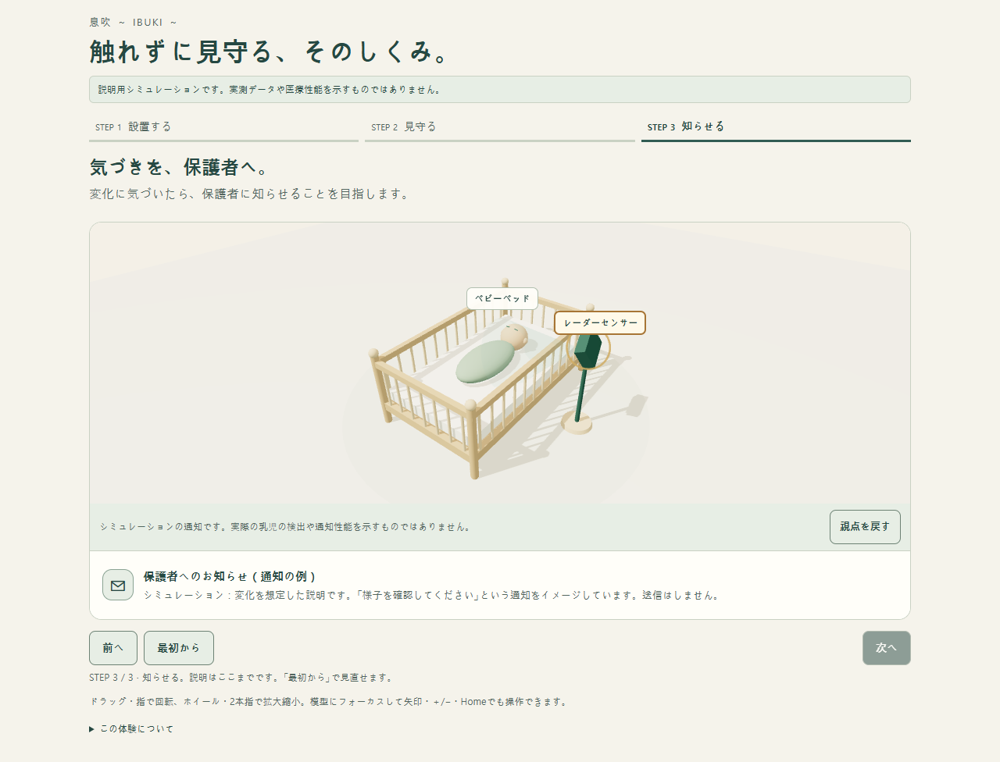](previews/showcase-step3-desktop.png) |

[Mobile sensing step](previews/showcase-step2-mobile.png) ·
[Mobile notification step](previews/showcase-step3-mobile.png) ·
[WebGL fallback](previews/showcase-fallback.png)

Step-2 captures show the active explanatory effect; other captures are static.
These are native-clock implementation screenshots, not mockups. Touch was
emulated, not tested on an actual handset. The next delivery step is to review
the video narration/capture sequence while keeping the simulation labels visible;
this mode does not introduce new radar or model functionality.

## Standalone conceptual 3D crib scene

`ml.analysis.spatial_scene3d` shows a procedural crib, still sleeping silhouette,
radar-like enclosure and a faint illustrative sensing direction. It explains the
**contactless monitoring concept**, without a camera feed, measurements or live
connection. The Japanese interface continuously identifies it as an installation
illustration, not measured data. The original no-data installation scene remains
available. An optional analysis mode connects existing synthetic evaluation
windows using the same validated loader and playback state machine as the 2D
Explorer below, on a **separate analysis coordinate plane**.

### Generate and open

From the repository root, with Python 3.10+ (standard library only):

```sh
python -m ml.analysis.spatial_scene3d --output analysis_runs/ibuki_crib_3d.html
```

Open that file directly in a browser (`file://`); no HTTP server, npm install,
dataset, CDN or network is needed. All JavaScript, styles, procedural geometry,
static SVG fallback and the Three.js license are embedded. Only a **new `.html`
under this checkout's ignored `analysis_runs/`** is accepted. Missing directories
are created. Existing files and symlink destinations are protected; use a fresh
filename to export again. Errors return CLI status 2 without a traceback.
Without `--case`, no dataset is read. Neither mode modifies input artifacts.

### Connect an existing synthetic case

Use an existing, unmodified `spatial_sim` case (not a recording CSV):

```sh
python -m ml.analysis.spatial_scene3d --case analysis_runs/spatial-demo/sweep/case_00 --output analysis_runs/spatial-demo/sweep/crib_evaluation.html
```

This mode needs the existing offline analysis dependencies (root
`requirements.txt` plus `ml/analysis/requirements.txt`). The no-data exporter
continues to use only the Python standard library. There are no new packages.
Missing/invalid cases fail clearly; the exporter never downloads, generates or
repairs input datasets. Output must stay outside `canonical/`.

`spatial_explorer.load_case` validates the synthetic canonical schema/artifact
hashes and truth agreement, and verifies any saved `evaluation.json` by invoking
the unchanged evaluator with its saved parameters. As in the 2D Explorer, a case
without a saved evaluation uses the existing evaluator defaults; the embedded
`explorer.evaluation_source` identifies that path. This re-evaluation is an
integrity check, not a new estimator or dataset generation. Modified canonical,
truth or saved evaluation artifacts that violate those checks are rejected.
Hashes establish consistency, not independent authenticity or hardware accuracy.

The complete loaded payload, windows in their original order, source provenance,
input/artifact hashes, parameters, quality and verification metadata are embedded
unchanged in inert JSON. There is no original-CSV fallback or live data input.

### Inspect and play analysis windows

The crib remains an installation illustration. Inside the same WebGL canvas, a
**separate synthetic range/horizontal-angle plane** shows a hollow green circle
for the configured reference and a filled brown diamond for the existing estimate.
Both color and shape distinguish them. The axes are the synthetic evaluator's
coordinates, **not the crib's coordinates**; no height is assigned, no markers are
placed on the baby, and no physical coordinate transform is invented.

The first window can be inspected immediately. `解析デモを開始` reveals the compact
controls without autoplay and scrolls once to the active visualization. `再生` advances one precomputed window per second;
`一時停止` pauses, `前へ` / `次へ` step, `調べる区間` and the discrete slider select
any window. This interval is presentation cadence, not a recording-time playback
speed. Manual selection pauses. There is no interpolation or path animation.

Both viewers use the exact same `createPlayback` function from the Explorer:
one selected index, one timer, stop before crossing discontinuities/gaps/restarts,
stop at the last window, pause when hidden or leaving the page, and no automatic
restart. Crossing a boundary requires explicit manual selection. Reduced motion
disables automatic playback but keeps manual selection and camera controls.
`視点を戻す` resets only the camera; the selected window is preserved.

The selected window, availability and position difference are visible. Expand
`詳しく見る` for reference/estimated range and horizontal angle, their differences,
board-relative times (exclusive end index correctly reads the last included
frame), source lines, raw diagnostic output and provenance. Values/formats match
the 2D Explorer; they describe window estimates, not instantaneous positions.

Unavailable estimates have no visible estimated marker and a Japanese reason.
Incorrect estimates remain incorrect: the rear-ambiguity case still shows its
original 30° estimate for a 150° reference and 120° angular error. No marker is
corrected or hidden to make a result look better. Noisy/unavailable results are
not replaced with plausible coordinates.

WebGL failure or context loss switches the active visualization to the existing
SVG analysis plane, beside the same playback controls and selected values. The
fallback is explained explicitly. With JavaScript disabled,
the static crib diagram and a table of **all** evaluation windows remain readable;
interactive selection/playback requires JavaScript. No renderer is needed for
that table. Controls are native keyboard/touch targets with visible focus. Data
selection never calls scrolling functions or moves focus during playback.

### Three.js analysis plane and mobile inspection

The configured and estimated markers now also live in the Three.js scene. A
separate render layer (1) and front-facing orthographic view isolate this plane
from the crib's perspective view (layer 0). It is beside the crib on wide screens
and below it within the same canvas on narrow screens. Camera orbit/zoom operates
the illustrative crib; the coordinate plane remains readable from the front.
There is no shared room/crib coordinate system, calibration, occlusion by the
crib, or movement of the baby's body.

The display convention is explicit. Let `extent_cm` be the same full-case extent
already used by the SVG viewer. A point `(x_cm, y_cm)` is rendered at:

```text
x_display = 1.45 * x_cm / extent_cm
y_display = 1.45 * y_cm / extent_cm - 0.06
z_display = 0
```

These are arbitrary rendering units. The fixed depth **is not a measured height
or elevation**; the offset reserves label space. The fixed orthographic camera
and responsive viewport fitting are presentation rules, not physical transforms.
The green reference is a hollow ring; the brown estimate is a square rotated
45° into a diamond. Range guides retain cm labels from the synthetic evaluator.
The plane displays the selected window and availability. When unavailable, the
estimated mesh is removed from the scene; an old position is not retained as a
visible estimate. Wrong estimates and their errors remain unchanged.

The existing `renderSelection` notification updates SVG, numerical values and
the Three.js meshes from the **same** selected window. There is no second player,
selection controller, timer, interpolation, smoothing, estimator or inferred
coordinate. Drawing remains on demand: selection changes request a frame, while
paused/idle views do not run a rendering loop. Canvas text uses local system fonts
and generated textures only. No external assets are loaded.

At 320/390px, the active canvas and compact controls are adjacent in one view
after the explicit start scroll. Playback and stepping never scroll. Color/shape
legend, selector, four playback buttons, slider, live status and position
difference remain together; targets are at least 44px high. Camera controls are
below, and original detailed values/provenance remain in `詳しく見る`. The original
SVG can additionally be opened with `SVGの平面図で確認`; after WebGL loss it is moved
into the primary viewport and remains synchronized. No-JavaScript behavior still
provides the static illustration and all-window table. The original no-case CLI
keeps its static installation scene without creating a data plane.

Actual native-clock software-WebGL captures of this implementation:

| Default analysis mode | Two selected windows |
| --- | --- |
| [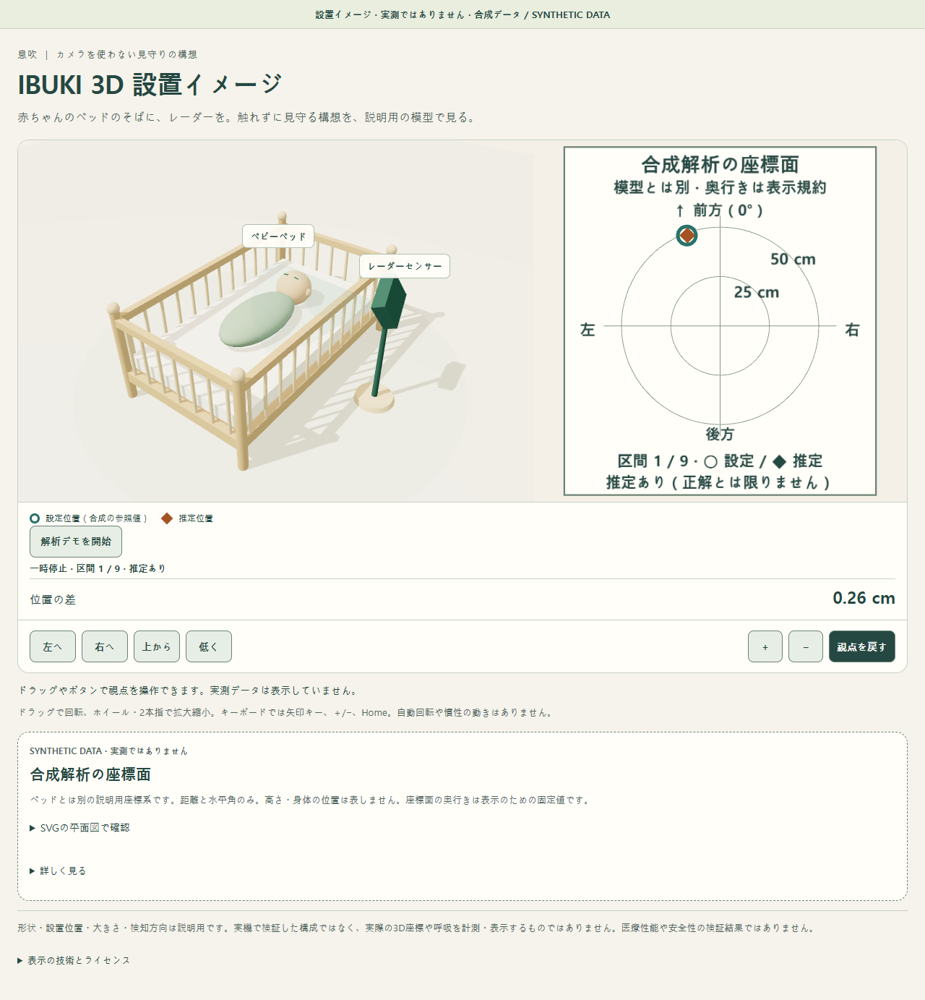](previews/scene3d-plane-default.png) | [Window 1](previews/scene3d-plane-selected.png) · [Window 2](previews/scene3d-plane-later.png) |

[Unavailable estimate](previews/scene3d-plane-unavailable.png) ·
[Uncorrected rear ambiguity](previews/scene3d-plane-ambiguity.png) ·
[Mobile](previews/scene3d-plane-mobile.png) ·
[SVG fallback](previews/scene3d-plane-fallback.png)

`check_scene3d_analysis.cjs` now also inspects the actual Three.js meshes' local
and world positions, render layer, shape, color, projection and absence of an
unavailable mesh. Inverse display normalization matches the unchanged 2D SVG
marker centers for every selected window in all 25 scenario/viewport combinations.
Checks cover mobile canvas/control co-visibility, no playback scrolling, idle
rendering and camera independence, as well as existing integrity/playback/fallback
checks. Mouse orbit/wheel and emulated touch/pinch are exercised on the connected
sweep view; the no-case camera regression remains separate. The read-only
`scene-canvas.ibukiAnalysisPlane()` inspection reports actual rendering objects,
not a new data schema or physical coordinates.

```sh
python -m unittest ml.analysis.tests.test_scene3d ml.analysis.tests.test_scene3d_analysis ml.analysis.tests.test_scene3d_plane ml.analysis.tests.test_spatial_explorer -v
```

The new pure coordinate checks use Node when available (no npm/Three.js install
needed); they skip if Node is absent. The existing browser command below runs
the full connected-plane checks against fresh exports of the five existing cases.

### Camera controls and fallback

- Drag / one-finger drag: rotate. Wheel / two-finger pinch: zoom.
- Visible Japanese buttons: rotate horizontally or vertically, zoom and reset.
- Focus the scene with Tab: arrow keys rotate, `+`/`−` zoom, Home resets.
  Native buttons also support Tab, Enter and Space with visible focus.
- Rotation stays above the floor; zoom and rotation have fixed limits.
  Reset restores an overview showing both crib and sensor.

There is no automatic rotation, damping, breathing animation or transition.
Rendering is requested only on interaction, selection, resize or visibility changes; hidden
pages cancel pending draws. Pixel ratio is capped at 1.5 and static shadow maps
are rendered once. Reduced-motion users receive the same immediate controls.
WebGL2 availability depends on the browser/device. When creation fails or the
context is lost, a labeled SVG replaces the scene, with camera controls
disabled and an explanation. Analysis mode keeps the selected result and playback
in its SVG viewport; no-data and JavaScript-disabled browsers retain the static crib plan.
This fallback is an illustration, not a measured radar map.

### Isolated dependencies and reproducibility

Three.js **0.187.0**, including OrbitControls, and build-only esbuild **0.28.2**
are pinned in `scene3d/package-lock.json`. The generated IIFE and SHA-256 are
committed; Python verifies that hash before export. LF attributes preserve the
bundle bytes on Windows and Unix. No production requirements or dashboard
packages change. See [licenses and notices](scene3d/THIRD_PARTY_NOTICES.md).

Only maintainers rebuilding the JavaScript need Node/npm:

```sh
cd ml/analysis/scene3d
npm ci
npm run build
```

The bundle including optional Showcase Mode is 589,361 bytes, with SHA-256:
`f03061b65f7fed5c71e24ad6d2c31130ea051fe4f46cdb8d0e82ed139bc5c6c3`.
Identical committed resources produce byte-identical HTML, with no timestamps.
Rendered pixels can differ across browser/graphics implementations.

### Browser evidence and repeatable checks

Actual local-file screenshots, captured offline in Chrome 156.0.8078.76 using
software WebGL (SwiftShader), rather than hardware validation:

| Desktop default, 1280px | Mobile default, 390px |
| --- | --- |
| [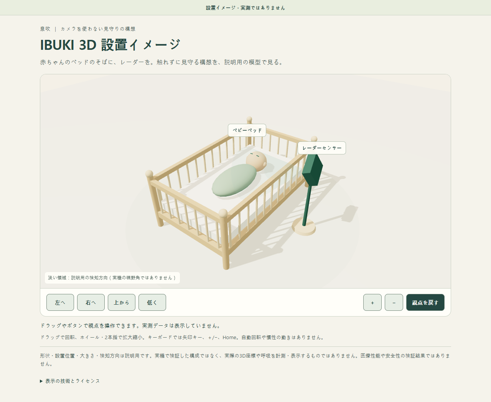](previews/scene3d-desktop.png) | [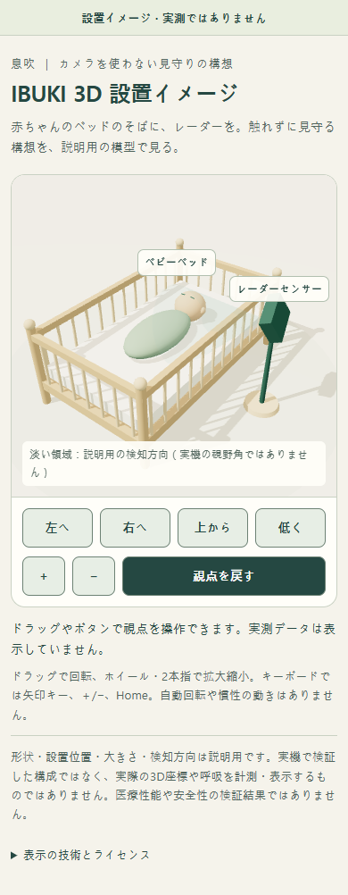](previews/scene3d-mobile.png) |

[Rotated camera](previews/scene3d-rotated.png) ·
[WebGL-unavailable static fallback](previews/scene3d-fallback.png)

The optional browser check tests 320, 390, 768, 1280 and 1440px with offline
`file://` loading; keyboard/native buttons, drag, wheel, emulated touch/pinch,
rotation/zoom limits, reset, reduced-motion and idle rendering; no horizontal
overflow, unexpected HTTP(S) requests or unhandled JS errors; WebGL creation
failure, context loss and disabled JavaScript. It uses isolated Playwright,
not a new CI/runtime dependency. Example from the repository root:

```sh
npm install --prefix .venv/ibuki-browser-qa --no-save playwright@1.64.1
node ml/analysis/tests/check_scene3d.cjs --playwright ./.venv/ibuki-browser-qa/node_modules/playwright --html analysis_runs/ibuki_crib_3d.html --screenshots analysis_runs/scene3d-browser
python -m unittest ml.analysis.tests.test_scene3d -v
```

The browser script needs installed Chrome; choose a fresh screenshot directory.
Its JSON records actual checks and browser version. Python tests require neither
Chrome nor npm and run in existing analysis CI. The existing 2D Explorer has its
own independent unit/browser regression checks; its implementation is unchanged.

### Data-connected verification and earlier SVG-only previews

The following PR #124 captures document the earlier SVG-only analysis mode.
The current in-scene plane previews are above. Both were captured in offline
Chrome 156.0.8078.76 (software WebGL/SwiftShader), without hardware validation:

[Original no-data 3D scene](previews/scene3d-analysis-default.png)

| Selected synthetic window | Later synthetic window |
| --- | --- |
| [](previews/scene3d-analysis-selected.png) | [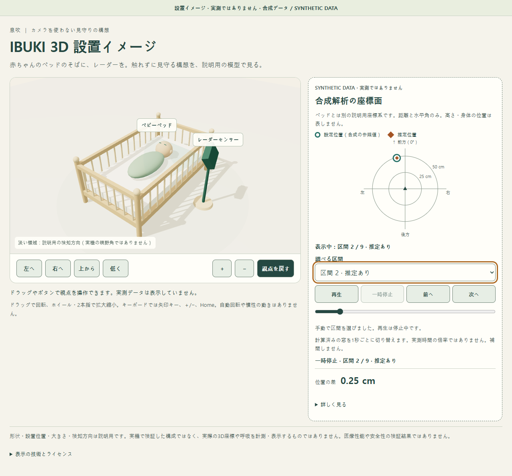](previews/scene3d-analysis-later.png) |

[Unavailable estimate](previews/scene3d-analysis-unavailable.png) ·
[Preserved rear-direction error](previews/scene3d-analysis-ambiguity.png) ·
[Mobile](previews/scene3d-analysis-mobile.png) ·
[WebGL fallback with analysis](previews/scene3d-analysis-fallback.png)

The paired browser checker requires already exported `{scenario}.html` and
`{scenario}-2d.html` for sweep, stationary, noisy, ambiguous and discontinuous.
It never creates/regenerates input cases. Export each with the two existing CLIs
to a fresh directory, for example:

```sh
python -m ml.analysis.spatial_scene3d --case analysis_runs/playback-demo/sweep/case_00 --output analysis_runs/scene-evaluation/sweep.html
python -m ml.analysis.spatial_explorer analysis_runs/playback-demo/sweep/case_00 --output analysis_runs/scene-evaluation/sweep-2d.html
# Repeat for the other four existing cases; preserve the discontinuous fixture.
node ml/analysis/tests/check_scene3d_analysis.cjs --playwright ./.venv/ibuki-browser-qa/node_modules/playwright --reports analysis_runs/scene-evaluation --screenshots analysis_runs/connected-browser
python -m unittest ml.analysis.tests.test_scene3d ml.analysis.tests.test_scene3d_analysis ml.analysis.tests.test_spatial_explorer -v
```

Verified all 25 scenario/viewport combinations (320/390/768/1280/1440px), every
window's actual displayed values, provenance and drawn marker centers against
the unchanged 2D view, keyboard/touch controls, camera-selection independence,
pause/step/end/gap/restart behavior, hidden/pagehide handling, real timer playback
and native reduced-motion changes. No HTTP(S) requests, unhandled JS errors or
horizontal overflow were observed. All five cases also passed WebGL-unavailable
and JavaScript-disabled fallbacks; source byte hashes and mtimes were unchanged.
Visibility checks use `document.hidden` override plus `visibilitychange`, and a
persisted `pagehide` event; they are not an OS background-process study. Touch is
emulated. These checks establish view consistency, not positioning accuracy.
Screenshot capture uses a fresh native-clock browser view of the same artifact
and selected index, independent of the virtual playback test clock, so software
WebGL compositing remains active. These are implementation captures, not mockups.

### Interpretation and next steps

All scene units, shapes, enclosure, support, placement and sensing direction are
arbitrary explanatory geometry. None establishes verified installation safety,
hardware dimensions, radar field of view, localization, reconstruction, breathing
detection or medical performance. The sleeping figure is static and supplies no
artificial breathing values. No first-viewer comprehension study or real-device
touch/performance validation has been performed. Analysis mode only presents
existing synthetic range/horizontal-angle outputs. It does not establish elevation,
room/crib calibration, full 3D localization, body tracking, infant breathing
accuracy or medical performance. Future work could improve inspection of existing
uncertainty/diagnostics with separately reviewed requirements; a physical mapping
would first require independent calibration and validation evidence. No such
mapping or estimator is introduced here.

## Standalone synthetic Radar Explorer

`ml.analysis.spatial_explorer` is the first interactive **offline, synthetic-only**
viewer for the spatial simulation above. It does not connect to a radar, run a
new estimator, or alter the guardian dashboard. All visible interface labels are
Japanese; a persistent `シミュレーション / SYNTHETIC DATA` banner remains visible
before and after starting.

### Generate, open, inspect

From the repository root, with the existing offline analysis environment:

```sh
python -m ml.analysis.spatial_sim --scenario sweep --out-dir analysis_runs/playback-demo/sweep
python -m ml.analysis.spatial_explorer analysis_runs/playback-demo/sweep/case_00 --output analysis_runs/playback-demo/sweep/explorer.html
```

These exact commands were executed. Choose fresh directories/filenames if they
already exist. Open `analysis_runs/playback-demo/sweep/explorer.html` directly in
a browser (`file://`, double-click); no server or frontend build is required.
Click **シミュレーションを開始** to reveal the results. The button reveals
precomputed evaluations; it does not simulate physical hardware in the browser.
Select any window using **調べる区間** or the discrete slider. The map shows only
that window's configured circle and available estimated diamond. Its marker buttons
support Enter/Space and describe the current range/angle. On start, focus moves to
the map heading and the page scrolls once to the map card, below the synthetic
warning. Playback/stepping never forces scrolling. Controls sit directly below the
map inside the same card. On mobile, **選択した結果を詳しく見る** explicitly jumps
to the unchanged detailed inspection panel below it.

- Green hollow circles: configured **synthetic reference** positions.
- Brown diamonds: positions from the unchanged antenna 0–1 direction estimator.
- Triangle: the ideal radar origin; upward is forward. Rings are centimeters.
- Only the selected window's markers are visible and keyboard-focusable; every
  window remains accessible via the dropdown/slider. An outline and the displayed
  window number identify the selection. Color and shape both distinguish reference
  and estimate, including when their coordinates coincide. Other windows are not
  deleted, interpolated or combined.
- The panel compares range, angle and absolute differences. Display rounding is
  for readability, not a claim about physical measurement resolution.
- **推定できません** shows a readable reason and dashes for unavailable values.
  No estimated marker or substitute zero-angle position is invented. Raw outputs
  remain available in the diagnostic disclosure.
- The 150-degree rear scenario retains the actual wrong 30-degree estimate and
  120-degree discrepancy; a warning explains the front/back ambiguity. Passing
  the signal guards does not establish that an estimate is correct.

### Discrete temporal playback

After revealing the results, playback remains **paused**. Use **再生** / **一時停止**,
**前へ** / **次へ**, the labeled **評価区間の目盛り** slider, the window dropdown,
or map markers. Every control uses one selected-window state and one rendering
path, updating the highlighted markers, window identity, observed time range,
reference time, configured/estimated values, differences and availability together.
Manual selection/stepping always pauses playback. At the last window it stops
without wrapping; select an earlier window explicitly to restart.

The demonstration advances **one precomputed window per nominal 1-second tick**.
This is not a physical-time playback multiplier: the slider is equally spaced
window indices, not elapsed-time spacing. Browser scheduling can delay a tick.
There is no continuous movement, interpolation or prediction between windows.
Each estimate covers its whole observed window; overlapping windows are not
independent instantaneous measurements. Both the controls and panel show start/end
board uptime and the existing earlier-middle reference frame, not Unix time.

Automatic playback stops **before crossing** a `(parent_block_index, trace_index)`
boundary and displays a Japanese explanation. This preserves gaps, restarts,
configuration changes and other boundaries from the evaluator. If those IDs,
increasing source-line references or increasing reference uptime cannot establish
continuity, automatic progression is disabled conservatively. **次へ**, the slider
or dropdown may explicitly select the next segment, while remaining paused.
No continuous path is drawn between any windows, including across segments.

Buttons and the integer-step slider support native keyboard operation with visible
focus. Selecting a marker with Enter/Space remains supported. The persistent
synthetic badge stays visible. Hiding/leaving the page cancels the single timer;
returning does not resume playback. With `prefers-reduced-motion: reduce`, automatic
playback is disabled (and stopped if already playing); manual navigation remains
available. There is no autoplay on load or when revealing the workspace.

To reproduce the other inspected cases (each uses a fresh output directory):

```sh
python -m ml.analysis.spatial_sim --scenario single --out-dir analysis_runs/playback-demo/stationary
python -m ml.analysis.spatial_explorer analysis_runs/playback-demo/stationary/case_00 --output analysis_runs/playback-demo/stationary/explorer.html
python -m ml.analysis.spatial_sim --scenario ambiguous --out-dir analysis_runs/playback-demo/ambiguous
python -m ml.analysis.spatial_explorer analysis_runs/playback-demo/ambiguous/case_00 --output analysis_runs/playback-demo/ambiguous/explorer.html
python -m ml.analysis.spatial_sim --scenario noisy --out-dir analysis_runs/playback-demo/noisy
python -m ml.analysis.spatial_explorer analysis_runs/playback-demo/noisy/case_00 --output analysis_runs/playback-demo/noisy/explorer.html
```

For a reproducible **synthetic test fixture**, remove frame 120 and restart
sequence/uptime at frame 240 of a newly generated 18-second sweep. The focused
test helper does this without modifying an existing recording or inventing a
different data format:

```sh
python -c "from ml.analysis.tests.test_spatial_explorer import write_discontinuous_case; write_discontinuous_case('analysis_runs/playback-demo/discontinuous/case_00')"
python -m ml.analysis.spatial_explorer analysis_runs/playback-demo/discontinuous/case_00 --output analysis_runs/playback-demo/discontinuous/explorer.html
```

Its eight windows form groups of 3, 2 and 3 across a gap and restart. Playback
stops at windows 3 and 5; explicitly selecting windows 4 and 6 enters the next
segment. Availability and the 150-degree rear-target error remain unchanged.

### Inputs, integrity and safe export

Input is a spatial simulation **case directory**, not the run summary or a CSV.
The viewer uses `canonical/{manifest.json,frames.parquet,events.jsonl,quality.json}`
and `truth.json`. The existing canonical loader validates schema, artifact hashes,
counts, configurations and event encoding. Only declared `source_type=synthetic`,
explicit synthetic/unvalidated spatial truth, E 3×24 data, and compatible known
15 cm / 37.5 mm geometry are accepted. Empty captures, missing/incompatible
geometry and invalid provenance stop with an actionable error.

If `evaluation.json` exists, its window/hop/availability settings are reused and
the **entire saved result must match** re-evaluation using the existing
`spatial_sim.evaluate`. Stale/modified results are rejected with instructions to
regenerate the case in the current environment. If it is absent, the same existing
evaluator uses its documented defaults (80/20 frames, movement >1, coherence >=0.5).
There is no parallel estimator or truth-derived replacement for estimated positions.
The original CSV and PNG are not read or used as fallbacks; no input file is modified.

The HTML includes hashes of truth, canonical manifest and optional saved evaluation,
the original input hash, verified canonical artifact hashes, quality, window/block
boundaries, simulation settings and calculation assumptions in disclosures. These
hashes detect inconsistency, not malicious replacement of an entire case or the
authenticity of declared provenance. Separate synthetic truth is not medical truth;
canonical scenario names retain their original non-ground-truth semantics.

Existing block/trace segmentation is reused. No window bridges resets, gaps or
invalid timing, and the map draws **no lines between windows**. Time is observed
board-relative uptime, not Unix time. No interpolation, filtering or tuning occurs.

Output must be a **new `.html` under this repository's ignored `analysis_runs/`**,
outside the canonical directory. Its parent must exist. Existing outputs and
symlinks are refused; there is deliberately no `--force`. CLI input/output errors
return code 2 without a traceback. Generated HTML/recordings stay untracked.

All CSS, JavaScript, SVG map and JSON data are embedded. There are no remote fonts,
CDNs, APIs, local `fetch()` or server dependencies. JSON escapes script-boundary
characters; displayed dynamic text uses `textContent`. A restrictive content
security policy blocks network connections, external scripts/images and form
submission. Identical inputs/settings/environment produce identical HTML without
generation timestamps or absolute source/output paths.

### Verified previews and limits

#### Focused Explorer UX refinement

The mobile map, selector, legend and compact playback controls now share one card.
The desktop map/inspection layout remains side by side at 1280/1440px; narrower
layouts stack the detailed panel below the map. There is no additional sticky
toolbar, modal, onboarding page or new analysis feature. The original synthetic
badge remains persistent, and both validation/export functions and the single-timer
playback controller are unchanged.

Visible, active text was measured against its rendered background with WCAG
relative-luminance calculations: minimum **5.53:1** in the tested views. Tested
guide/control/focus/marker colors against the map background were at least
**3.17:1**. Inactive disabled controls are excluded from the text-contrast check.
Primary buttons, selector and slider have at least **44 CSS px** target dimensions.
Marker hit circles adapt to SVG scaling to keep a 44px diameter; their centers and
estimated positions never move. A transparent non-scaling stroke initially looked
large enough but failed an actual off-center browser hit test at 320px; the final
geometry-based hit circles passed. Only one polite, atomic status region announces
selected window, play/pause and availability, including critical stop reasons.
Buttons have explicit accessible labels, and the slider describes its time/context.
Activating a marker also retains keyboard focus: the old redraw moved SVG nodes
and dropped focus to the page body. Current-only rendering no longer needs that
node rearrangement, and the browser checker asserts focus remains on the marker.

These five task-based checks are **implementation walkthroughs, not real-user
testing**, timed usability measurements or accessibility certification:

| Task | Expected behavior | Observed result | Problem reviewed and improvement |
| --- | --- | --- | --- |
| A. Start | Find the map and controls without searching | At 320/390px and 900px height, the map and all playback buttons are visible together after start; no autoplay | Previously the map was below the first viewport. A single explicit start scroll and map-heading focus bring the shared card into view |
| B. Play/pause | Observe the selected point while operating controls | Touch/keyboard play, one advance and pause keep all values synchronized; scroll position does not change during the step | Previously controls were vertically separated from the map. Compact adjacent controls and verified 44px targets reduce that separation |
| C. Select a window | Reach any recorded evaluation window | Every dropdown option, slider input and stepping control selects its corresponding values, including discontinuous segments | Many overlapping map markers also created redundant tab stops. Only the selected pair is visible/focusable; all windows remain in the existing selector |
| D. Identify positions | Tell configured reference from estimate | Hollow green circle and filled brown diamond remain distinct, with explicit Japanese legend and accessible range/angle names | Faded historical markers cluttered stationary/sweep views. Current-window-only rendering and stronger indicators identify the selected pair |
| E. Interpret failure | See unavailability or the actual wrong estimate | Noisy windows have no estimated marker/values; rear truth 150° still estimates 30°, with 120° difference and the original warning | Availability is now also stated beside the map and in the single live region. Detailed reasons/differences remain in the inspection panel; no error is hidden |

Actual offline before/after screenshots show the same first sweep window immediately
after starting. The viewport is 900px high; these are browser captures, not mockups:

| Width | Before | After |
| --- | --- | --- |
| 1280px |  | 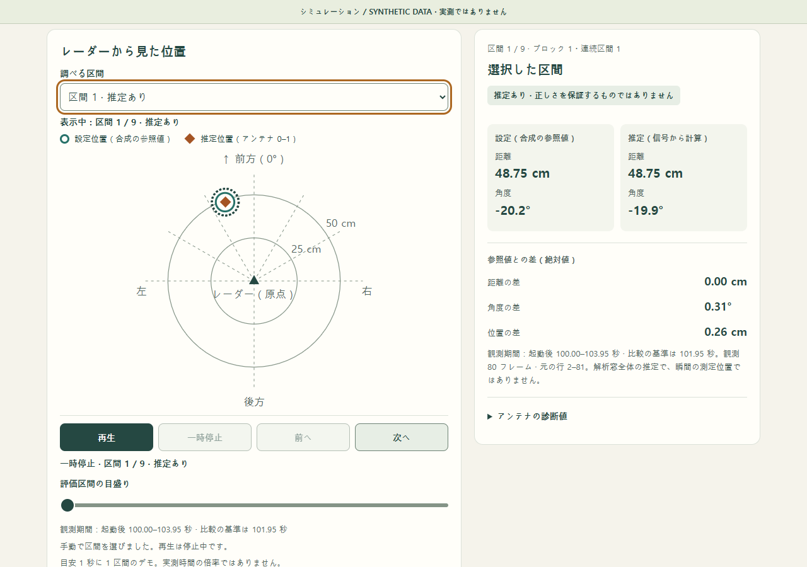 |
| 390px |  | 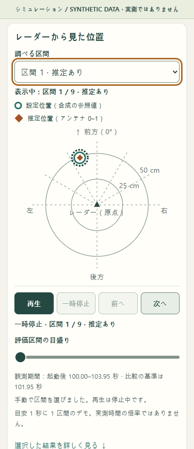 |

The focused browser checker adds `--ux` for **320/390/768/1280/1440px** across sweep,
stationary, noisy, rear ambiguity and gap/restart cases (25 combinations). It checks
text/indicator contrast, label overlap, primary target size and off-center marker
hit testing, initial focus order, touch, current-only markers, co-visible map/buttons
on small screens, unchanged scroll during playback, and existing synchronization,
boundary, lifecycle and reduced-motion regressions. No page errors, HTTP(S) requests,
horizontal overflow or clipped controls were observed in the final run.

The verified commands reuse the synthetic cases generated above and preserve earlier
HTML files by writing fresh names (use new names/directories when already present):

```sh
python -c "from ml.analysis.spatial_explorer import render_explorer; [render_explorer(f'analysis_runs/playback-demo/{name}/case_00', f'analysis_runs/playback-demo/{name}/ux-accessible.html') for name in ('sweep','stationary','noisy','ambiguous','discontinuous')]"
node ml/analysis/tests/check_spatial_playback.cjs --ux --playwright ./.venv/ibuki-browser-qa/node_modules/playwright --reports analysis_runs/playback-demo --file ux-accessible.html --screenshots analysis_runs/explorer-ux-accessible
```

Before/after embedded evaluation/provenance objects and CSP were compared for all
five cases and were identical. No estimator, geometry, schema, runtime or model
behavior changed. Contrast/ARIA/keyboard assertions are useful regression evidence,
not a full screen-reader audit; real device, assistive technology and other browser
engine testing remain future work. Touch checks use Chrome's touch emulation.

#### Earlier playback baseline (PR #120)

The following playback evidence and previews record the baseline before the UX
refinement above; the current UI is shown in the before/after comparison instead.

The generated playback HTML was opened using `file://` in Chrome 156 with networking
disabled. Sweep, stationary, noisy/unavailable, rear ambiguity and gap/restart
cases were checked at **1280px and 390px**: ten scenario/layout checks, with no
horizontal overflow, browser page errors or HTTP(S) requests. Every window (nine
per ordinary case, eight in the discontinuity fixture) was selected and compared
to embedded values. Automatic selection, keyboard buttons/slider/markers, rapid
play/pause, end and boundary stops, unavailable markers and the 120-degree error
were checked. A separate native-clock browser check verified actual timer advance
and reduced-motion media changes; timer-chain tests otherwise use a virtual clock.

Visibility/pagehide handlers were tested with controlled events and a
`document.hidden` override; OS background-tab throttling and sleep/resume timing
were **not** benchmarked. Browser checks cover Chrome here, not all browser/assistive
technology combinations. Early checker runs failed on programmatic-focus versus
keyboard-focus assumptions and emulated media delivery under polling. The final
checker uses Tab and isolates native rendering/media checks from virtual clocks,
allowing a native rendering turn before testing the media-change outcome.

| Desktop | Mobile |
| --- | --- |
| 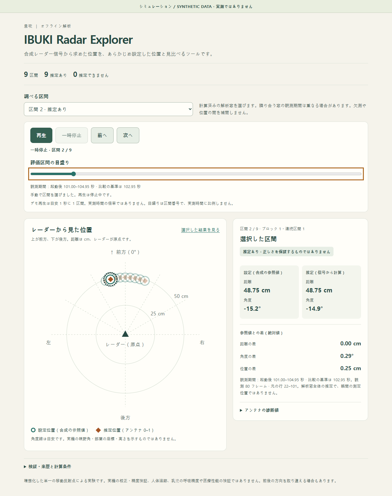 | 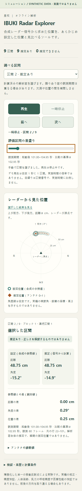 |

[Playback paused at a data gap](previews/spatial-playback-boundary.png)

[Rear ambiguity inspection](previews/spatial-explorer-ambiguity.png) ·
[Unavailable noisy-signal inspection](previews/spatial-explorer-unavailable.png)

The committed previews contain public synthetic results only. Unit coverage includes
provenance/integrity, saved/default evaluation settings, missing geometry, empty
input, gaps/resets, unavailable and incorrect results, JSON injection boundaries,
determinism, source preservation, output restrictions and CLI failures. New controller
tests execute the exact shipped JavaScript with Node.js and a deterministic fake
clock (no browser/build dependency). Those focused JS tests are explicitly skipped
if optional Node.js is absent; Python ingestion/security tests still run. Node.js
is already used by this repository's web development and available in the verified
CI environment; no runtime dependency is added.

```sh
python -m unittest ml.analysis.tests.test_spatial_explorer -v
python -m unittest discover -s ml/analysis/tests -t . -v
python -m unittest discover -s pc/tests -t pc -v
git diff --check
```

The optional, committed browser checker requires Playwright/Chrome in a separate
QA environment; neither is needed to generate or open HTML. The exact verified
command uses the existing isolated QA install (choose a fresh screenshot directory):

```sh
node ml/analysis/tests/check_spatial_playback.cjs --playwright ./.venv/ibuki-browser-qa/node_modules/playwright --reports analysis_runs/playback-demo --file explorer-final.html --screenshots analysis_runs/playback-browser-final-v2
```

Pass another installed Playwright module path via `--playwright`, or omit it if
`playwright` is on Node's module search path. The checker uses an isolated child
process for native clock/media checks and saves screenshots/results in the ignored
directory. It changes no source datasets and never needs a web server/network.
`--file` defaults to `explorer.html`. The final check above used a fresh export
named `explorer-final.html` in each case's parent to preserve earlier reports:

```sh
python -c "from ml.analysis.spatial_explorer import render_explorer; [render_explorer(f'analysis_runs/playback-demo/{name}/case_00', f'analysis_runs/playback-demo/{name}/explorer-final.html') for name in ('sweep','stationary','noisy','ambiguous','discontinuous')]"
```

For fresh initial exports from the earlier commands, omit `--file` instead.

**Synthetic algorithm tests are not proof of real radar accuracy.** This remains an
idealized single-target range/horizontal-angle experiment, not room localization,
full 3D reconstruction, multi-person/body tracking, breathing performance or medical
validation. This discrete demonstration timeline does not add autoplay, live
integration, new measurements, runtime/model changes or a raw-I/Q editor. Further
accessibility polish and other analysis views remain separate work; physical
evaluation requires independently calibrated antenna geometry and real E recordings
first.

## Relationship to existing readers

`pc/ibuki/serial_reader.py` remains the live transport/parser: it silently ignores
bad lines and stores raw bins as complex floating point arrays. `ml/features.py`
is the model input reader with fixed 24-bin/scale-10 assumptions and E support;
`ml/antennas.py` decodes E for antenna analysis. Those runtime paths are unchanged.
The separate offline parser provides lossless integers and row diagnostics without
importing the PC application or adopting model-specific defaults. Tests compare
all D rows in all three public samples exactly with `ml.features.read_csv` and
check conversion against the live parser.

E/Y/H/S and other nonempty message kinds are retained in `other_messages` with
source line numbers, without payload validation or interpretation. Quality
diagnostics below count these message kinds without decoding them.

## Capture quality diagnostics

Use the standard-library-only diagnostics to check recording integrity without
hardware. The API consumes the existing parser result and never repairs samples:

```python
from ml.analysis.protocol import read_capture
from ml.analysis.quality import analyze_quality

capture = read_capture("recordings/samples/breathing.sample.csv")
report = analyze_quality(capture)
print(report.to_dict())
```

From the repository root:

```sh
python -m ml.analysis.quality recordings/samples/breathing.sample.csv
python -m ml.analysis.quality recordings/samples/breathing.sample.csv --json
```

The default summary prints descriptive metric labels; JSON uses the stable keys
below, sorted deterministically, with unavailable values as `null`. Reports go
to stdout only; no files are written. Empty files succeed with zero counts and
unavailable timing metrics. Files without D (including E-only captures) also have
unavailable timing metrics. Missing/unreadable files produce an error on stderr,
no report on stdout, and exit status 2. Row issues remain in the capture and do
not cause a nonzero CLI status; consumers should inspect the issue counts.

Measured breathing sample JSON:

```json
{
  "backward_sequence_events": 0,
  "backward_timestamp_events": 0,
  "bin_count_mismatch_frames": 0,
  "duplicate_sequence_events": 0,
  "estimated_missing_frames": 0,
  "frames_without_configuration": 0,
  "frames_without_usable_configuration": 0,
  "issue_source_line_count": 0,
  "long_interval_events": 0,
  "long_interval_multiplier": 3.0,
  "long_interval_threshold_ms": 180.0,
  "parser_issue_count": 0,
  "repeated_timestamp_events": 0,
  "sequence_gap_events": 0,
  "suspected_reset_events": 0,
  "timing_reference_interval_count": 998,
  "total_d_frames": 999,
  "typical_sampling_interval_ms": 60.0,
  "unparsed_message_kind_counts": {}
}
```

All three public samples were measured, rather than assumed continuous:

| Sample | D frames | Estimated missing | Seq gaps/duplicates/backward | Repeated/backward time | Typical interval | Long intervals |
| --- | ---: | ---: | --- | --- | --- | ---: |
| breathing | 999 | 0 | 0 / 0 / 0 | 0 / 0 | 60 ms | 0 |
| hold | 1000 | 0 | 0 / 0 / 0 | 0 / 0 | 60 ms | 0 |
| leave | 996 | 0 | 0 / 0 / 0 | 0 / 0 | 60 ms | 0 |

Each has zero parser issues and zero frames without usable configuration. Their
timing reference counts are 998, 999, and 995 respectively; each long-interval
threshold is 180 ms. Their unparsed-message dictionaries are empty.

### Metric definitions and JSON fields

All adjacency metrics compare consecutive **parsed D frames in file order**,
even if C, other messages, or malformed rows occur between them. Let `ds` and
`dt` be current minus previous seq and t_ms. The first D has no predecessor.

| JSON key | Definition |
| --- | --- |
| `total_d_frames` | All parsed D frames, including missing/mismatched configuration. |
| `parser_issue_count` | Number of existing CaptureIssue entries; no re-parsing. |
| `issue_source_line_count` | Distinct physical source line numbers across those entries. |
| `estimated_missing_frames` | Sum of `ds - 1` where `ds > 1` and `dt >= 0`; an estimate, not reconstructed data. |
| `sequence_gap_events` | Number of those positive sequence-gap pairs. |
| `duplicate_sequence_events` | Pairs with `ds == 0`, regardless of timestamp or payload. Not a global repeated-ID count. |
| `backward_sequence_events` | Pairs with `ds < 0`; never interpreted as huge positive gaps. |
| `repeated_timestamp_events` | Pairs with `dt == 0`, regardless of seq. |
| `backward_timestamp_events` | Pairs with `dt < 0`, regardless of seq. |
| `suspected_reset_events` | Pairs with `ds < 0` OR `dt < 0`, counted once if both; not proof of a reboot. |
| `timing_reference_interval_count` | Positive `dt` intervals with `ds == 1`. |
| `typical_sampling_interval_ms` | Median of reference intervals if there are at least three; otherwise null. |
| `long_interval_multiplier` | Fixed deterministic policy, 3.0. |
| `long_interval_threshold_ms` | Typical interval times multiplier, otherwise null. |
| `long_interval_events` | Forward seq/time pairs (`ds > 0`, `dt > 0`) whose raw dt strictly exceeds the threshold; null without a threshold. Sequence gaps may also be long intervals. |
| `frames_without_configuration` | Frames with config None; no model defaults inferred. |
| `bin_count_mismatch_frames` | Frames with config but I or Q count unequal to config.n. |
| `frames_without_usable_configuration` | Union of missing config, invalid range/scale config, and bin mismatch. Valid config requires finite first_cm/step_mm/scale, first_cm >= 0, and step_mm/n/scale > 0. |
| `unparsed_message_kind_counts` | Sorted mapping of OtherMessage kind to row count, including E/Y/H/S when present. These payloads are not validated. |

These fields may overlap: a mismatched frame is both unusable and a parser issue,
and a positive sequence gap may also be a long time gap. Do not sum these counts
into a composite score. The parser already rejects invalid C messages; usability
checks also protect captures assembled through the Python structures directly.

### Interpretation and limitations

**Parsing success** means a row fits the supported protocol. **Capture
completeness** concerns sequence/time continuity of the observed D frames.
**Signal quality** concerns the radar measurements themselves; this tool does
not measure noise, motion, SNR, or physiological validity. **AI inference
accuracy** requires labeled evaluation and cannot be inferred from this report.
Zero integrity anomalies therefore do not establish signal quality or accuracy.

Missing-frame estimates cannot detect loss before the first or after the last
observed D. Malformed D rows may contribute both parser issues and inferred seq
loss. Backward seq/time can reflect restarts, wraparound, or out-of-order rows;
they are boundaries, and positive seq gaps across backward time are excluded.
No wraparound or restart is automatically corrected. No duration or sampling
rate is calculated across suspected resets. `t_ms` remains board uptime.

The median policy requires three reference intervals but cannot prove stable
cadence: predominantly slow intervals or mixed recording modes can bias it.
Duplicate/backward pairs are excluded from timing, and seq-gap intervals never
establish the baseline. A long interval can reflect missing rows or delayed
output, not a diagnosed hardware fault. C association follows the parser's
documented first-C backfill assumption. E-only captures have zero analyzed D,
not a claim that no radar data was recorded.

Quality diagnostics do not filter, interpolate, repair, or evaluate signals or
models. Offline inspection plots are available separately below.

## Offline capture visualization

Generate a headless PNG overview with NumPy and Matplotlib (already in the PC
requirements). No hardware, TensorFlow, model inference, or GUI is involved.

```sh
python -m ml.analysis.visualize recordings/samples/breathing.sample.csv --output breathing_overview.png --bin 10
python -m ml.analysis.visualize recordings/samples/hold.sample.csv --output hold_overview.png --bin 10
python -m ml.analysis.visualize recordings/samples/leave.sample.csv --output leave_overview.png --bin 10
```

The output is a 1950 x 1500 PNG with three panels:

1. **Discrete time/distance heatmap.** Each observed complex value `z` comes
   from `CaptureFrame.z()`. For each bin, subtract its unweighted temporal mean
   over the parsed D frames, then color by `abs(z - mean(z))` in scaled radar
   units. The magma color bar maps darker to smaller and brighter to larger
   variation. It uses a separate linear color range per report, not a shared
   scale across files. Subtracting the mean defines this display metric; it is
   not a signal filtering or noise-removal pipeline.
2. **Selected-bin I/Q.** Blue is the real component (I), orange the imaginary
   component (Q), both scaled by C.scale without centering or filtering. Bin
   selection is zero-based, default 0; valid indices are 0 through C.n - 1.
   Distance is obtained from `Config.ranges_cm()` and included in the title.
   The public samples have `C,15.0,37.5,24,10`, so bin 10 is 52.5 cm. Neither
   that bin count nor its geometry/scale is built into the implementation.
3. **Entire-recording integrity summary.** Values come directly from
   `analyze_quality(capture)`, including total parsed D, parser issues, estimated
   missing frames, seq gaps/duplicates/backward movement, suspected resets,
   repeated/backward times, long intervals/threshold, and unusable configuration.
   The plotted frame count and number of I/Q segments are displayed separately.
   Malformed rows are excluded from the plots but retained in the whole-file
   parser issue count. No composite score is calculated.

Both plots use `(t_ms - first_plotted_t_ms) / 1000`, subtracting integer uptime
before converting to seconds. Labels state the first D's board uptime and that
it is not Unix time. There is no uniform-time assumption. Heatmap columns are
vertical strokes at actual timestamps, with a fixed display width (0.8 points),
not rectangles filling estimated time intervals. Distance strokes span half a
configured bin step on either side of the bin center. Blank time intervals are
not filled with invented data; finite image resolution can overlap dense
columns. The heatmap is deliberately discrete rather than interpolated.

I/Q markers show every observed D. Connecting lines are broken at sequence gaps,
at parser issue lines between D frames, and at timestamp intervals exceeding
the quality report's long-interval threshold. If that threshold is unavailable,
line drawing conservatively uses three times the smallest observed positive
interval; this display policy does not modify the quality report. Line segments
are visual guides, not reconstructed intermediate measurements. A single D is
supported as one column/marker with unavailable timing metrics.

### Python API and file handling

```python
from ml.analysis.protocol import read_capture
from ml.analysis.visualize import prepare_visualization, render_report

capture = read_capture("recordings/samples/breathing.sample.csv")
data = prepare_visualization(capture, bin_index=10)
print(data.distances_cm[10], data.z.shape)
# 52.5 (999, 24)
render_report(capture, "breathing_overview.png", bin_index=10)
```

`prepare_visualization` returns actual elapsed coordinates, physical distances,
scaled complex values, variation values, contiguous trace slices, and the
whole-capture quality report. `build_figure(data)` returns a Figure using an Agg
canvas; `render_report` renders entirely in memory before opening its PNG output.
No pyplot global figures or GUI windows are created. Existing files are protected
by exclusive creation unless `--force` (Python: `force=True`) is supplied.
Validation failures leave an existing output unchanged, even with force.
Only `.png` is accepted; output parent directories must already exist. CLI
success prints the output path. Input, validation, or output errors print to
stderr and exit with status 2. No output is created on failed validation.

### Supported captures and limits

One consistent D configuration is supported. Repeated identical C messages and
the parser's documented late first-C association are valid. The tool rejects:

- Empty/no-D/E-only captures (three-antenna E payloads are not visualized).
- Missing/unusable configuration or I/Q bin-count mismatches.
- Any observed C geometry or scale change, including a trailing changed C.
- Duplicate/backward seq, suspected restarts, and repeated/backward timestamps.
- Out-of-range/noninteger bin indices and nonfinite numeric preparations.

Malformed rows may coexist with usable D frames; their count and plot exclusions
are explicit. E/Y/H/S payloads are not decoded, and their presence does not imply
that those messages were analyzed. The report covers only parsed D values.
The complete capture, complex matrix, and plot are kept in memory; large files
can need substantial memory. There is no downsampling or automatic repair.

Actual review examples were generated for all three public samples with bin 10:
999/1000/996 plotted frames, distances 15 to 101.25 cm (bin centers), and zero
reported parser/continuity/configuration anomalies. The measured 60 ms typical
interval gives a 180 ms long-gap threshold in each summary. In the leave sample,
the plots show a change near 23 seconds; this is an observed signal change, not
an inferred event label. Generated binaries are kept outside tracked source.

These plots support later signal analysis by exposing distance regions and time
intervals worth investigating alongside recording integrity. They do not measure
breathing, respiratory rate, chest displacement, medical status, or AI accuracy.
No filtering, automatic noise removal, classification, live dashboard, 3D,
three-antenna direction plotting, Parquet, or HTML report is implemented.

## Temporal signal diagnostics

`ml.analysis.signal` explores variation and spectral structure before choosing
filters or engineering new features. It reuses the parser and whole-file
`analyze_quality` report and requires only the existing NumPy/SciPy packages.

```sh
python -m ml.analysis.signal recordings/samples/breathing.sample.csv --bin 9 --window-sec 12 --hop-sec 3 --json
python -m ml.analysis.signal recordings/samples/hold.sample.csv --bin 9 --window-sec 12 --hop-sec 3 --json
python -m ml.analysis.signal recordings/samples/leave.sample.csv --bin 9 --window-sec 12 --hop-sec 3 --json
```

Without `--json`, the CLI prints a compact per-window summary. JSON is sorted,
deterministic for the same input/environment, and contains no generated wall-clock
time. Output goes only to stdout, never to automatically created files. Missing
input, invalid bin/window/hop, and unsupported captures produce stderr and exit
status 2. Empty/E-only files, absent/mismatched/changing C, nonfinite values,
duplicate/backward seq, repeated/backward time and suspected restarts are rejected.
Positive sequence gaps and irregular positive timestamps remain analyzable, with
explicitly unavailable spectral results in affected windows.

```python
from ml.analysis.protocol import read_capture
from ml.analysis.signal import analyze_signal

report = analyze_signal(read_capture("recordings/samples/breathing.sample.csv"),
                        bin_index=9, window_sec=12, hop_sec=3)
results = report.to_dict()
```

### Windows and signal definition

Window starts are anchored to the first parsed D's **board uptime**, every hop
through the last observed D: `[start_t_ms, start_t_ms + window_ms)`. Right-boundary
samples belong to the next window, not the previous one. Positive window/hop
lengths must resolve to whole milliseconds. Overlap is permitted; overlapping
windows are not independent observations. No resampling or samples are invented.
Windows falling in a gap can contain zero samples. Tail windows are retained:
`complete_window` means the requested end is at or before the capture's last
observed timestamp, not a promise that all expected samples exist. Partial
windows can have RMS but never spectral peaks. The last start may coincide with
the last D, producing a one-sample window. Requested start/end and observed
first/last timestamps are separate fields; all are uptime, not Unix time.

The 12-second default relates to `ml.features.WINDOW = 200`, approximately 12 s
at the board's nominal cadence. The existing model uses a fixed **sample count**;
these diagnostics use actual elapsed time. They are not interchangeable after
loss or variable cadence. No model constants are used as a sampling rate.

For the selected bin, scaled complex values are `CaptureFrame.z()[bin_index]`.
With `c = z - mean(z)`, define:

- `rms_variation = sqrt(mean(abs(c)**2))`, in scaled radar units.
- Project onto `axis = angle(sum(c**2))/2`, using
  `wave = real(c * exp(-1j*axis))`, then
  `projected_rms = sqrt(mean(wave**2))` in the same units.

This is the same single-bin projection as `ml.features.window_features`, verified
against its actual model feature output. Here it is used without neighbor
normalization, paired-sample decimation, or logarithmic transforms. Its sign is
arbitrary and is not calibrated displacement. Constant inputs explicitly produce
zero variation/projection. Fewer than two samples gives null RMS. Means and RMS
are unweighted over observed samples, not time-weighted estimates; gaps and
irregular timing therefore change which observations contribute.

### Conservative spectral policy

The projected real signal is examined only when all these conditions hold:

- At least eight observed samples and a complete requested window.
- Consecutive selected seq values (delta exactly one).
- No parser issue source line between the first and last selected D.
- Positive, approximately uniform observed time spacing.
- First/last selected samples within 1.5 measured intervals of the requested
  boundaries, to avoid analyzing an apparently full window with uncovered edges.

The measured interval is `(last_t_ms - first_t_ms) / (N-1)`. Both the largest
interval deviation from this mean **and** the largest deviation from the implied
uniform grid must be at most `max(1 ms, 0.02 * measured_interval_ms)`. This policy
admits small millisecond quantization jitter but rejects larger irregularity and
accumulated timing drift. Thresholds, measured interval, and deviation magnitudes
are exposed. Timestamp validation happens before spectral calculation. Admitted
jitter is an approximation, not proof of exact uniform sampling.

For eligible nonconstant windows, SciPy's Hann `periodogram` uses
`fs = 1000 / measured_interval_ms`, no additional detrending, no zero padding,
and spectrum scaling. The projected wave is amplitude-normalized only for numeric
stability; this does not change peak location or power ratios. DC is excluded.

- `dominant_frequency_hz` is the largest remaining periodogram bin, over the
  entire positive range through Nyquist; there is no respiratory band assumption.
- `spectral_resolution_hz = fs / N`; the reported peak lies on this discrete grid.
- `spectral_concentration` is power in the peak bin and its immediate available
  neighbors (radius one), divided by all positive-frequency power. It is in
  [0, 1], is affected by Hann leakage and window length, and is not a calibrated
  probability, significance test, or composite quality score.

No filtering, interpolation, denoising, or peak-to-respiratory-rate conversion
is performed. Even very weak nonconstant input can have a dominant bin. Trends
can dominate the lowest nonzero bin. A short record or broad peak does not
establish periodicity merely because a maximum exists.

### JSON fields and unavailable values

Top-level fields are `bin_index`, `distance_cm`, effective `window_sec` and
`hop_sec`, `spectral_policy` (minimum sample count, jitter tolerances, Hann/DC/
concentration policy), existing whole-capture `quality`, and ordered `windows`.
Each window contains:

| Fields | Meaning |
| --- | --- |
| `window_start_t_ms`, `window_end_t_ms` | Requested half-open interval in board uptime milliseconds. |
| `observed_start_t_ms`, `observed_end_t_ms` | First/last included D uptime; null if empty. |
| `observed_samples`, `complete_window` | Observed count and temporal-boundary coverage as defined above. |
| `rms_variation`, `projected_rms` | Complex-centered and projected RMS; null with fewer than two samples. |
| `sampling_interval_ms` | Mean observed spacing; measurable even when FFT is rejected, so not necessarily the underlying cadence. |
| `interval_tolerance_ms` | Effective spacing/grid tolerance. |
| `max_interval_deviation_ms`, `max_grid_deviation_ms` | Measured timing deviations, null with fewer than two samples. |
| `spectral_status` | Explicit eligibility/result reason below. |
| `spectral_resolution_hz`, `dominant_frequency_hz`, `spectral_concentration` | Available spectral outputs; otherwise null. |

Status checks run in order: `insufficient_samples`, `partial_window`,
`sequence_gap`, `parser_issues`, `irregular_timing`, `incomplete_coverage`, then
`constant_signal` or `available`. A window can have multiple problems; its status
names the first applicable reason. Existing quality metrics still describe the
entire file, not just a selected window. Captures are loaded in memory and windows
are emitted at every hop, including gaps; use sensible hop sizes for long files.

### Measured public-sample comparison

The following actual measurements use **bin 9 (48.75 cm)**, 12-second windows,
and 3-second hop. RMS is complex-centered, in scaled radar units. Times in this
table are seconds from the first D, not asserted breath-hold/leave event labels.

| Sample | Median RMS over complete windows | 0-12 s RMS | 24-36 s RMS | 45-57 s RMS |
| --- | ---: | ---: | ---: | ---: |
| breathing | 371.7680 | 287.9260 | 375.2042 | 395.4441 |
| hold | 15.0202 | 19.8027 | 9.6672 | 13.7083 |
| leave | 4.6580 | 9.0779 | 0.9515 | 0.9862 |

For those same windows (peak Hz / spectral concentration):

| Sample | 0-12 s | 24-36 s | 45-57 s |
| --- | --- | --- | --- |
| breathing | 0.0832 / 0.2005 | 0.4992 / 0.3125 | 0.6656 / 0.5927 |
| hold | 0.0832 / 0.3953 | 0.2496 / 0.6174 | 0.3328 / 0.2548 |
| leave | 0.1664 / 0.5054 | 3.9936 / 0.0717 | 6.3233 / 0.0858 |

For example, breathing's first requested window is `[774777, 786777)` ms,
contains 200 samples through 786735 ms, has projected RMS 214.5069, measured
interval 60.09045 ms, and frequency resolution about 0.08321 Hz. There are 16/17/16
spectrally eligible complete windows in breathing/hold/leave. Breathing and leave
each have four tail partial windows. Hold has three partial windows and a final
one-sample window (insufficient samples), because its last D is just beyond 60 s.

The hold file still varies; its name supplies no exact hold interval. The selected
distance bin is also a confounder: different recordings can have their strongest
reflector at different ranges. These measurements do not demonstrate that the
features classify breathing or apnea. In leave, later selected windows have lower
variation and more diffuse spectral power despite a numerical peak at higher
frequencies; a peak alone must not be treated as a physiological rate.

These findings can guide later work: compare multiple bins and labeled intervals,
inspect low-frequency drift before selecting detrending/filter policies, evaluate
short-window frequency resolution and peak concentration, and measure how timing
loss changes feature availability. Any new filter/feature must be validated on
labeled recordings, rather than chosen from filenames or these three examples
alone. This PR changes no models, live detection, alarms, firmware, or dashboard.

## Offline denoising benchmark

`ml.analysis.denoise` compares unchanged scaled complex I/Q with **causal**
Butterworth low-pass and band-pass outputs. This is an offline experiment, not
a recommended filter, classifier, or change to runtime/model inputs.

```sh
python -m ml.analysis.denoise --synthetic --sample-hz 20 --seed 7 --output synthetic20.png --json > synthetic20.json
python -m ml.analysis.denoise --synthetic --sample-hz 10 --seed 7 --output synthetic10.png --json > synthetic10.json
python -m ml.analysis.denoise recordings/samples/breathing.sample.csv --bin 9 --output breathing_filters.png --json > breathing_filters.json
python -m ml.analysis.denoise recordings/samples/hold.sample.csv --bin 9 --output hold_filters.png --json > hold_filters.json
python -m ml.analysis.denoise recordings/samples/leave.sample.csv --bin 9 --output leave_filters.png --json > leave_filters.json
```

`--output` is optional; without it no files are written. JSON goes to stdout;
PNG success messages go to stderr with `--json`, preserving machine readability.
Omitting `--json` prints descriptive metrics. Existing PNG paths require
`--force`, supported output is `.png`, and parent directories must exist.
PNG encoding happens in memory before exclusive output creation. Validation
failures create no report and leave an existing report unchanged, even with
force. Invalid arguments/input produce stderr and exit status 2.

Configurable flags are `--order` (default 2, integer 1-12), `--lowpass-hz`
(1.5), `--band-low-hz` (0.1), and `--band-high-hz` (1.5). Cutoffs must be finite,
positive, correctly ordered, and strictly below measured Nyquist. These are
**exploratory settings, not validated physiological thresholds**. The band-pass
transformation has twice the transfer-function order specified by `--order`:
default low-pass is order 2, default band-pass order 4. SciPy represents both
using second-order sections (SOS).

### Data domain, cadence, and state

The selected bin uses `CaptureFrame.z()` and `Config.ranges_cm()` with no assumed
scale/geometry. Default bin is 9 (48.75 cm in the public samples). The recording
validator reuses visualization preparation and whole-capture quality diagnostics.
It rejects empty/E-only captures, missing/mismatched/changing C, repeated/backward
seq or time, **any parser issue**, seq gaps, and insufficient/irregular timing.
Repeated identical C and the parser's documented late first-C association work.
No gap is bridged, segmented implicitly, or interpolated.

All timestamps are integer board uptime milliseconds. With at least eight samples,
derive the mean interval from the first/last timestamps. As in PR #4, both largest
per-interval and cumulative grid deviation must be <= `max(1 ms, 2% of mean
interval)`. Reject before filtering if either fails. Cadence and deviations are
reported, and the filter sample rate is derived from that measured interval.
Admitted small quantization jitter is an explicit approximation, not resampling.

Identical real SOS coefficients filter I and Q separately, implemented as one
complex `sosfilt` call per mode. No magnitude or projected waveform is filtered.
Baseline is an unchanged copy. State starts once, using `sosfilt_zi * first_z`,
the equilibrium for a constant extension of the first observed complex sample.
This is a documented assumption about pre-recording history; a noisy first sample
can cause startup artifacts. Low-pass preserves constant input; band-pass removes
DC. No `filtfilt`, future samples, phase alignment, delay compensation, or state
reset at analysis-window boundaries is used. Filtering happens over the entire
accepted recording before metrics or plots.

The existing `project_iq` from PR #4 is reused only for descriptive projected RMS
**after** filtering, independently per mode; that scalar is not a shared-axis
reconstruction-error measurement. The unfiltered PR #4 temporal report is also
included as `source.baseline_temporal`, along with whole-file quality. Existing
parser, quality, visualization, signal, model, and runtime contracts are unchanged.

### Seeded synthetic ground truth and metrics

The 60-second test case uses actual quantized sample timestamps, clean unit-amplitude
0.3 Hz sine motion along complex direction `exp(0.6j)`, and exact movement cessation
at 40 s (a zero crossing). Observed I/Q adds 0.5-amplitude 0.03 Hz drift along
`exp(1.2j)` and independent I/Q Gaussian noise, sigma 0.6 per component, seeded
with NumPy `default_rng` (default seed 7). Drift/noise continue after cessation.
Ground truth deliberately excludes both. Sample rate and seed are configurable;
rates 10 and 20 Hz were measured, with 12.5 Hz additionally tested. Fixed noise
variance per sample at different rates is not a matched continuous-noise model,
so cross-rate differences do not establish a sampling-rate advantage.

All modes use identical evaluation intervals. Metrics are not selected from a
favorable post-hoc lag or from a spectral concentration score:

| Metric | Definition |
| --- | --- |
| `snr_db` | `10*log10(mean(abs(clean)^2) / mean(abs(output-clean)^2))`, over 10 <= t < 40 s. This is reference/error SNR including drift, noise, attenuation and phase error, not isolated stochastic-noise power. Null for zero error/reference power instead of JSON infinity. |
| `snr_improvement_db` | Mode SNR minus baseline SNR on that same interval. |
| `reconstruction_rmse` | `sqrt(mean(abs(output-clean)^2))` on 10-40 s, with **no delay compensation**. |
| `signal_attenuation_db` | Negative 20 log10 gain at the known 0.3 Hz motion; fit sine/cosine plus constant to the **noise-free filtered clean response** and clean reference over 10-40 s. Positive means attenuation; negative would mean gain. |
| `phase_delay_sec` | Signed, wrapped fitted phase difference divided by `-2*pi*0.3`. A narrowband phase lead can be negative despite strict causality; this is not onset-detection latency. |
| `group_delay_sec` | Theoretical `-d phase(H)/d angular_frequency` at 0.3 Hz, using SOS response at 0.3 +/- 0.0003 Hz. Not an event-detection latency. |
| `post_cessation_residual_rms` | RMS of the noise-free clean-only filter response on 40 <= t < 45 s. Isolates memory/ringing from continuing injected noise and drift. |
| `post_cessation_peak_abs` | Peak magnitude of that clean-only response over 40-45 s. |
| `post_cessation_observed_rms` | RMS of the noisy/drifting output on 40-45 s; includes nuisance as well as memory. |
| `settling_time_sec` | First sample after the last post-cessation clean-only magnitude > 0.01 (1% of unit motion). All remaining observed samples must stay below; null if not settled by recording end. No claim about unobserved future. |
| `startup_rmse` | Noisy output versus clean RMS error over 0 <= t < 10 s; exposes the startup interval omitted from the main active-motion score. |

The clean-only response used for attenuation and ringing has the same causal
filter/initial-state rule as the noisy output. It is a separate ground-truth
experiment, never substituted for observed output in the SNR calculation.

Actual seed-7 measurements, order 2 / LP 1.5 Hz / BP 0.1-1.5 Hz:

| Rate | Mode | Reference/error SNR dB | Improvement dB | RMSE | Motion attenuation dB | Phase delay s | Group delay s | Clean residual RMS | Settling s |
| --- | --- | ---: | ---: | ---: | ---: | ---: | ---: | ---: | ---: |
| 10 Hz | baseline | -1.8847 | 0 | 0.87846 | 0 | 0 | 0 | 0 | 0 |
| 10 Hz | lowpass | 1.4096 | 3.2943 | 0.60118 | 0.00514 | 0.14075 | 0.14467 | 0.03999 | 0.5 |
| 10 Hz | bandpass | 3.1253 | 5.0100 | 0.49342 | 0.00319 | -0.11846 | 0.42659 | 0.19937 | 8.1 |
| 20 Hz | baseline | -2.2684 | 0 | 0.91813 | 0 | 0 | 0 | 0 | 0 |
| 20 Hz | lowpass | 1.9188 | 4.1871 | 0.56695 | 0.00646 | 0.14923 | 0.15306 | 0.03612 | 0.5 |
| 20 Hz | bandpass | 5.8463 | 8.1147 | 0.36072 | 0.00262 | -0.11053 | 0.43465 | 0.19923 | 8.1 |

Thus lower active-motion error can coexist with longer memory after movement
stops. At 20 Hz the clean-only residual peaks are about 0.2774 (LP) and 0.4660
(BP), versus 0 baseline. Startup RMSE is 0.9261/0.5390/0.4133 for baseline/LP/BP.
These findings depend on this motion/drift/noise mix, seed, cessation phase, and
chosen cutoffs. They do not pick a universally better filter.

### Descriptive real-recording results

The same parameters and bin 9 (48.75 cm) were used for all three recordings;
sample rates were measured individually (about 16.641 Hz). All 999/1000/996 D
frames respectively pass cadence/integrity/configuration checks. No filenames
are used to label exact breathing/hold/cessation intervals. Truth-dependent metrics
above are explicitly null for real recordings: no SNR improvement, attenuation,
reconstruction accuracy, or cessation-ring time is inferred.

| Sample | Mode | Whole-file complex variation RMS | RMS change from original I/Q | Power fraction above 1.5 Hz |
| --- | --- | ---: | ---: | ---: |
| breathing | baseline | 377.4619 | 0 | 0.31378 |
| breathing | lowpass | 307.9223 | 330.2131 | 0.08104 |
| breathing | bandpass | 285.5036 | 349.3846 | 0.08204 |
| hold | baseline | 30.6705 | 0 | 0.02632 |
| hold | lowpass | 29.8985 | 11.1492 | 0.00560 |
| hold | bandpass | 11.3222 | 38.7146 | 0.04380 |
| leave | baseline | 8.2581 | 0 | 0.65373 |
| leave | lowpass | 6.1620 | 7.2533 | 0.15791 |
| leave | bandpass | 5.3379 | 9.1808 | 0.16871 |

Variation RMS is centered complex RMS over the entire output; change RMS is
`sqrt(mean(abs(output-original)^2))` including DC/phase changes, **not** distortion
against truth. `mean_i`/`mean_q` expose DC removal. The high-frequency fraction
uses centered Hann one-sided I and Q PSDs summed together, DC excluded; numerator
is bins above the configured LP cutoff, denominator all positive-frequency bins.
For no measurable power the fraction is null. A fraction can increase after BP
because its low-frequency denominator decreased (as in hold), so it is not a
noise reduction score. Useful motion can also be removed. Fixed-bin comparisons
have distance/reflector confounders and these three unlabeled captures cannot
select a filter or establish improved apnea detection or AI/medical accuracy.

### Reports, API, and future on-device implications

The PNG uses Agg with no GUI: three side-by-side I/Q panels with common vertical
limits, before/after centered I/Q spectra, and a metric table. Synthetic reports
also include a known-cessation I-component zoom and clean-I overlay. The observed
zoom still contains drift/noise; the table's clean-only residual explicitly
isolates filter memory. All raw time coordinates are preserved. Plotted PSD is
summed I/Q power, never a silently substituted magnitude/projection spectrum.

```python
from ml.analysis.protocol import read_capture
from ml.analysis.denoise import FilterParameters, benchmark_capture, benchmark_synthetic, render_report

settings = FilterParameters(order=2, lowpass_hz=1.5, band_low_hz=0.1, band_high_hz=1.5)
experiment = benchmark_synthetic(sample_hz=20, seed=7, parameters=settings)
real = benchmark_capture(read_capture("recordings/samples/hold.sample.csv"), 9, settings)
metrics = experiment.to_dict()  # detached JSON-compatible dictionary
render_report(experiment, "synthetic20.png")
```

`DenoisingComparison` retains observed elapsed times, mode arrays, optional clean
truth, and the numeric report. Report keys include source/seed/selected distance,
observed count, original first/last t_ms, cadence diagnostics, parameters, explicit
signal-domain/initial-state descriptions, common evaluation intervals, and per-mode
metrics. Baseline temporal/quality reports appear only for real captures. JSON
has stable sorted keys and no generated date/time; NumPy/SciPy versions can affect
floating-point or seeded-generator reproducibility across environments. PNG
appearance can additionally depend on Matplotlib/fonts. Five actual CLI PNG/JSON
reports were generated for review (10/20 Hz synthetic plus three samples) and
kept outside tracked source; no large binary artifacts are committed.

`ml/features.py` intentionally uses simple, stateless-window arithmetic for later
on-device execution. Adding these IIR filters there would require continuous
state per antenna/bin/I/Q channel, reconnect/reset handling, cadence validation,
and a specified initialization policy. A direct-form SOS has two states and
roughly five multiplies/four additions per real sample; filtering both I and Q
doubles that arithmetic. Default LP uses one SOS and BP two, so each bin needs
four/eight real state values respectively. These are structural operation/state
counts, not measured runtime benchmarks. Float64 offline behavior does not
validate embedded precision, memory, CPU cost, or quantization stability.

Causal delay is frequency-dependent, and low cutoff state can keep oscillating
after motion stops. This can matter to alarm timing and to CNN feature
distributions. Any future adoption would need labeled evaluation, training/input
consistency, state reset tests, and target-board cost/precision measurements.
This PR makes none of those runtime/model changes and automatically selects no
winning filter. Processing stays in memory and no interpolation, model training,
classifier, medical judgment, 3D work, or live dashboard is added.

## CNN sensitivity to denoising

`ml.analysis.model_impact` measures **feature drift** and **prediction drift**
when the same exported 1D `breath_slot` CNN sees original, causal low-pass, and
causal band-pass I/Q. It does not train, replace, or modify the model. Here
"sensitivity" means response to an input perturbation, not the labeled
classification statistic. No LiteRT, TensorFlow, GPU, or radar is required.

```sh
python -m ml.analysis.model_impact recordings/samples/breathing.sample.csv --bin 9 --json
python -m ml.analysis.model_impact recordings/samples/hold.sample.csv --bin 9 --hop 8 --max-windows 12 --json
python -m ml.analysis.model_impact recordings/samples/leave.sample.csv --bin 9 --output leave_model_impact.png --json > leave_model_impact.json
```

Without `--json`, a descriptive summary is printed. PNG output is optional,
headless, and never created automatically. JSON goes to stdout; a PNG success
message goes to stderr in JSON mode. Existing PNGs require `--force`. Invalid
capture/options, missing input/model artifacts, and output errors produce stderr
and status 2. Validation failures create no PNG. Parent directories must exist.

### Model input compatibility and continuous filtering

The analysis reuses parser/quality validation and PR #5 cadence checks, rejecting
malformed rows, seq gaps, resets, repeated/backward time, irregular timing, and
missing/mismatched/changing configuration. In addition, it requires the trained
model's `C,15,37.5,24,10` configuration. The range grid is derived from existing
`ml.features` constants/`slot_cm`; scale 10 is required because training/live D
readers divide by `SCALE=10`. Accepting another scale while claiming equivalence
to those readers would be misleading. At least `WINDOW=200` observed D samples
are required. No interpolation or geometry conversion is performed.

`CaptureFrame.z()` supplies scaled complex I/Q. For **all 24 bins**, PR #5's
`filter_iq` is applied once over the entire accepted recording with identical
settings and measured sample rate. State is initialized once per bin/mode using
the first-sample steady-state rule, never at individual CNN windows. Default
settings remain order 2, LP 1.5 Hz, BP 0.1-1.5 Hz; matching `--order`,
`--lowpass-hz`, `--band-low-hz`, and `--band-high-hz` flags are supported.

The unchanged `ml.features.window_features()` produces each condition's tensor:
24 bins x 100 steps x 15 interleaved channels from the same 200 sample indices.
This preserves mean subtraction/projection, five-bin neighborhood normalization,
level/amount transforms, edge padding and paired-sample averaging. Tests compare
baseline arrays/features exactly with `ml.features.read_csv()` plus the existing
feature function, verify all-bin filtering, and distinguish continuous filtering
from an incorrectly reset late window. No alternate feature definition is used.

`--bin` selects only the displayed curve and per-bin summary (default 9, 48.75 cm).
It **does not restrict filtering or inference**: all 24 bins, including neighboring
context bins, remain in every evaluated window. The existing 1D model is loaded
explicitly via `ml.runtime.Model("breath_slot")`, not `ml.runtime.load`, so the
same full-precision NumPy weights are used for all three conditions even when
LiteRT is installed. Results are not asserted identical to live int8 inference.
No 2D state model, alarm logic, or complete live pipeline is reproduced.

### Bounded, aligned evaluation policy

`--hop` is a positive integer **sample count**, default 8, matching the existing
feature-window hop and live 1D evaluation schedule. Candidate ends are exclusive
indices `200, 200+hop, ... <= observed_D_count`. For each end, the interval is
`[end-200, end)`, with actual source line numbers and first/last included uptime
recorded. `evaluation_t_ms` is the last included D's board uptime, not Unix time.

`--max-windows` is a positive cap, default 12. For M candidates choose
K = min(M, max_windows) ranks, with rank j = floor(j*(M-1)/(K-1)). K > 1 includes
first and last candidates; K=1 selects the first. No randomness or resampling is
used. Selection is shared by all conditions. Increasing the cap to at least M
evaluates every candidate window; this remains overlapping-window inference,
not independently labeled trials. Reports explicitly include M, K, hop, the
selected indices, 24 evaluated bins, and K*24 predictions **per condition**.
Filtering the complete recording does not mean all candidate windows were inferred.

The default cap bounds feature/inference tensors to 12 x 24 x 100 x 15 per
condition; complete raw/filtered arrays are still held in memory. The first
evaluated feature window includes causal-filter startup effects; no warm-up is
silently discarded. Choosing another hop/cap/bin or filter setting can change
the summaries. Deterministic spread sampling is a cost policy, not proof that
the subset represents every rare event in a recording.

### Metrics and report fields

All differences compare a condition against the **unfiltered** tensor/predictions
at identical windows/bins; baseline differences and flips are zero by definition.

- Feature metrics are the mean and 95th percentile of elementwise absolute
  differences, plus element counts. They are also split by the existing channel
  families (`wave = channels 0::3`, `level = 1::3`, `amount = 2::3`). Counts include
  all five neighborhood channels and padded edge context, not just the central
  bin's scalar. All-bin and selected-bin summaries are separate. Differences
  preserve the model's numeric channel scales and do not measure correctness.
- Prediction metrics are mean and 95th percentile absolute probability
  difference, mean probability, positive counts, flip counts/percent, and up/down
  flips. The convention is `p >= 0.5`, matching the existing `ml/train.py`
  threshold. A flip is disagreement with the unfiltered decision, not a corrected
  prediction. Percent = 100*flips/(evaluated windows*bins); selected-bin percent
  instead uses evaluated-window count. P95 is an elementwise percentile, not a
  confidence interval. A few large changes can make MAE exceed P95.

JSON top-level keys are `model`, `parameters`, `selected_bin`, `recording`,
`evaluation`, `feature_drift`, `prediction_drift`, `windows`, and `limitations`.
`model` names the runtime/export representation and SHA-256 of the exact JSON/NPZ
artifact bytes loaded. `--model-dir` can select an exported artifact directory;
the default is the committed `ml/data/models`, and missing/malformed artifacts
fail explicitly. Changing directories does not switch models between conditions.
JSON-layer artifact hashes can reflect checkout newline conversions; binary
weight hashes identify the evaluated weights. Recording quality/cadence and
explicit candidate coverage remain separate from feature/prediction drift.

Every window records start/exclusive-end sample indices, source line bounds,
actual `start_t_ms` and `evaluation_t_ms`, all 24 probabilities for each condition,
and the selected-bin probabilities. No generated wall-clock metadata appears.
The optional PNG plots selected-bin probabilities against actual evaluation
times on a fixed 0-1 scale; marker-connecting lines are visual guides, not inferred
intermediate outputs. It includes both selected/all-bin metrics and coverage.
Near-zero/one probabilities can overlap visually; JSON retains full precision.

```python
from ml.analysis.protocol import read_capture
from ml.analysis.model_impact import analyze_model_impact, prepare_features

capture = read_capture("recordings/samples/breathing.sample.csv")
report = analyze_model_impact(capture, bin_index=9, hop_samples=8, max_windows=12)
# prepare_features exposes aligned feature tensors/whole-recording filtered I/Q
# for numeric inspection, without running or changing the model.
```

### Actual public-sample results

The following use committed NumPy `breath_slot` weights (NPZ SHA-256
`4b51fb3ce7fffa14a113a6f39a313e07e726f474e83d5a3b53b05949e6d643fc`), defaults
above, and selected bin 9. Breathing/hold/leave contain 999/1000/996 D frames and
100/101/100 candidate windows. **Only 12 windows per file** were evaluated: 288
probabilities per condition over all bins, not a complete candidate-window run.
Each all-bin feature comparison covers 432,000 elements (144,000 per family).

All-bin feature drift relative to original (absolute difference):

| Recording | Filter | MAE | P95 | Wave MAE | Level MAE | Amount MAE |
| --- | --- | ---: | ---: | ---: | ---: | ---: |
| breathing | LP | 0.195707 | 0.731095 | 0.327054 | 0.204529 | 0.055537 |
| breathing | BP | 0.221193 | 0.817426 | 0.369776 | 0.229315 | 0.064488 |
| hold | LP | 0.146832 | 0.570779 | 0.237273 | 0.163254 | 0.039970 |
| hold | BP | 0.251597 | 0.940362 | 0.429227 | 0.253910 | 0.071654 |
| leave | LP | 0.231263 | 0.907098 | 0.448751 | 0.207716 | 0.037322 |
| leave | BP | 0.295926 | 1.128229 | 0.570841 | 0.264282 | 0.052655 |

All-bin prediction drift (288 predictions per row):

| Recording | Filter | Probability MAE | P95 | Flips | Percent | Up / down |
| --- | --- | ---: | ---: | ---: | ---: | --- |
| breathing | LP | 0.013206 | 0.061805 | 3 | 1.0417% | 2 / 1 |
| breathing | BP | 0.020405 | 0.125248 | 6 | 2.0833% | 4 / 2 |
| hold | LP | 0.015606 | 0.047268 | 4 | 1.3889% | 2 / 2 |
| hold | BP | 0.035632 | 0.146148 | 11 | 3.8194% | 9 / 2 |
| leave | LP | 0.010538 | 0.003546 | 3 | 1.0417% | 1 / 2 |
| leave | BP | 0.010343 | 0.003372 | 3 | 1.0417% | 2 / 1 |

Selected bin 9 (12 predictions per condition) has zero threshold flips in every
file, but nonzero probability drift. Its mean probabilities are:

| Recording | Original | LP | BP |
| --- | ---: | ---: | ---: |
| breathing | 0.999843 | 0.999478 | 0.999803 |
| hold | 0.002065 | 0.001703 | 0.001433 |
| leave | 0.000123 | 0.000062 | 0.000093 |

These near-zero/one values explain visually overlapping selected-bin curves;
they do not establish calibration, robustness, or correctness across other bins.
The filenames supply no complete per-window labels, and fixed-bin comparisons
also have reflector/distance confounders. Feature drift, prediction drift and
labeled accuracy are different quantities. No accuracy, precision, recall,
classification sensitivity/specificity, corrected predictions, improved apnea
detection, or best filter is claimed. A future labeled evaluation must decide
whether the observed feature/probability/threshold changes help or harm detection.
No retraining, weight changes, live model inference changes, alarm logic, firmware,
training pipeline, or React dashboard change is included.

## Labeled per-slot denoising evaluation

`ml.analysis.labeled_impact` extends the sensitivity study to **labeled** examples
from existing synthetic-session CSV + matching JSON truth files. It evaluates the
same fixed NumPy `breath_slot` weights, feature function, threshold 0.5, filters,
and labeled examples in all conditions. No training, tuning loop, download, dataset
generation, runtime/Brain change, or automatic filter selection is performed.

### Data availability and exact commands

The default exploratory split is **val**, in `ml/data/val/<kind>/*.csv` with a
same-stem `.json` beside every CSV. `--data-root` names the directory containing
`val/` and/or `test/`, not the split directory itself. Existing `ml.synth` sessions
use this layout. Discovery follows `ml.train.examples`: sorted `split/*/*.csv`.

```sh
python -m ml.analysis.labeled_impact --split val --json
python -m ml.analysis.labeled_impact --data-root /path/to/existing/ml-data --split val --hop 8 --max-windows 12 --seed 5 --json
python -m ml.analysis.labeled_impact --split val --output val_confusion.png --json > val_labeled_impact.json
```

At implementation time, this checkout contained the committed model artifacts
but **no val or test session pairs**. The actual command
`python -m ml.analysis.labeled_impact --split val --json` exited 2 with
`No labeled sessions found ... Supply existing val/<kind>/*.csv and matching
.json truth files ...`. **No real dataset accuracy, precision, recall, F1, error
counts or filter improvement was measured.** Unit-test fixtures verify behavior;
their artificial labels/scores are not reported as research results.

To evaluate, supply already-existing session pairs and their truth. See
[the ML data setup](../README.md#how-to-run) for the historical split/generation
recipe. That recipe requires locally available breath annotations and authorized
base recordings; this evaluator never obtains them or calls `ml.air400`/`ml.synth`
automatically. Missing/empty splits fail with actionable instructions, never fall
back to public filenames, invent labels, or switch to another split. Missing
matching JSON or invalid selected sessions abort instead of silently dropping
failures from the denominator. Keep datasets/private recordings and reports with
private provenance local; none are committed by this workflow.

### Label policy and alignment

The evaluator imports `BREATHING_WITHIN_S`, `STOPPED_FOR_S`, `FAR_SLOTS`,
`PARENT_BODY_SLOTS`, `FAR_PER_WINDOW`, and `slot_of()` directly from `ml.train`.
Importing these definitions does not invoke TensorFlow or training. Labels are:

| Slot | Inclusion/label |
| --- | --- |
| Baby center, since_breath_s < 5 | Positive: `baby_breathing`. |
| Baby center, since_breath_s >= 8 | Negative: `baby_stopped`. |
| Baby center, 5 <= since_breath_s < 8 | Exclude as ambiguous, including exactly 5 s. Exactly 8 s is stopped. |
| Baby center with null/NaN age | Exclude as unlabeled. Existing synth truth can contain NaN before the first breath. |
| Parent center, parent present and truth.base does not contain `rec_hold` | Positive: `parent`, as assumed by the existing training labeler. |
| Parent center in `rec_hold` source | Exclude, not label as stopped: parent's stop timing is unknown. |
| Far slots | Negative: at least 3 bin indices from baby AND at least 4 from parent if present. |
| Other slots near actors | Exclude as ambiguous/unlabeled spatial context. |

As in training, only two eligible far slots per window are sampled without
replacement (or fewer if unavailable), using one seeded NumPy generator across
sorted selected sessions/windows, default seed 5. The choice is made **once**
before any inference and shared by baseline/LP/BP. Unchosen eligible far slots
are explicitly counted as `far_not_sampled`. A held parent's location still
excludes surrounding slots from far sampling; missing parent labels do not make
that region negative. The source `base` field, not the session CSV name, controls
the existing `rec_hold` rule. The policy assumes genuine `ml.synth`-format source
semantics; arbitrary user metadata is not independently verified.

One conservative addition to legacy labeling excludes a shared baby/parent center
as `overlapping_centers` rather than assigning duplicate/conflicting labels to
one bin. Tests verify exact legacy feature/label/group equivalence on a fixture
without this ambiguity. Other exclusion reasons distinguish transition age,
unknown age, parent hold, spatial ambiguity and far subsampling. Per selected
window, labeled examples plus excluded slots account for all 24 bins.

Truth requires `base`, finite baby/optional-parent distances, `since_breath_s`,
and `t_ms`. Both arrays must match the number of parsed D frames; every truth
timestamp must exactly equal the corresponding D uptime. There is no nearest-time
matching, truncation, or interpolation. Invalid negative/infinite ages or out-of-bin
actor distances fail explicitly. Null/NaN ages are allowed only as unlabeled ages;
output JSON remains strict and never contains NaN.

For feature window `[start_index, end_index_exclusive)`, labels use
**`since_breath_s[end_index_exclusive - 1]`**, aligned with the last D and its
actual timestamp. This matches `ml.features.windows`, which yields the inclusive
last index. No majority/mean label across the 200-sample window is substituted.
The report records both indices and `label_t_ms` so the alignment is auditable.

### Paired inference and coverage

Existing `prepare_features` validates the trained `C,15,37.5,24,10` geometry,
continuity, parser issues, and cadence. All 24 bins are filtered over the full
accepted session once with continuous first-sample steady-state causal state;
no analysis-window resets or new preprocessing definitions are introduced.
Existing `window_features()` creates identical aligned model tensors. Only the
shared labeled rows are passed to the same loaded `ml.runtime.Model` instance
under all three conditions. No label selection depends on model predictions.

Default hop is 8 samples and cap is 12 windows per session, with PR #6's evenly
spread deterministic candidate selection. `--hop` and `--max-windows` change
validation exploration; `--max-sessions` optionally chooses an explicitly reported
sorted prefix of validation sessions. With all windows selected, the far sampling
order matches the training labeler for ordinary, non-overlapping actor centers.
With a window cap, skipped windows do not consume RNG draws: changing coverage
or session order can change subsequent far choices. Seeds and manifests are
reported; a bounded subset must not be described as whole-recording accuracy.

Each session reports observed frames, candidate/evaluated windows, 24 filtered
and feature-context bins, actually scored bin indices, labeled example counts,
exclusions and quality/cadence. Every labeled example has a stable session/frame/
bin ID, group, truth label, actual label timestamp and all three probabilities.
Session CSV/truth SHA-256, declared subject/kind/base/origin, model artifact hashes,
parameters, threshold, label rules, seed and a protocol hash identify the run.
Dataset origin is synthetic-session labels plus declared source metadata, not a
claim that provenance/held-out independence was verified.

### Classification metrics and paired correctness changes

Per-session and micro-pooled aggregate metrics are reported for each condition,
both overall and separately for `baby_breathing`, `baby_stopped`, `parent`, `far`.
All use `p >= 0.5`. Confusion matrix rows are true `[0,1]`, columns predicted
`[0,1]`: **`[[TN, FP], [FN, TP]]`**. Counts include sample/positive/negative totals.

- Precision = TP/(TP+FP); recall = TP/(TP+FN).
- F1 = 2TP/(2TP+FP+FN); accuracy = (TP+TN)/N.
- A zero denominator returns `null`, including entirely absent groups. A ratio
  with a nonzero denominator and zero numerator correctly returns 0. These are
  count-derived F1 values, not an average of separately imputed precision/recall.

Single-class group breakdowns naturally have undefined ratios (for example recall
for only negative far slots). Aggregates sum confusion counts, not session scores
or group percentages. Far subsampling changes class prevalence: these scores
describe the specified training-style labeled subset, not every radar slot in a
natural deployment. Overlapping windows, bins, and reused room recordings are
correlated, so example count is not a count of independent clinical trials.

Paired baseline-versus-LP/BP results identify baseline errors fixed, previously
correct examples made wrong, both-correct and both-wrong cases, and net error-count
change. Changed example IDs link to the session records for inspection. Group
breakdowns are separate. A small net improvement is not an automatic winner or a
statistical/generalization claim; fixing some errors can introduce others.

### Explicit test split and frozen settings

Validation is exploratory. **Only an explicit `--split test` opens test data**:

```sh
python -m ml.analysis.labeled_impact --split test --json
```

Before any test-data I/O, the tool requires the predeclared defaults: order 2,
LP 1.5 Hz, BP 0.1-1.5 Hz, hop 8, cap 12 windows/session, far seed 5, all sessions,
fixed committed model and threshold 0.5. It rejects nondefault filter/selection/
seed settings or a session prefix on test, directing exploration to val instead.
There is no threshold/model selector or test-based parameter search. The protocol
hash and explicit split are recorded. This is a fixed baseline experiment, not
support for moving validation-tuned arbitrary parameters onto test after peeking.
The tool cannot verify users' earlier experiments, original train/test overlap,
or the truth of declared subjects. Supply/audit provenance before claiming an
independent held-out result; do not tune settings from test scores.

### CLI, API and validation status

```python
from ml.analysis.labeled_impact import evaluate_labeled

report = evaluate_labeled(data_root="ml/data", split="val", hop_samples=8,
                          max_windows=12, seed=5)
# Fails clearly if the optional dataset is absent; no placeholder scores.
```

JSON keys include `dataset`, `model`, `protocol`, `protocol_sha256`, `coverage`,
`exclusions`, `aggregate`, `sessions`, and `limitations`. JSON is deterministic for
identical files/options/environment, with sorted keys and no wall-clock timestamp.
Only explicit `--output` writes a headless PNG of the three **count** confusion
matrices; `--force` is required to overwrite. Generated JSON can be redirected by
the caller. File/label/configuration errors return status 2, not partial scores.

The normal unittest discovery includes small temporary synthetic fixtures,
committed NumPy model inference, train-labeler equivalence, boundary/alignment,
ambiguity/parent/far exclusions, arithmetic/undefined ratios, identical paired
sampling, aggregate coverage, fixed test settings, deterministic CLI JSON, missing
data and PNG protection. It needs no ignored sessions, downloads, TensorFlow or GPU.
Fixture model scores are not presented as actual dataset evaluation results.

### Interpretation and next work

Per-slot classification accuracy against synthetic-session labels is distinct
from apnea-event detection, 2D state-model performance, false alarms per hour,
alarm latency, and medical-device validation. The unmodified full-precision 1D
CNN is evaluated here; no equivalence to deployed int8/state/alarm behavior or
improved safety is claimed.

Next work requires the authorized existing val session pairs and a provenance/
split audit, then running the documented exploratory evaluation and reviewing
paired errors across sessions. Meaningful claims also need uncertainty accounting
for correlated windows and source domains. Only a separately pre-fixed protocol
should be evaluated on explicit held-out test data. No filter winner, threshold
tuning, new model training, firmware/runtime change or deployment is part of this PR.

## Validation

```sh
python -m unittest discover -s ml/analysis/tests -t . -v
python -m unittest discover -s pc/tests -t pc -v
```
