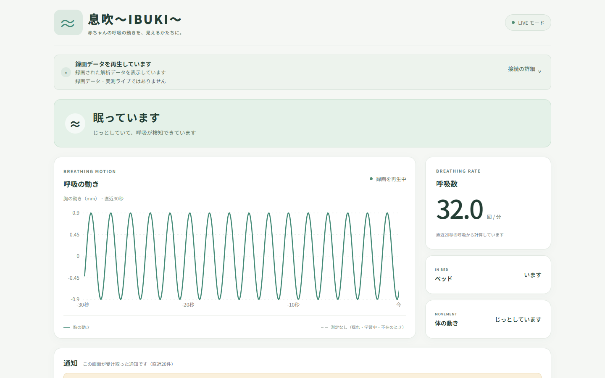
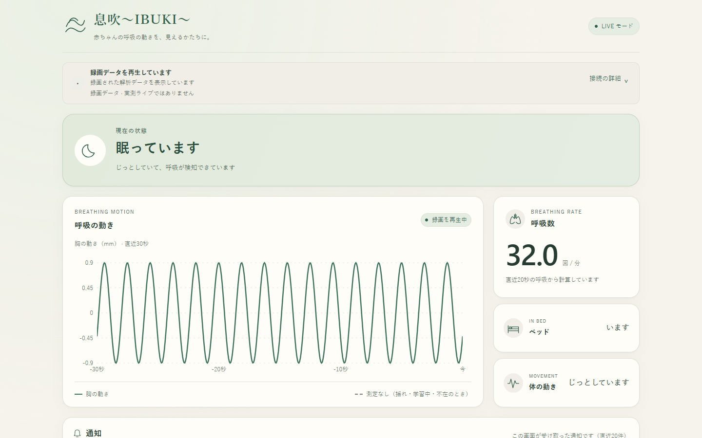
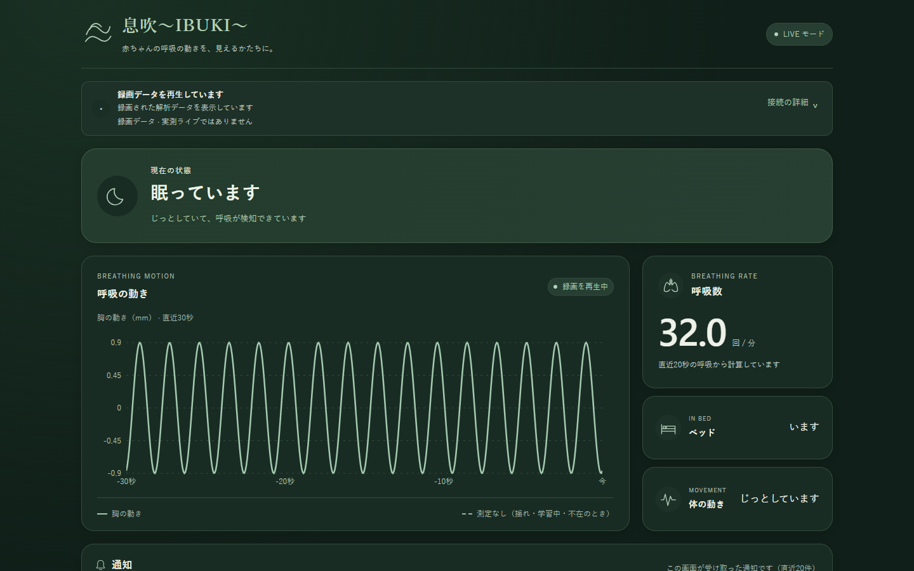
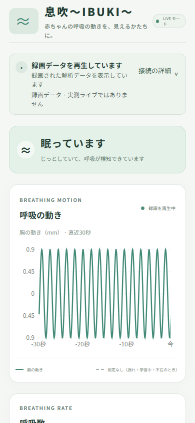
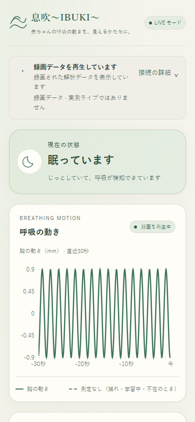
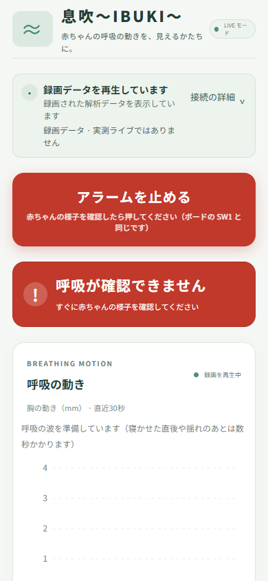
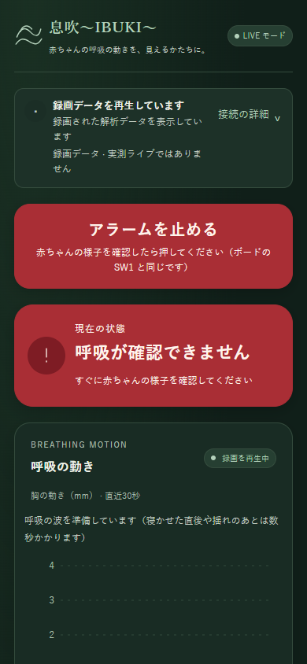

# Issue #70 — Warm dashboard theme

[Issue #70](https://github.com/jphacks/hs_2605/issues/70) の外観変更とブラウザー検証記録です。

## デザイン

アイボリーの背景、落ち着いたセージグリーン、細い線のアイコン、控えめな影で、日中も夜間も読みやすい画面にしました。日本語のブランド表記には明朝系、本文にはシステムの日本語ゴシック系を使用し、外部フォントの通信は追加していません。

| 要素 | ライト | ダーク |
|---|---|---|
| 背景 / カード | 温かいアイボリー / オフホワイト | 深いセージ / 暗いグリーン |
| 通常の状態 / 波形 | 落ち着いたグリーン | 明るさを抑えた淡いセージ |
| CHECK / 注意の通知 | アンバー | 暗いアンバーの面と明るい文字 |
| ALERT / アラーム停止 | 赤い面と明るい文字 | 赤い面と明るい文字 |
| 不在 / 利用できないデータ | ニュートラル | ニュートラル |

- 色・文字・余白・角丸・影は [tokens.css](../../../src/tokens.css) に集約しています。チャートも同じ意味の色変数を参照します。
- 状態名、説明、通知の緊急度、色以外のアイコンを併記します。アイコンは装飾として読み上げから除外し、既存の日本語テキストを残しています。
- OS の `prefers-color-scheme: dark` に自動追従します。テーマ切替ボタンや保存設定は追加していません。
- キーボードフォーカスを表示します。`prefers-reduced-motion: reduce` では時間軸のフレーム単位の補間を止め、受信した時刻ごとに描画します。測定値やサンプルは変更しません。警告の認識にアニメーションは必要ありません。
- 既存の DOM 順序、1000px / 700px のレイアウト境界、LIVE / 開発用 DEMO、接続診断、通知履歴、アラーム停止の動作を維持します。#69 の情報階層変更と #71 の mobile-first 再構成は別の作業です。
- #75 の将来の処理方式・ボード情報・ペアリングには、既存の診断リストとカードのスタイルを再利用できます。新しい項目、API、能力の表示は追加していません。

## Before / After

基準は main `6e9dc032d29a0cf41231e8c3845f4aa8168b5106`（PR #76 まで）です。基準のファイルを別ディレクトリで実行し、同じブラウザー・ビューポート・合成ステータスを使用しました。

**画像はすべてブラウザーテスト用の合成データです。** `/ws`、`/api/health`、`/api/button` を Playwright が横取りし、入力元を `FileReplay` として表示します。実際の録画、レーダー、赤ちゃんの測定結果ではありません。夜間 ALERT の入力サンプルは空配列で、呼吸数も不明です。実サーバーや電話へコマンドを送っていません。

| ビューポート / シーン | Before | After |
|---|---|---|
| 1440 × 900 / 昼・STILL |  |  |
| 1440 × 900 / 夜・STILL |  |  |
| 390 × 844 / 昼・STILL |  |  |
| 390 × 844 / 夜・ALERT |  |  |

通知とフッターまでの全体画像：

- デスクトップ昼：[Before](before-1440-light-still-full.png) / [After](after-1440-light-still-full.png)
- モバイル夜・ALERT：[Before](before-390-dark-alert-full.png) / [After](after-390-dark-alert-full.png)

## 検証結果

Windows 上の Microsoft Edge / Chromium `156.0.4314.42` と Playwright で検証しました。

| 検証 | 結果 |
|---|---|
| `npm test` | 60 件成功（既存 56 件 + テーマの 4 件） |
| `npm run build` | 成功 |
| `git diff --check` | 成功 |
| 1440×900 / 390×844 × 昼夜 × STILL・OK・CHECK・ALERT・EMPTY・切断・サンプルなし | 28 シーン成功 |
| 320×700（昼 ALERT / 夜 STILL） | 2 シーン成功 |
| センサーの揺れ / データ停滞 / ボード切断（390px） | 3 シーン成功 |
| 接続詳細の Enter / Space、フォーカス、模擬アラーム停止 POST | 成功 |
| 動きを減らす設定、通常の時間軸補間、実行中の昼夜変更 | 成功。再接続や呼吸数変更なし |

33 シーンでページ・コンソールエラー、横スクロール、カード内テキストのはみ出しは検出されませんでした。代表的な本文・状態・通知・ボタンの実描画色で 4.5:1 以上を確認し、ユニットテストでも両テーマの文字・警告・フォーカス・波形色を検査しています。これは全面的なアクセシビリティ監査の代替ではありません。

### 再実行

通常のフロントエンド検証：

```sh
cd web
npm test
npm run build
```

ブラウザー検証は任意の開発用ツールです。アプリの依存には Playwright を追加していません。Playwright（`routeWebSocket` 対応）と Chromium を別のツール用フォルダーにインストールするか、既存の環境を使用してください。

例：リポジトリルートで初回のみ実行します。`.venv/ibuki-browser-qa` は Git の対象外です。

```sh
npm install --prefix .venv/ibuki-browser-qa --no-save playwright
```

別ターミナルで Vite を起動します（Python サーバーは不要です）。

```sh
cd web
npm run dev -- --port 5178 --strictPort
```

Windows PowerShell / Edge：

```powershell
$env:IBUKI_PLAYWRIGHT_MODULE = (Resolve-Path '.venv/ibuki-browser-qa/node_modules/playwright').Path
$env:IBUKI_BROWSER_PATH = 'C:/Program Files (x86)/Microsoft/Edge/Application/msedge.exe'
node web/scripts/check_design.cjs
```

macOS / Linux では任意のローカルブラウザーを `IBUKI_BROWSER_PATH` で指定するか、Playwright の Chromium をインストールして指定を省略します。

```sh
./.venv/ibuki-browser-qa/node_modules/.bin/playwright install chromium
IBUKI_PLAYWRIGHT_MODULE="$PWD/.venv/ibuki-browser-qa/node_modules/playwright" node web/scripts/check_design.cjs
```

- 結果 JSON と全ページ画像は `.venv/ibuki-browser-qa/design-70/after/` に出力します。
- `IBUKI_DESIGN_BASE_URL` で URL を変更できます（既定 `http://127.0.0.1:5178`）。
- `--quick` は比較用の 4 シーンのみ、`--publish` は文書用画像も更新します。
- `--before --publish` は別途起動した基準バージョンを撮影するための指定です。必ず `IBUKI_DESIGN_BASE_URL` を基準の URL に変更してください。チェックアウトは自動変更しません。

## 制限

- 実機のレーダー、iOS / Safari、macOS の実ブラウザー、スクリーンリーダーでの検証は行っていません。サーバー側の分析・通知・ボード動作は今回の対象外です。
- 既存の 500 kB 超の JavaScript チャンクに対する Vite の警告は残っています。今回、新しいライブラリーやフォントは追加していません。
- 表示文言・通知の状態遷移・データの扱いは既存実装を引き継ぎます。コンセプト画像にある未実装のナビゲーション、姿勢推定、「正常」判定などは追加していません。
- このプロトタイプは医療機器ではなく、診断、安全の保証、SIDS の予防を目的としません。
